# Визуальный каталог Widgets

Снимки всех **37 публичных конкретных классов виджетов** из `view`. Каталог объединяет исходные облачные снимки от 11 ноября 2026 года и более новые вырезки с конкретными состояниями. Снимок относится к зафиксированной версии и сам по себе не доказывает доступность или исправление дефекта.

Для исходной серии база — `7112edfa10eea3f3f895e426895242f432eba41e` (демонстрация была дополнена в той ветке). Точный SHA-256 исходника AllWidgets, пиксельные координаты вырезок и хеши изображений записаны в [manifest.json](images/widgets/manifest.json). Исходный полный снимок: 1348 × 6775 px; браузер сообщал viewport 1363 × 936 CSS px, DPR 1. Кадры окон: 1348 × 926 px. Размер возвращённого снимка отличается от viewport; вырезки сделаны в его пиксельных координатах, без масштабирования и ретуши.

Запуск: `./run.sh com.kniazkov.widgets.example.AllWidgets 18087`, затем `http://localhost:18087/`. Аргумент порта необязателен; по умолчанию 8080. См. [протокол облачной проверки](CLOUD_VERIFICATION.ru.md).

Срез R19 от 14 ноября: standalone AllWidgets, коммит
`29106ee49eb61f6d141b55921543e9577c621eec`, облачный Chromium 156.0.8078.79.
Новые кадры содержат актуальную панель запуска popup, подтверждение загрузки
файла и открытое сообщение в узком окне. Метаданные `captures` содержат размеры
исходных кадров и приблизительный viewport, отдельно от пиксельных координат
вырезок. В старых кадрах сохраняется историческое состояние и исходная метаинформация.

## Как обновлять каталог

1. Сверьте таблицу и `manifest.json` с публичными конкретными подклассами `Widget`
   в `view`. Композиция допустима для контейнеров, строк и ячеек. Объясните
   исключения. Если нового виджета или состояния ещё нет в AllWidgets, добавьте
   его в пример (обычный, выключенный, ошибочный, загрузка, где применимо).
2. Соберите точную ревизию и откройте AllWidgets в настоящем облачном браузере.
   Для popup сохраняйте **открытое** окно; для событий подтвердите серверный
   результат. Проверьте обычное и узкое окно, мышь и клавиатуру; эмулированный
   touch в E2E отмечайте отдельно от ручной проверки.
3. Вырежьте только содержимое страницы с полезными отступами, без браузерных
   панелей и других окон. Не масштабируйте и не ретушируйте PNG. Укажите
   страницу, состояние, браузер и его версию, SHA, viewport и точные размеры
   исходного кадра в `captures`; добавьте `captureId`, прямоугольник
   `[x, y, ширина, высота]` и SHA-256 PNG в запись изображения. Добавьте
   один осмысленный alt, подпись и ссылки в матрице классов.
4. Запустите `npm run check:gallery`. Он сверяет классы, файлы, вложения
   Markdown, alt, хеши, размеры PNG и границы вырезок, когда известен исходный
   кадр. Проверка не заменяет визуальный просмотр каждой вырезки: проверьте,
   что надписи целы, кадры не пустые и состояния соответствуют подписям.
   Полная приёмка описана в [облачном протоколе](CLOUD_VERIFICATION.ru.md).

## Покрытие классов

| Класс | Изображение |
| --- | --- |
| `ActiveImage` | [ActiveImage](#active-image) |
| `ActiveText` | [ActiveText](#active-text) |
| `Button` | [Button](#button), [демо Enter](#keyboard-login-demo) |
| `Carousel` | [Carousel](#carousel), [Carousel — второй слайд](#carousel-selected) |
| `Cell` | [Table](#table) |
| `CheckBox` | [CheckBox](#check-box) |
| `CheckBoxWithText` | [CheckBoxWithText / RadioButtonWithText](#labeled-choices) |
| `Countdown` | [Countdown](#countdown) |
| `DropDownList` | [DropDownList](#drop-down-list) |
| `FileLoader` | [FileLoader](#file-loader), [загрузка завершена](#file-loader-complete) |
| `HorizontalLine` | [HorizontalLine](#horizontal-line) |
| `ImageWidget` | [ImageWidget](#image-widget) |
| `InlineBlock` | [Layout composition](#layout-composition) |
| `InputField` | [InputField](#input-field), [демо Enter](#keyboard-login-demo) |
| `Link` | [Link](#link) |
| `MarginDecorator` | [Layout composition](#layout-composition) |
| `Markdown` | [Markdown](#markdown) |
| `MessagePopup` | [MessagePopup](#message-popup), [открыто в узком окне](#message-popup-narrow) |
| `ModalPopup` | [ModalPopup](#modal-popup) |
| `NoWrap` | [NoWrap](#no-wrap) |
| `OverlayStack` | [OverlayStack](#overlay-stack) |
| `Panel` | [Layout composition](#layout-composition) |
| `PasswordInput` | [PasswordInput](#password-input), [демо Enter](#keyboard-login-demo) |
| `Popup` | [Popup](#popup) |
| `RadioButton` | [RadioButton](#radio-button) |
| `RadioButtonWithText` | [CheckBoxWithText / RadioButtonWithText](#labeled-choices) |
| `RootWidget` | [All widgets](#root-widget) |
| `Row` | [Table](#table) |
| `Section` | [Layout composition](#layout-composition) |
| `SortableSection` | [SortableSection](#sortable-section) |
| `StickyPanel` | [StickyPanel — scroll the page to see this block stick to the top.](#sticky-panel) |
| `SuggestionField` | [SuggestionField](#suggestion-field), [SuggestionField — раскрытый список](#suggestion-open) |
| `Table` | [Table](#table) |
| `TextArea` | [TextArea](#text-area) |
| `TextFlow` | [Layout composition](#layout-composition) |
| `TextWidget` | [TextWidget](#text-widget) |
| `ZoomDecorator` | [ZoomDecorator](#zoom-decorator) |

Абстрактные классы не имеют отдельного изображения: `BaseImageWidget`, `BlockWidget`, `InlineWidget`, `LabeledChoice`, `Widget`. `RadioGroup` — невизуальная модель взаимоисключения, показанная через RadioButton; стили, интерфейсы Has*, модели, контроллеры и UploadingFile не являются самостоятельными визуальными виджетами. Row/Cell показаны внутри Table, базовые контейнеры — в композиции.

## Изображения

### All widgets

Начальное состояние; варианты подписаны внутри карточки.

### StickyPanel — scroll the page to see this block stick to the top.

Начальное состояние; варианты подписаны внутри карточки.

### HorizontalLine

Начальное состояние; варианты подписаны внутри карточки.

### TextWidget

Начальное состояние; варианты подписаны внутри карточки.

### Markdown

Начальное состояние; варианты подписаны внутри карточки.

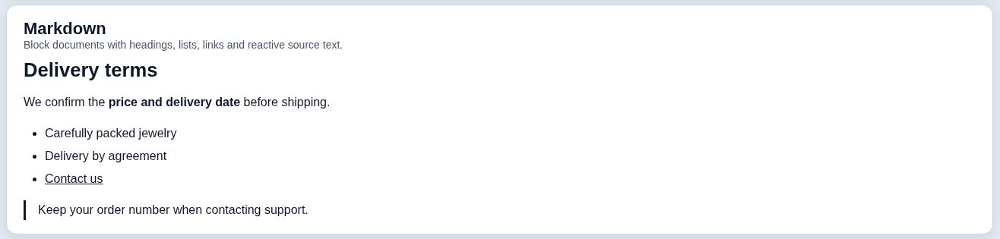

### NoWrap

Начальное состояние; варианты подписаны внутри карточки.

### ActiveText

Начальное состояние; варианты подписаны внутри карточки.

### Link

Начальное состояние; варианты подписаны внутри карточки.

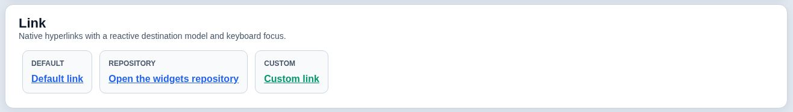

### InputField

Начальное состояние; варианты подписаны внутри карточки.

### Numeric input hints

Начальное состояние; варианты подписаны внутри карточки.

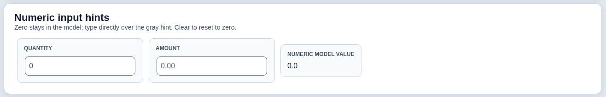

### SuggestionField

Начальное состояние; варианты подписаны внутри карточки.

### Keyboard login demo

Композиция `InputField`, `PasswordInput` и `Button`: Enter в любом из полей и нажатие кнопки запускают одну и ту же проверку вымышленных данных.

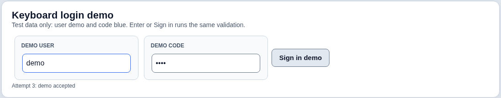

*Широкое окно: поля и кнопка в одну строку.*

*Узкое окно: поля и кнопка переносятся на отдельные строки.*

### PasswordInput

Начальное состояние; варианты подписаны внутри карточки.

### TextArea

Начальное состояние; варианты подписаны внутри карточки.

### CheckBox

Начальное состояние; варианты подписаны внутри карточки.

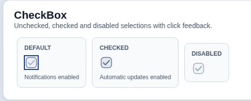
*CheckBox: синяя рамка фокуса, состояние checked и отключённый вариант.*

### RadioButton

Начальное состояние; варианты подписаны внутри карточки.

*RadioButton: выбор стрелкой и видимый фокус.*

### CheckBoxWithText / RadioButtonWithText

Начальное состояние; варианты подписаны внутри карточки.

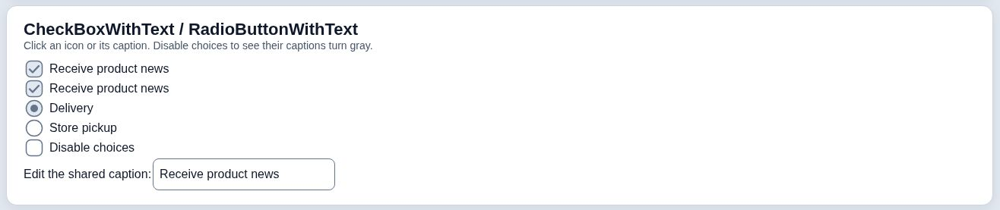

Подписи активируют нативные поля, а длинный текст переносится рядом с контролом.
См. [клавиатурный контракт и API доступных имён](CHOICE_ACCESSIBILITY.ru.md).

*Ширина 320 px: длинная подпись и рамка фокуса не обрезаны.*

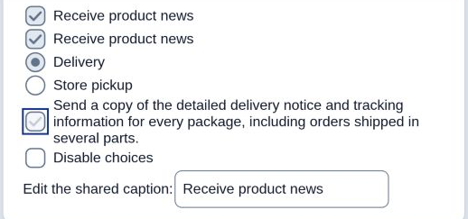
*Фактический масштаб Chromium 200%: длинная подпись читается рядом с полем.*

### DropDownList

Начальное состояние; варианты подписаны внутри карточки.

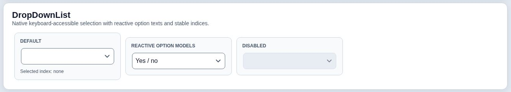

### Button

Начальное состояние; варианты подписаны внутри карточки.

### Popup

Начальное состояние; варианты подписаны внутри карточки.

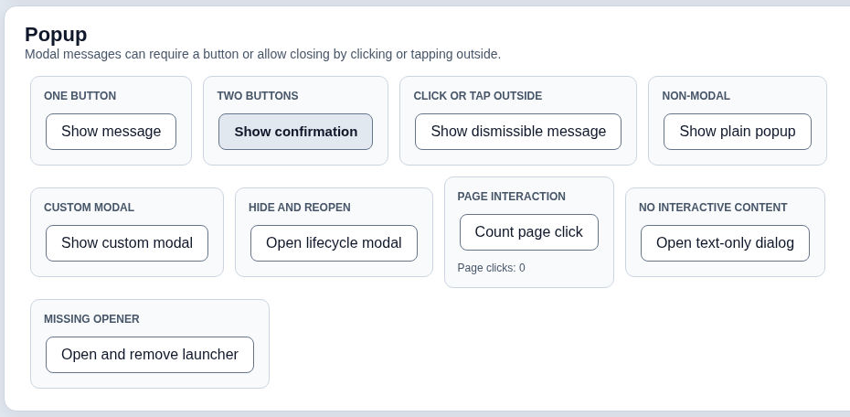

### FileLoader

Начальное состояние; варианты подписаны внутри карточки.

### FileLoader — загрузка завершена

Java обработала тестовый файл `recovery.bin` (7 байт), а результат вернулся в
браузер. Это состояние после загрузки, не только выбор файла.

### ImageWidget

Начальное состояние; варианты подписаны внутри карточки.

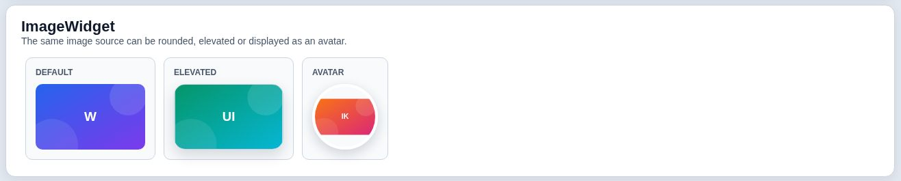

### ActiveImage

Начальное состояние; варианты подписаны внутри карточки.

### OverlayStack

Начальное состояние; варианты подписаны внутри карточки.

### Table

Начальное состояние; варианты подписаны внутри карточки.

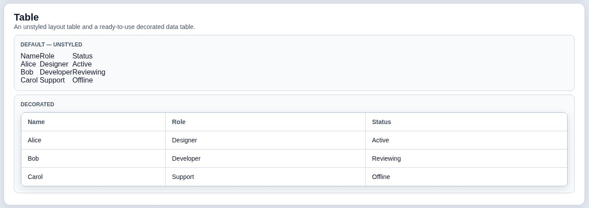

### SortableSection

Начальное состояние; варианты подписаны внутри карточки.

### ZoomDecorator

Начальное состояние; варианты подписаны внутри карточки.

### Layout composition

Начальное состояние; варианты подписаны внутри карточки.

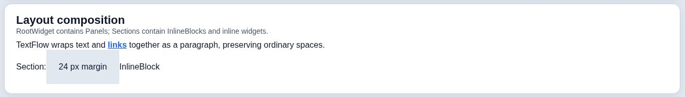

### Countdown

Начальное состояние; варианты подписаны внутри карточки.

### Carousel

Начальное состояние; варианты подписаны внутри карточки.

### MessagePopup

Открытое сообщение; видна модальная подложка вокруг окна.

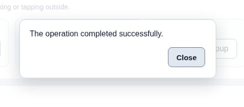

### MessagePopup — узкое окно

Модальная подложка и сфокусированная кнопка Close в реальном узком окне
облачного Chromium. Это проверка компоновки окна, не снимок с телефона.

### Popup

Открытое немодальное окно; фон страницы остаётся активным.

### ModalPopup

Открытое модальное окно с произвольным содержимым и полем ввода.

Вариант **Hide and reopen** показывает одно и то же окно до и после `hide()`.
При скрытии окна или его предка подложка тоже перестаёт блокировать страницу. Кнопка
**Count page click** позволяет это проверить. Внутри окна можно открыть вложенное,
а его подложка закроет только верхнее окно. Подробности в [контракте виджетов](WIDGETS.md#temporarily-hiding-a-modal).

*Широкий экран: открытое окно и подложка.*

*Широкий экран: страница снова принимает клики.*

*Экран 390 px: окно и подложка.*

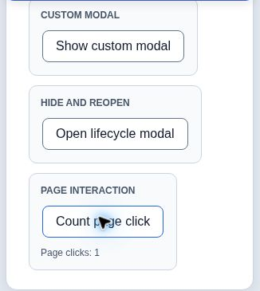
*Экран 390 px: после скрытия окна страница снова интерактивна.*

В варианте **Hide and reopen** клавиша Enter открывает окно, а Tab и Shift+Tab
переводят фокус по кругу. Escape закрывает переднее окно, только когда это разрешено.
Варианты **No interactive content** и **Missing opener** показывают фокус на самом
окне и возврат к контейнеру страницы. См. [контракт доступности](MODAL_ACCESSIBILITY.ru.md).

*Начальный фокус в широком диалоге; фон затемнён.*

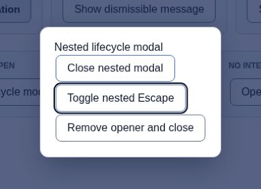
*Переднее вложенное окно принимает клавиатурный фокус.*

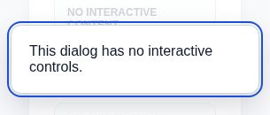
*Диалог без контролов удерживает фокус на самом окне при ширине 320 px.*

*Вложенное окно на ширине 320 px, видны края и фокус.*

### SuggestionField — раскрытый список

Фокус в поле, открыт список подсказок перед выбором с клавиатуры.

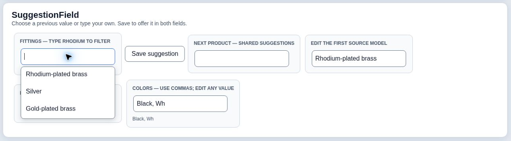

### Carousel — второй слайд

После drag браузер показал 2 / 3; Java обновила подпись Selected image: 2.

### Семантика: названия, картинки и связи

Секция **Accessible widgets** показывает нативную кнопку с именем и декоративной
иконкой, её отключённый вариант, а также информативное и декоративное изображения.
Поле получает имя от подписи: её можно переименовать или убрать. Ошибка связана с
полем до валидации. См. [договор об именах и описаниях](ACCESSIBLE_WIDGETS.ru.md).

*Фокус иконки, отключённое действие, информативная/декоративная картинки и поле с ошибкой.*

*Подпись поля изменена, после валидации ошибка исчезла.*

*Иконка и отключённое действие на ширине 320 px.*

*Декоративная картинка и поле с подсказкой и ошибкой на ширине 320 px.*

## Как обновлять каталог

1. Добавить новый виджет в API-документацию и AllWidgets. Показать обычное состояние и применимые disabled/invalid/loading/empty/open состояния.
2. Собрать текущую версию, открыть её в браузере облачного компьютера. Проверить действие до и после ответа Java, клавиатуру и узкий viewport. Автоматические браузерные тесты дополняют ручную проверку.
3. Снять интерфейс. Вырезать виджет с полезными отступами; для окна оставить немного подложки. Не заменять интерфейс рисованной имитацией, не включать посторонние окна, браузерные вкладки или личные данные.
4. Сохранить crop в `docs/images/widgets`, добавить alt и подпись, обновить `manifest.json` (класс, состояние, источник, координаты, хеш). Для существующего класса заменять устаревшие изображения.
5. Выполнить `npm run check:gallery`, `mvn verify`, `npm run test:browser`; проверить каждый crop визуально в документации. Известные дефекты фиксировать отдельной задачей, не маскировать снимком.
