# Визуальный каталог Widgets

Снимки всех **70 публичных конкретных классов виджетов** из `view`. Каталог объединяет исходные облачные снимки от 11 ноября 2026 года и более новые вырезки с конкретными состояниями. Снимок относится к зафиксированной версии и сам по себе не доказывает доступность или исправление дефекта.

Для исходной серии база — `7112edfa10eea3f3f895e426895242f432eba41e` (демонстрация была дополнена в той ветке). Точный SHA-256 исходника AllWidgets, пиксельные координаты вырезок и хеши изображений записаны в [manifest.json](images/widgets/manifest.json). Исходный полный снимок: 1348 × 6775 px; браузер сообщал viewport 1363 × 936 CSS px, DPR 1. Кадры окон: 1348 × 926 px. Размер возвращённого снимка отличается от viewport; вырезки сделаны в его пиксельных координатах, без масштабирования и ретуши.

Запуск: `./run.sh com.kniazkov.widgets.example.AllWidgets 18087`, затем `http://localhost:18087/`. Аргумент порта необязателен; по умолчанию 8080. См. [протокол облачной проверки](CLOUD_VERIFICATION.ru.md).

Срез R19 от 14 ноября: standalone AllWidgets, коммит
`29106ee49eb61f6d141b55921543e9577c621eec`, облачный Chromium 156.0.8078.79.
Новые кадры содержат актуальную панель запуска popup, подтверждение загрузки
файла и открытое сообщение в узком окне. Метаданные `captures` содержат размеры
исходных кадров и приблизительный viewport, отдельно от пиксельных координат
вырезок. В старых кадрах сохраняется историческое состояние и исходная метаинформация.

## Как обновлять каталог

1. Сверьте таблицу и `manifest.json` с публичными конкретными подклассами `Widget`
   в `view`. Композиция допустима для контейнеров, строк и ячеек. Объясните
   исключения. Если нового виджета или состояния ещё нет в AllWidgets, добавьте
   его в пример (обычный, выключенный, ошибочный, загрузка, где применимо).
2. Соберите точную ревизию и откройте AllWidgets в настоящем облачном браузере.
   Для popup сохраняйте **открытое** окно; для событий подтвердите серверный
   результат. Проверьте обычное и узкое окно, мышь и клавиатуру; эмулированный
   touch в E2E отмечайте отдельно от ручной проверки.
3. Вырежьте только содержимое страницы с полезными отступами, без браузерных
   панелей и других окон. Не масштабируйте и не ретушируйте PNG. Укажите
   страницу, состояние, браузер и его версию, SHA, viewport и точные размеры
   исходного кадра в `captures`; добавьте `captureId`, прямоугольник
   `[x, y, ширина, высота]` и SHA-256 PNG в запись изображения. Добавьте
   один осмысленный alt, подпись и ссылки в матрице классов.
4. Запустите `npm run check:gallery`. Он сверяет классы, файлы, вложения
   Markdown, alt, хеши, размеры PNG и границы вырезок, когда известен исходный
   кадр. Проверка не заменяет визуальный просмотр каждой вырезки: проверьте,
   что надписи целы, кадры не пустые и состояния соответствуют подписям.
   Полная приёмка описана в [облачном протоколе](CLOUD_VERIFICATION.ru.md).

## Покрытие классов

| Класс | Изображение |
| --- | --- |
| `Alert` | [Сообщения и операции](#feedback) |
| `FieldError` | [Сообщения и операции](#feedback) |
| `EmptyState` | [Сообщения и операции](#feedback) |
| `Busy` | [Сообщения и операции](#feedback) |
| `Progress` | [Сообщения и операции](#feedback) |
| `NumberField` | [Точные числа и количество](#numbers) |
| `QuantityField` | [Точные числа и количество](#numbers) |
| `DateField` | [Даты и время](#temporal) |
| `TimeField` | [Даты и время](#temporal) |
| `DateRange` | [Даты и время](#temporal) |
| `Dialog` | [Диалоги с результатом](#dialog) |
| `Toast` | [Сообщения и операции](#feedback) |
| `ActiveImage` | [ActiveImage](#active-image) |
| `ActiveText` | [ActiveText](#active-text) |
| `Button` | [Button](#button), [демо Enter](#keyboard-login-demo) |
| `Carousel` | [Carousel](#carousel), [Carousel — второй слайд](#carousel-selected) |
| `Cell` | [Table](#table) |
| `CheckBox` | [CheckBox](#check-box) |
| `CheckBoxWithText` | [CheckBoxWithText / RadioButtonWithText](#labeled-choices) |
| `Countdown` | [Countdown](#countdown) |
| `ComboBox` | [Типизированный выбор](#typed-choices) |
| `MultiSelect` | [Типизированный выбор](#typed-choices) |
| `Select` | [Типизированный выбор](#typed-choices) |
| `Slider` | [Размер браслета](#slider) |
| `SplitPane` | [Редактор каталога](#split-pane) |
| `TreeView` | [Дерево категорий](#tree-view) |
| `DataTable` | [Таблица данных](#data-table) |
| `DropDownList` | [DropDownList](#drop-down-list) |
| `FileLoader` | [FileLoader](#file-loader), [загрузка завершена](#file-loader-complete) |
| `Form` | [Демонстрационная форма](#form) |
| `FormField` | [Демонстрационная форма](#form) |
| `FormLayout` | [Адаптивный пример](#adaptive-form) |
| `HorizontalLine` | [HorizontalLine](#horizontal-line) |
| `ImageWidget` | [ImageWidget](#image-widget) |
| `InlineBlock` | [Layout composition](#layout-composition) |
| `InputField` | [InputField](#input-field), [демо Enter](#keyboard-login-demo) |
| `Label` | [Демонстрационная форма](#form) |
| `Link` | [Link](#link) |
| `MarginDecorator` | [Layout composition](#layout-composition) |
| `Markdown` | [Markdown](#markdown) |
| `MessagePopup` | [MessagePopup](#message-popup), [открыто в узком окне](#message-popup-narrow) |
| `ModalPopup` | [ModalPopup](#modal-popup) |
| `NoWrap` | [NoWrap](#no-wrap) |
| `OverlayStack` | [OverlayStack](#overlay-stack) |
| `Panel` | [Layout composition](#layout-composition) |
| `PasswordInput` | [PasswordInput](#password-input), [демо Enter](#keyboard-login-demo) |
| `Popup` | [Popup](#popup) |
| `RadioButton` | [RadioButton](#radio-button) |
| `RadioButtonWithText` | [CheckBoxWithText / RadioButtonWithText](#labeled-choices) |
| `ResponsiveGrid` | [Адаптивный пример](#adaptive-layouts) |
| `RootWidget` | [All widgets](#root-widget) |
| `Row` | [Table](#table) |
| `Section` | [Layout composition](#layout-composition) |
| `SortableSection` | [SortableSection](#sortable-section) |
| `Stack` | [Адаптивный пример](#adaptive-layouts) |
| `StickyPanel` | [StickyPanel — scroll the page to see this block stick to the top.](#sticky-panel) |
| `SuggestionField` | [SuggestionField](#suggestion-field), [SuggestionField — раскрытый список](#suggestion-open) |
| `Table` | [Table](#table) |
| `TextArea` | [TextArea](#text-area) |
| `TextFlow` | [Layout composition](#layout-composition) |
| `TextWidget` | [TextWidget](#text-widget) |
| `ZoomDecorator` | [ZoomDecorator](#zoom-decorator) |

Абстрактные классы не имеют отдельного изображения: `BaseImageWidget`, `BlockWidget`, `InlineWidget`, `LabeledChoice`, `Widget`. `RadioGroup` — невизуальная модель взаимоисключения, показанная через RadioButton; стили, интерфейсы Has*, модели, контроллеры и UploadingFile не являются самостоятельными визуальными виджетами. Row/Cell показаны внутри Table, базовые контейнеры — в композиции.

## Изображения

### All widgets

Начальное состояние; варианты подписаны внутри карточки.

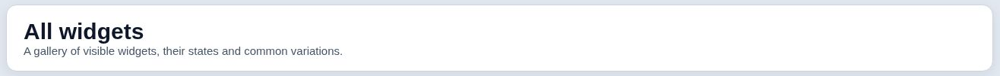

### StickyPanel — scroll the page to see this block stick to the top.

Начальное состояние; варианты подписаны внутри карточки.

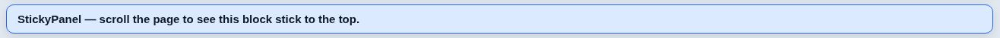

### HorizontalLine

Начальное состояние; варианты подписаны внутри карточки.

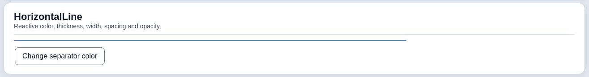

### TextWidget

Начальное состояние; варианты подписаны внутри карточки.

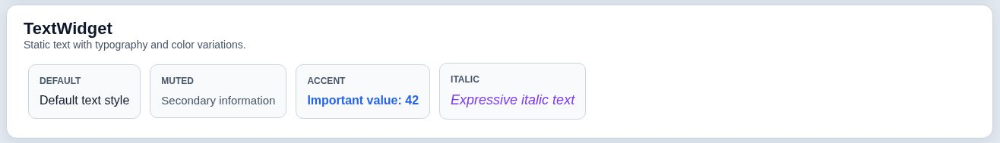

### Markdown

Начальное состояние; варианты подписаны внутри карточки.

### NoWrap

Начальное состояние; варианты подписаны внутри карточки.

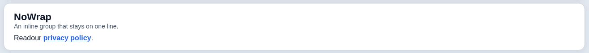

### ActiveText

Начальное состояние; варианты подписаны внутри карточки.

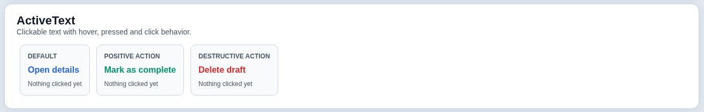

### Link

Начальное состояние; варианты подписаны внутри карточки.

### InputField

Начальное состояние; варианты подписаны внутри карточки.

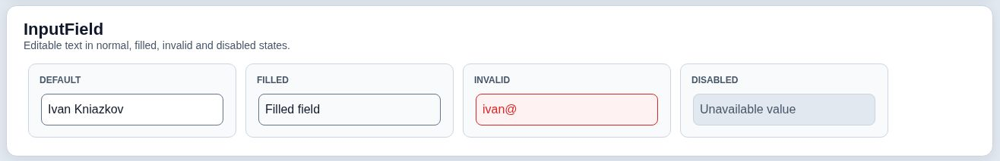

### Numeric input hints

Начальное состояние; варианты подписаны внутри карточки.

### SuggestionField

Начальное состояние; варианты подписаны внутри карточки.

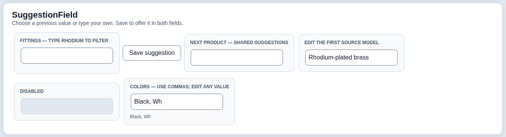

### Keyboard login demo

Композиция `InputField`, `PasswordInput` и `Button`: Enter в любом из полей и нажатие кнопки запускают одну и ту же проверку вымышленных данных.

*Широкое окно: поля и кнопка в одну строку.*

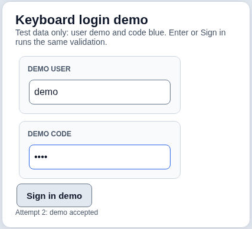

*Узкое окно: поля и кнопка переносятся на отдельные строки.*

### Select, ComboBox и MultiSelect

Одинаковые подписи могут представлять разные ключи. Демо использует только учебные
материалы и склады. См. [договор API](TYPED_CHOICES.ru.md).

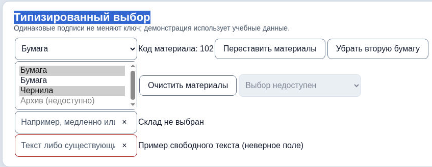

*Настольный режим: ключ остаётся отдельным от подписи и не зависит от позиции.*

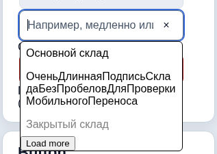

*Узкий режим: список прокручивается, пока фокус остаётся в поле поиска.*

### DataTable

Синтетический архив из 125 заказов показывает только пять строк на странице.
Заголовки сортируют на сервере, выбор сохраняется по ключу. См. [контракт API](DATA_TABLE.ru.md).

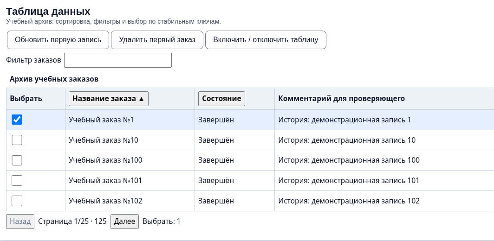

*Широкий экран: выбранная строка остаётся отмеченной после сортировки.*

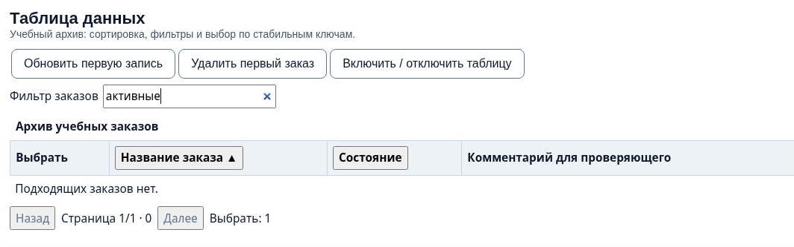

*Пустой результат фильтра не удаляет архив: очистите поле, чтобы вернуть его.*

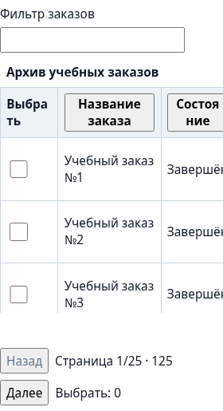

*Узкое окно: фильтр и страницы остаются в пределах карточки, клавиатурная прокрутка показывает правые колонки.*

### Stack и ResponsiveGrid

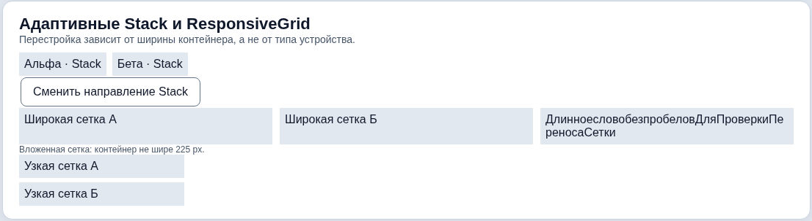

*Широкий экран: вложенная сетка учитывает свои 225 px, а не ширину экрана. Длинное слово переносится внутри широкой сетки.*

### FormLayout

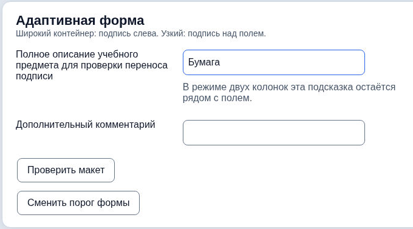

*Широкая форма: две колонки, тестовый ввод остаётся в поле.*

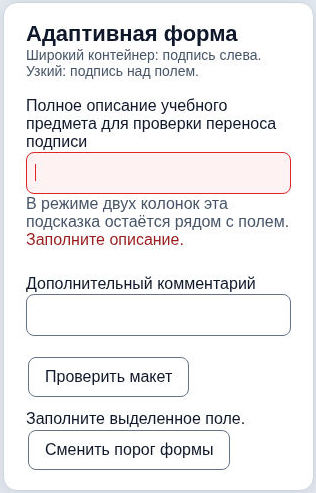

*Узкая форма: подпись над полем; Enter использует прежнюю проверку. См. [договор адаптивной компоновки](ADAPTIVE_LAYOUT.ru.md).*

### Form, FormField, Label

Учебная заявка показывает доступные подписи, подсказки, ошибки, состояние ожидания и отдельное поле только для чтения. Ввод не сбрасывается после имитированного отказа сервера. См. [договор API](FORMS.ru.md).

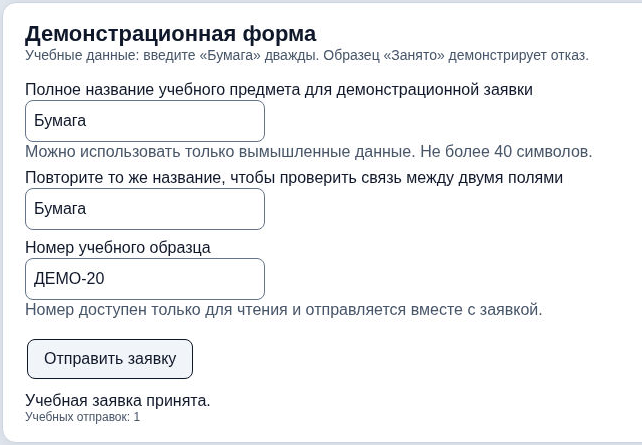

*1280 px: кнопка успешно отправила учебную заявку.*

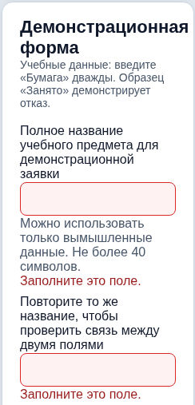

*320 px: пустые обязательные поля после Enter. Фокус возвращается к первому полю.*

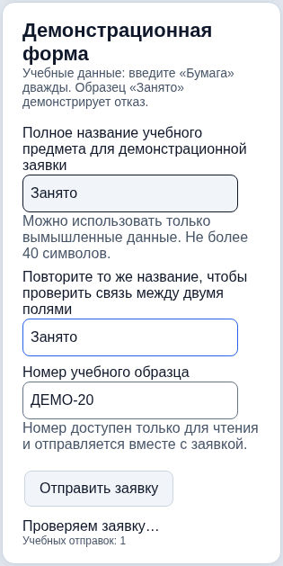

*390 px: асинхронная проверка учебной заявки.*

### PasswordInput

Начальное состояние; варианты подписаны внутри карточки.

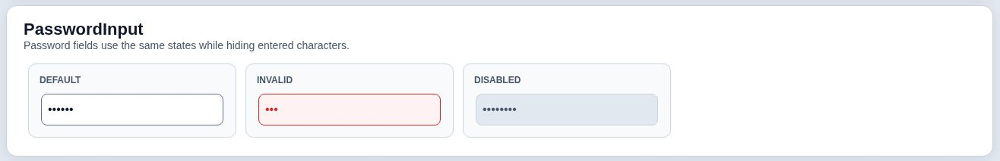

### TextArea

Начальное состояние; варианты подписаны внутри карточки.

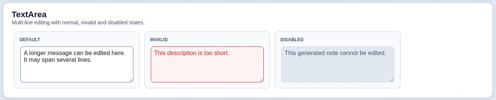

### CheckBox

Начальное состояние; варианты подписаны внутри карточки.

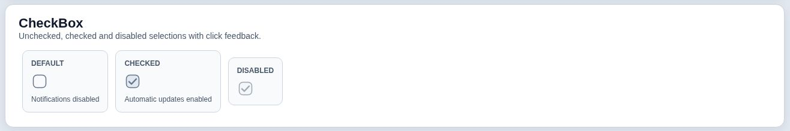

*CheckBox: синяя рамка фокуса, состояние checked и отключённый вариант.*

### RadioButton

Начальное состояние; варианты подписаны внутри карточки.

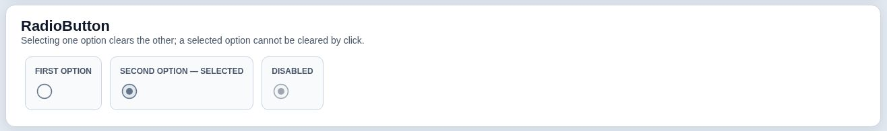

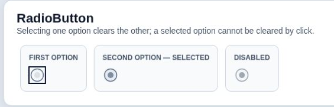
*RadioButton: выбор стрелкой и видимый фокус.*

### CheckBoxWithText / RadioButtonWithText

Начальное состояние; варианты подписаны внутри карточки.

Подписи активируют нативные поля, а длинный текст переносится рядом с контролом.
См. [клавиатурный контракт и API доступных имён](CHOICE_ACCESSIBILITY.ru.md).

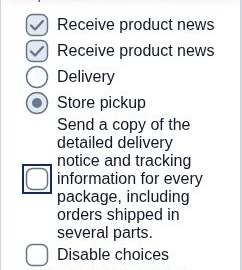
*Ширина 320 px: длинная подпись и рамка фокуса не обрезаны.*

*Фактический масштаб Chromium 200%: длинная подпись читается рядом с полем.*

### DropDownList

Начальное состояние; варианты подписаны внутри карточки.

### Button

Начальное состояние; варианты подписаны внутри карточки.

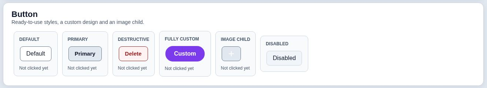

### Popup

Начальное состояние; варианты подписаны внутри карточки.

### FileLoader

Начальное состояние; варианты подписаны внутри карточки.

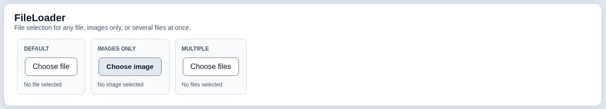

### FileLoader — загрузка завершена

Java обработала тестовый файл `recovery.bin` (7 байт), а результат вернулся в
браузер. Это состояние после загрузки, не только выбор файла.

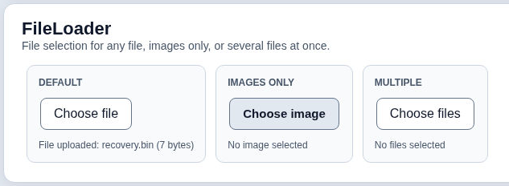

### ImageWidget

Начальное состояние; варианты подписаны внутри карточки.

### ActiveImage

Начальное состояние; варианты подписаны внутри карточки.

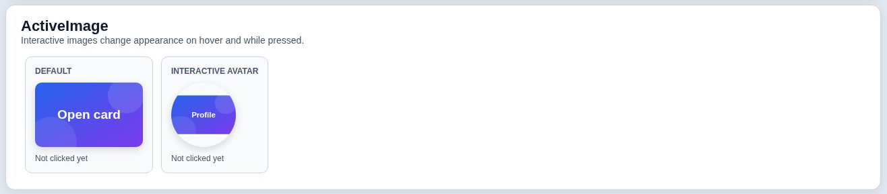

### OverlayStack

Начальное состояние; варианты подписаны внутри карточки.

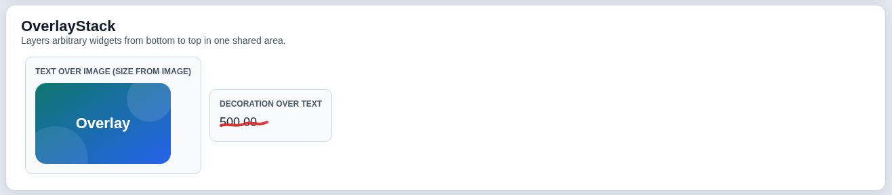

### Table

Начальное состояние; варианты подписаны внутри карточки.

### SortableSection

Начальное состояние; варианты подписаны внутри карточки.

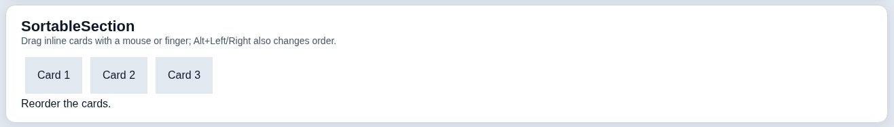

### ZoomDecorator

Начальное состояние; варианты подписаны внутри карточки.

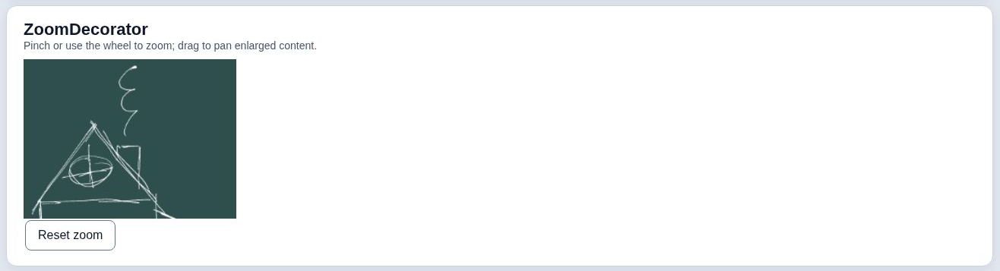

### Layout composition

Начальное состояние; варианты подписаны внутри карточки.

### Countdown

Начальное состояние; варианты подписаны внутри карточки.

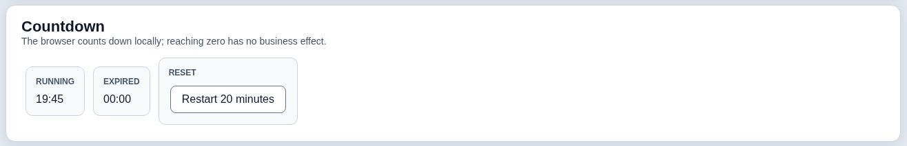

### Carousel

Начальное состояние; варианты подписаны внутри карточки.

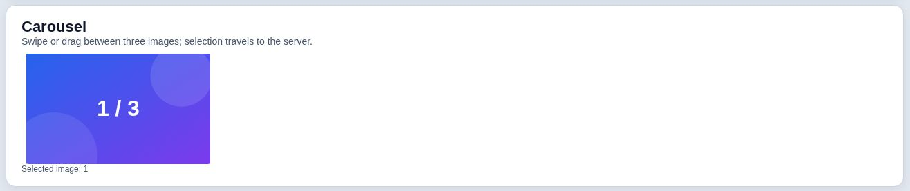

### MessagePopup

Открытое сообщение; видна модальная подложка вокруг окна.

### MessagePopup — узкое окно

Модальная подложка и сфокусированная кнопка Close в реальном узком окне
облачного Chromium. Это проверка компоновки окна, не снимок с телефона.

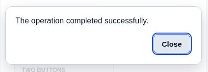

### Popup

Открытое немодальное окно; фон страницы остаётся активным.

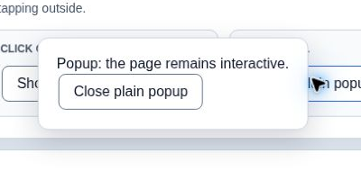

### ModalPopup

Открытое модальное окно с произвольным содержимым и полем ввода.

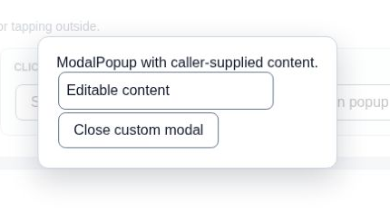

Вариант **Hide and reopen** показывает одно и то же окно до и после `hide()`.
При скрытии окна или его предка подложка тоже перестаёт блокировать страницу. Кнопка
**Count page click** позволяет это проверить. Внутри окна можно открыть вложенное,
а его подложка закроет только верхнее окно. Подробности в [контракте виджетов](WIDGETS.md#temporarily-hiding-a-modal).

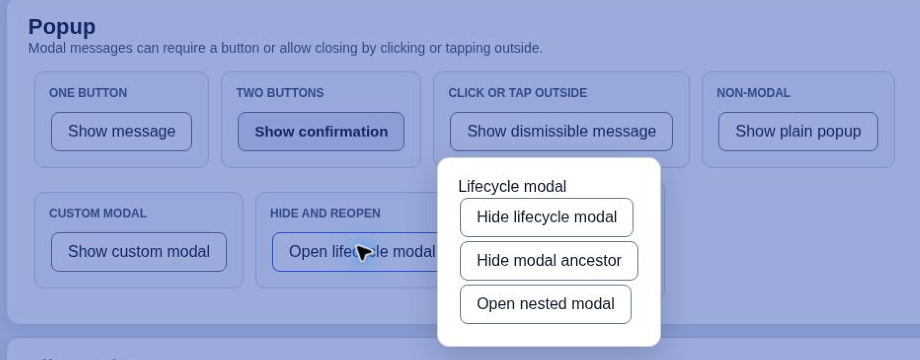
*Широкий экран: открытое окно и подложка.*

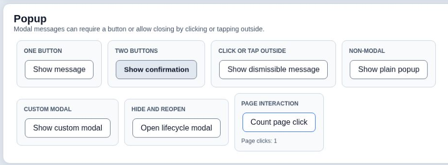
*Широкий экран: страница снова принимает клики.*

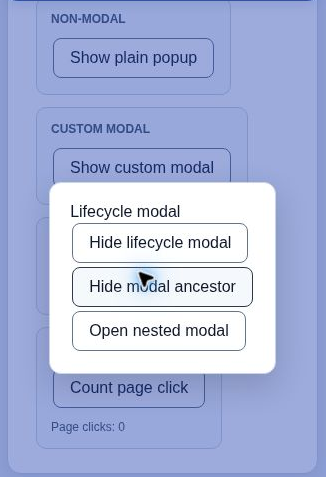
*Экран 390 px: окно и подложка.*

*Экран 390 px: после скрытия окна страница снова интерактивна.*

В варианте **Hide and reopen** клавиша Enter открывает окно, а Tab и Shift+Tab
переводят фокус по кругу. Escape закрывает переднее окно, только когда это разрешено.
Варианты **No interactive content** и **Missing opener** показывают фокус на самом
окне и возврат к контейнеру страницы. См. [контракт доступности](MODAL_ACCESSIBILITY.ru.md).

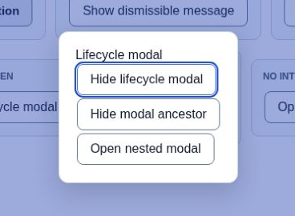
*Начальный фокус в широком диалоге; фон затемнён.*

*Переднее вложенное окно принимает клавиатурный фокус.*

*Диалог без контролов удерживает фокус на самом окне при ширине 320 px.*

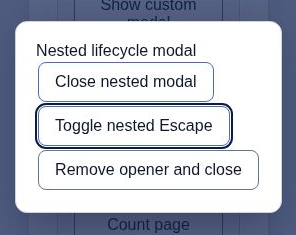
*Вложенное окно на ширине 320 px, видны края и фокус.*

### SuggestionField — раскрытый список

Фокус в поле, открыт список подсказок перед выбором с клавиатуры.

### Carousel — второй слайд

После drag браузер показал 2 / 3; Java обновила подпись Selected image: 2.

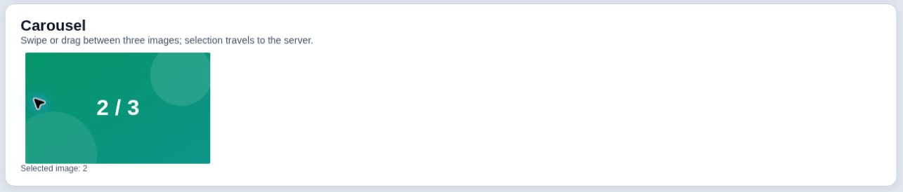

### Семантика: названия, картинки и связи

Секция **Accessible widgets** показывает нативную кнопку с именем и декоративной
иконкой, её отключённый вариант, а также информативное и декоративное изображения.
Поле получает имя от подписи: её можно переименовать или убрать. Ошибка связана с
полем до валидации. См. [договор об именах и описаниях](ACCESSIBLE_WIDGETS.ru.md).

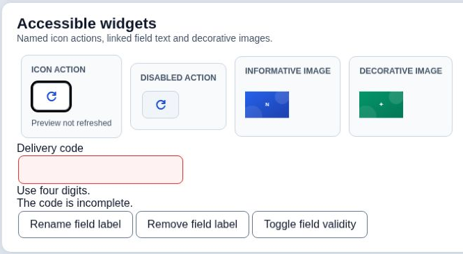
*Фокус иконки, отключённое действие, информативная/декоративная картинки и поле с ошибкой.*

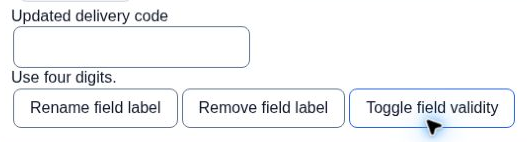
*Подпись поля изменена, после валидации ошибка исчезла.*

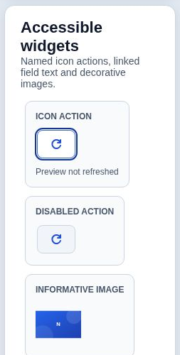
*Иконка и отключённое действие на ширине 320 px.*

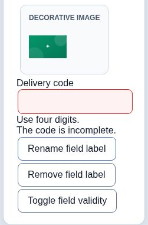
*Декоративная картинка и поле с подсказкой и ошибкой на ширине 320 px.*

## Как обновлять каталог

1. Добавить новый виджет в API-документацию и AllWidgets. Показать обычное состояние и применимые disabled/invalid/loading/empty/open состояния.
2. Собрать текущую версию, открыть её в браузере облачного компьютера. Проверить действие до и после ответа Java, клавиатуру и узкий viewport. Автоматические браузерные тесты дополняют ручную проверку.
3. Снять интерфейс. Вырезать виджет с полезными отступами; для окна оставить немного подложки. Не заменять интерфейс рисованной имитацией, не включать посторонние окна, браузерные вкладки или личные данные.
4. Сохранить crop в `docs/images/widgets`, добавить alt и подпись, обновить `manifest.json` (класс, состояние, источник, координаты, хеш). Для существующего класса заменять устаревшие изображения.
5. Выполнить `npm run check:gallery`, `mvn verify`, `npm run test:browser`; проверить каждый crop визуально в документации. Известные дефекты фиксировать отдельной задачей, не маскировать снимком.

## Сообщения, операции и Toast

Срез R24 от 16 ноября 2026 года: собранный AllWidgets в облачном Chromium.
Постоянные сообщения, действие пустого состояния, неопределённый Busy,
Progress 40% с отменой и ошибка Toast, которая не исчезает по таймеру.
[Контракт, ограничения и пример](FEEDBACK.ru.md).

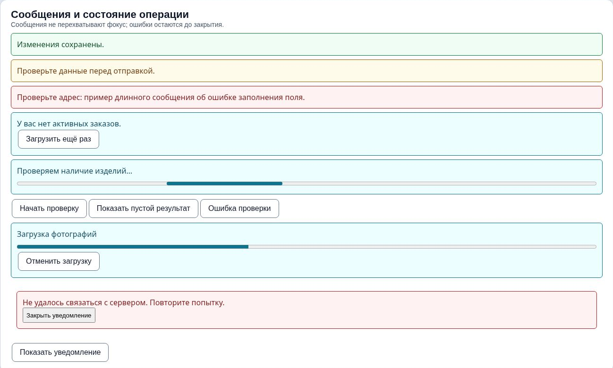

Узкий контейнер 390 px: длинные русские сообщения переносятся; кнопки
и индикаторы остаются внутри карточки. Два кадра сняты при прокрутке одной
карточки, без изменения масштаба и ретуши.

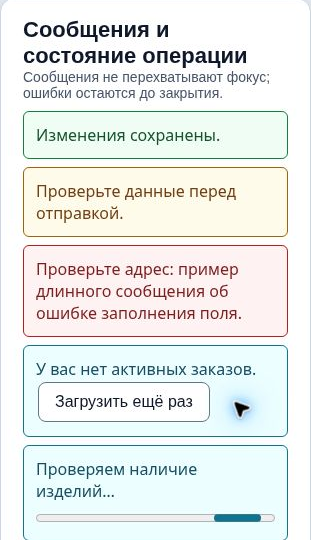

## Диалоги с результатом

Облачный AllWidgets, 16 ноября 2026 года. Одноразовое подтверждение различает
подтверждение, отмену и закрытие.

После ошибки введённое название сохраняется, подтверждение повторяет действие.
Длинное окно прокручивается внутри viewport; кнопки закрытия находятся ниже.

Ширина 390 CSS px: подписи переносятся, кнопка растёт по высоте,
длинная форма имеет собственную прокрутку. Это iframe-проверка, не снимок телефона.

[API и ограничения](DIALOGS.ru.md) · [Проверки](R25_VERIFICATION.ru.md).

## Даты, время и диапазон

AllWidgets, облачный Chromium, 16 ноября 2026 года. DateField и TimeField
используют нативные элементы: здесь браузер показывает американский формат,
хотя подписи приложения русские. DateRange включает обе границы.

Обратный диапазон отклонён сервером; значения не потеряны.

390 CSS px: поля диапазона переходят в одну колонку, ошибка времени переносится.

Календарь открыт настоящим кликом; выделено 29 февраля високосного 2028 года.
Снимок нативного окна, а не нарисованный макет календаря.

[API, локаль и DST](TEMPORAL_FIELDS.ru.md) · [Проверки R26](R26_VERIFICATION.ru.md).

## NumberField и QuantityField

AllWidgets, облачный Chromium, 16 ноября 2026 года. Число длиннее безопасного
целого JavaScript передано на сервер точно. QuantityField показывает подпись,
редактор, кнопки и общие ошибки FormField.

Незавершённое `12,` сохранено и получает ошибку преобразования. После снижения
максимума до 2 введённое количество 3 не меняется, обе кнопки отключены.

При ширине iframe 390 CSS px кнопки переносятся под редактор; длинное число
остаётся читаемым. Отправка с клавиатуры приняла точное значение и количество 3.

[Контракт, ограничения и примеры](NUMBER_FIELDS.ru.md). [Отчёт проверки](R27_VERIFICATION.ru.md).

## R28: вкладки, раскрывающиеся разделы и путь

Снимки от 16 ноября 2026 года: реальная собранная AllWidgets в облачном Chromium.
Нативная клавиатура проверена вручную; touch — автоматическими E2E Chromium/WebKit.
[Контракт и примеры](NAVIGATION.ru.md), [результаты проверки](R28_VERIFICATION.ru.md).

Широкое окно: подчёркнута выбранная вкладка, заголовки Accordion показывают состояние;
в пути предки являются ссылками, текущий пункт — текстом.

Настоящая AllWidgets внутри iframe 320 CSS px: названия переносятся, высота кнопок
подстраивается, поле не выходит за край компонента. Это проверка узкого контейнера,
а не снимок физического телефона.

Верхняя группа допускает один открытый раздел, нижняя — несколько. Вырезки не
масштабировались; исходные размеры, прямоугольники и SHA-256 перечислены в manifest.

| Класс | Изображения |
| --- | --- |
| `Tabs` | `navigation-desktop`, `navigation-mobile-tabs` |
| `Accordion` | `navigation-desktop`, `navigation-mobile-accordion` |
| `Breadcrumbs` | `navigation-desktop`, `navigation-mobile-tabs` |

## R29: Menu, Popover и Tooltip

Реальная AllWidgets в облачном Chromium, 16 ноября 2026 года.
[Контракт и примеры](ANCHORED_OVERLAYS.ru.md), [проверка](R29_VERIFICATION.ru.md).

Menu пропускает disabled-пункт при навигации стрелками; Enter/Space выбирают действие.

Popover получает фокус в поле и сохраняет введённое значение между открытиями.

Tooltip не перехватывает фокус, текст также связан с кнопкой через aria-describedby.

При прокрутке якорь оказался у нижнего края: `data-placement=top`, панель перешла наверх.

Узкий iframe содержит настоящую AllWidgets, а не макет. Это проверка ширины 320 CSS px
в desktop-браузере; touch отдельно проверен автоматическими Chromium/WebKit E2E.
Изображения вырезаны без масштабирования и ретуши. Прямоугольники и SHA-256 — в manifest.

| Класс | Изображения |
| --- | --- |
| `Menu` | `anchored-menu`, `anchored-menu-mobile` |
| `Popover` | `anchored-popover`, `anchored-popover-flipped` |
| `Tooltip` | `anchored-tooltip` |

## UploadManager / UploadList (R30)

[Контракт, ограничения и пример](UPLOAD_MANAGER.ru.md). Настоящие снимки AllWidgets из CI run [44036207319](https://github.com/kniazkov/widgets/actions/runs/44036207319), вырезанные без масштабирования и ретуши.

| Виджет | Покрытие |
| --- | --- |
| `UploadManager` | Выбор, передача, ошибка, повтор и завершение; desktop/mobile |
| `UploadList` | Индивидуальный и общий прогресс, действия над файлами; desktop/mobile |

### Дерево категорий

На широком экране виден путь от корня до выбранной подвески. Треугольник раскрывает ветку, нажатие на подпись выбирает узел.

На экране шириной 360 px длинное название переносится внутри строки. Доступны те же операции касанием.

[API, модель выбора и правила загрузки](TREE_VIEW.ru.md)

### Редактор каталога

Внешний разделитель задаёт ширину списка коллекций, внутренний — высоту карточки подвески. Рамка показывает, какой разделитель сейчас принимает нажатия стрелок.

На экране шириной 360 px список коллекций расположен над карточкой. Оба разделителя меняют высоту своих областей.

[Положение, границы и сохранение в модели приложения](SPLIT_PANE.ru.md)

### Размер браслета

Верхний ползунок показывает длину во время выбора. Нижний отображает последнее значение, принятое сервером.

[Диапазон, единицы измерения и управление](SLIDER.ru.md)
