# Визуальный каталог Widgets

Снимки всех **37 публичных конкретных классов виджетов** из `view`. Изображения вырезаны из скриншотов реально собранного AllWidgets на облачном компьютере 11 ноября 2026 года. Это состояние библиотеки, а не обещание, что найденные ревью дефекты уже исправлены.

Базовый commit: `7112edfa10eea3f3f895e426895242f432eba41e`; демонстрации дополнены в этой ветке. Точный SHA-256 исходника AllWidgets, пиксельные координаты вырезок и хеши изображений записаны в [manifest.json](images/widgets/manifest.json). Исходный полный снимок: 1348 × 6775 px; браузер сообщал viewport 1363 × 936 CSS px, DPR 1. Кадры окон: 1348 × 926 px. Размер возвращённого снимка отличается от viewport; вырезки сделаны в его пиксельных координатах, без масштабирования и ретуши.

Запуск: `./run.sh com.kniazkov.widgets.example.AllWidgets 18087`, затем `http://localhost:18087/`. Аргумент порта необязателен; по умолчанию 8080. См. [протокол облачной проверки](CLOUD_VERIFICATION.ru.md).

## Покрытие классов

| Класс | Изображение |
| --- | --- |
| `ActiveImage` | [ActiveImage](#active-image) |
| `ActiveText` | [ActiveText](#active-text) |
| `Button` | [Button](#button) |
| `Carousel` | [Carousel](#carousel), [Carousel — второй слайд](#carousel-selected) |
| `Cell` | [Table](#table) |
| `CheckBox` | [CheckBox](#check-box) |
| `CheckBoxWithText` | [CheckBoxWithText / RadioButtonWithText](#labeled-choices) |
| `Countdown` | [Countdown](#countdown) |
| `DropDownList` | [DropDownList](#drop-down-list) |
| `FileLoader` | [FileLoader](#file-loader) |
| `HorizontalLine` | [HorizontalLine](#horizontal-line) |
| `ImageWidget` | [ImageWidget](#image-widget) |
| `InlineBlock` | [Layout composition](#layout-composition) |
| `InputField` | [InputField](#input-field) |
| `Link` | [Link](#link) |
| `MarginDecorator` | [Layout composition](#layout-composition) |
| `Markdown` | [Markdown](#markdown) |
| `MessagePopup` | [MessagePopup](#message-popup) |
| `ModalPopup` | [ModalPopup](#modal-popup) |
| `NoWrap` | [NoWrap](#no-wrap) |
| `OverlayStack` | [OverlayStack](#overlay-stack) |
| `Panel` | [Layout composition](#layout-composition) |
| `PasswordInput` | [PasswordInput](#password-input) |
| `Popup` | [Popup](#popup) |
| `RadioButton` | [RadioButton](#radio-button) |
| `RadioButtonWithText` | [CheckBoxWithText / RadioButtonWithText](#labeled-choices) |
| `RootWidget` | [All widgets](#root-widget) |
| `Row` | [Table](#table) |
| `Section` | [Layout composition](#layout-composition) |
| `SortableSection` | [SortableSection](#sortable-section) |
| `StickyPanel` | [StickyPanel — scroll the page to see this block stick to the top.](#sticky-panel) |
| `SuggestionField` | [SuggestionField](#suggestion-field), [SuggestionField — раскрытый список](#suggestion-open) |
| `Table` | [Table](#table) |
| `TextArea` | [TextArea](#text-area) |
| `TextFlow` | [Layout composition](#layout-composition) |
| `TextWidget` | [TextWidget](#text-widget) |
| `ZoomDecorator` | [ZoomDecorator](#zoom-decorator) |

Абстрактные классы не имеют отдельного изображения: `BaseImageWidget`, `BlockWidget`, `InlineWidget`, `LabeledChoice`, `Widget`. `RadioGroup` — невизуальная модель взаимоисключения, показанная через RadioButton; стили, интерфейсы Has*, модели, контроллеры и UploadingFile не являются самостоятельными визуальными виджетами. Row/Cell показаны внутри Table, базовые контейнеры — в композиции.

## Изображения

### All widgets

Начальное состояние; варианты подписаны внутри карточки.

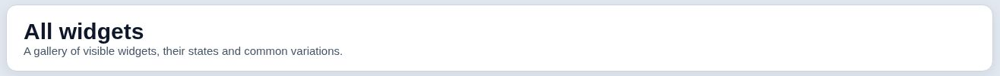

### StickyPanel — scroll the page to see this block stick to the top.

Начальное состояние; варианты подписаны внутри карточки.

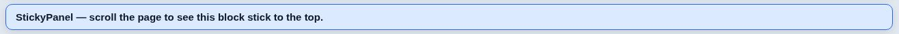

### HorizontalLine

Начальное состояние; варианты подписаны внутри карточки.

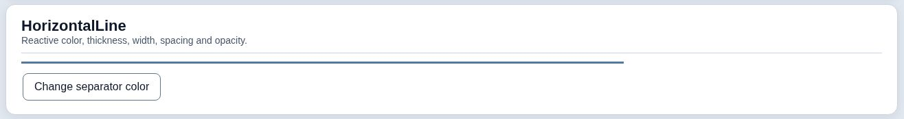

### TextWidget

Начальное состояние; варианты подписаны внутри карточки.

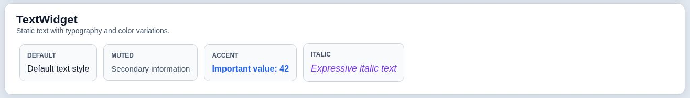

### Markdown

Начальное состояние; варианты подписаны внутри карточки.

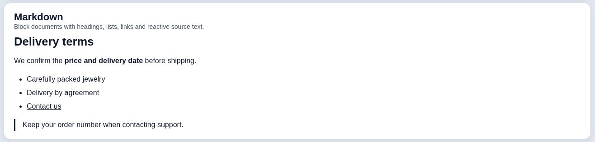

### NoWrap

Начальное состояние; варианты подписаны внутри карточки.

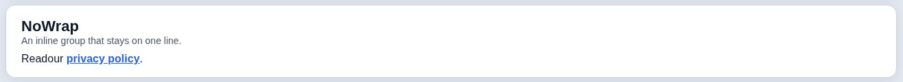

### ActiveText

Начальное состояние; варианты подписаны внутри карточки.

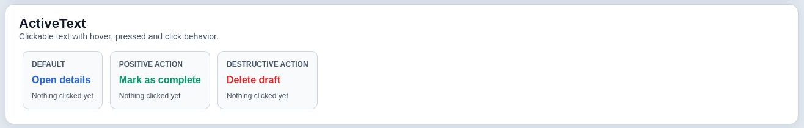

### Link

Начальное состояние; варианты подписаны внутри карточки.

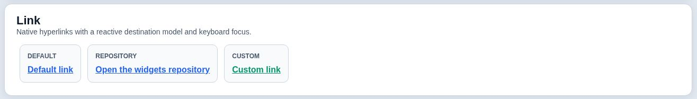

### InputField

Начальное состояние; варианты подписаны внутри карточки.

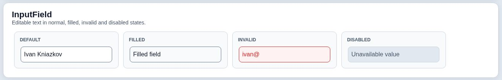

### Numeric input hints

Начальное состояние; варианты подписаны внутри карточки.

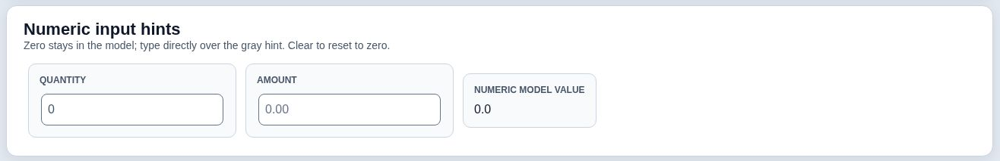

### SuggestionField

Начальное состояние; варианты подписаны внутри карточки.

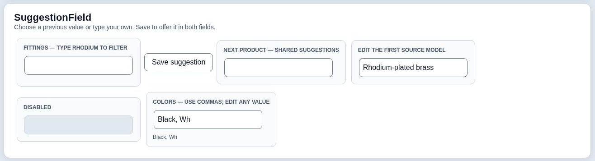

### PasswordInput

Начальное состояние; варианты подписаны внутри карточки.

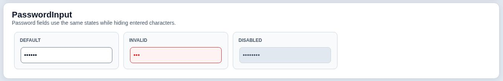

### TextArea

Начальное состояние; варианты подписаны внутри карточки.

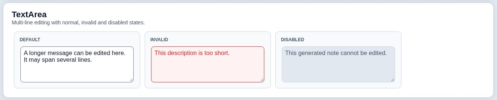

### CheckBox

Начальное состояние; варианты подписаны внутри карточки.

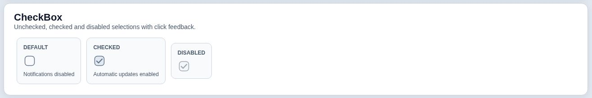

### RadioButton

Начальное состояние; варианты подписаны внутри карточки.

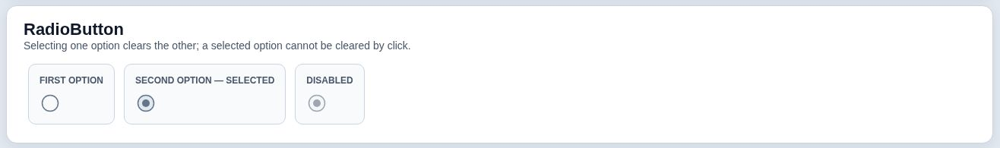

### CheckBoxWithText / RadioButtonWithText

Начальное состояние; варианты подписаны внутри карточки.

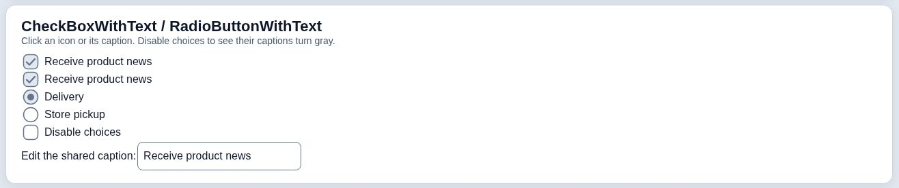

### DropDownList

Начальное состояние; варианты подписаны внутри карточки.

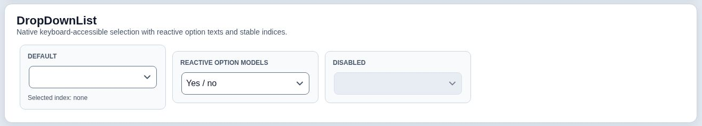

### Button

Начальное состояние; варианты подписаны внутри карточки.

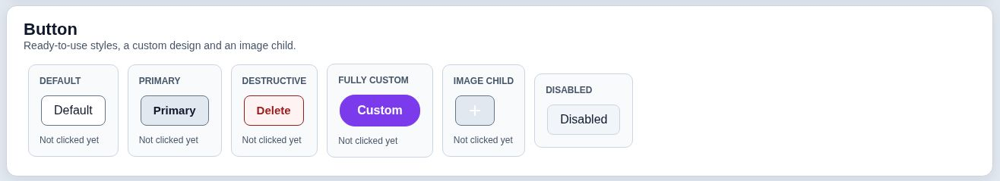

### Popup

Начальное состояние; варианты подписаны внутри карточки.

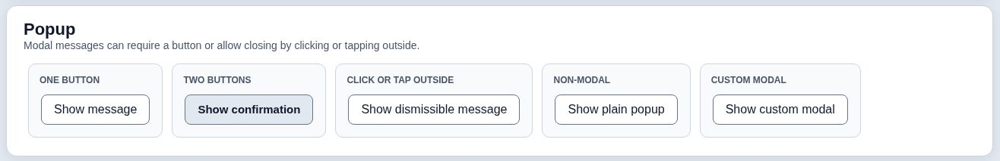

### FileLoader

Начальное состояние; варианты подписаны внутри карточки.

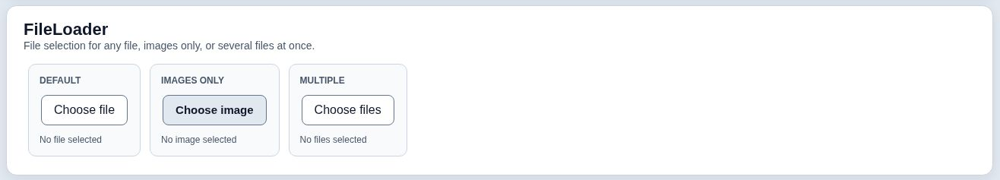

### ImageWidget

Начальное состояние; варианты подписаны внутри карточки.

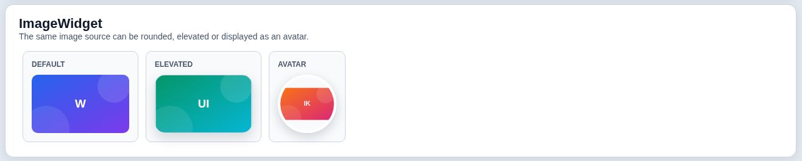

### ActiveImage

Начальное состояние; варианты подписаны внутри карточки.

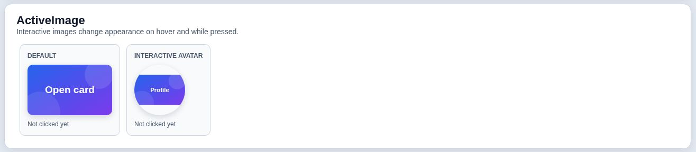

### OverlayStack

Начальное состояние; варианты подписаны внутри карточки.

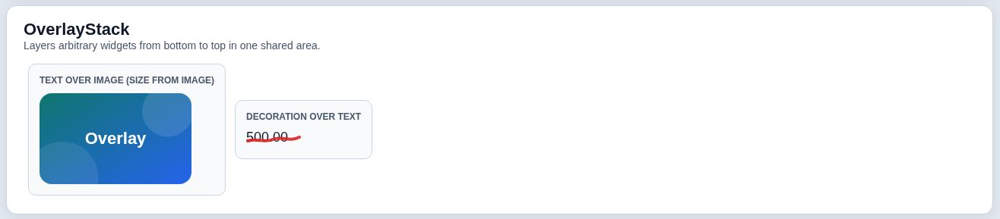

### Table

Начальное состояние; варианты подписаны внутри карточки.

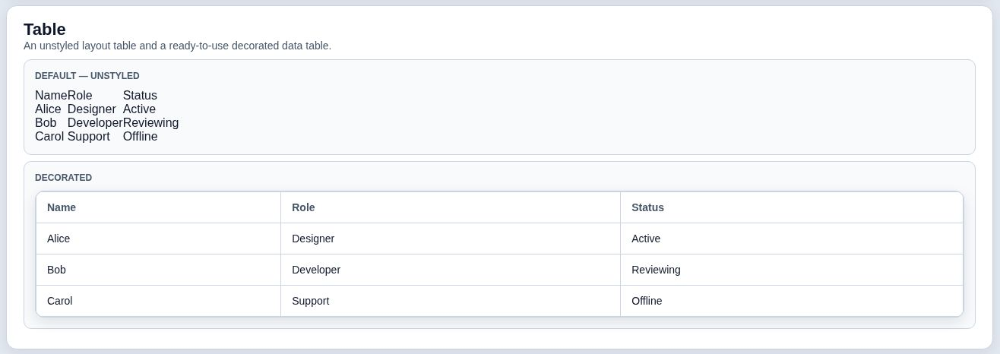

### SortableSection

Начальное состояние; варианты подписаны внутри карточки.

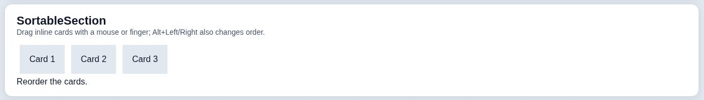

### ZoomDecorator

Начальное состояние; варианты подписаны внутри карточки.

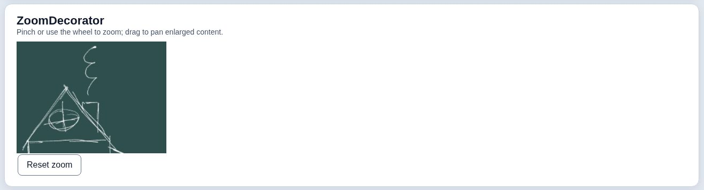

### Layout composition

Начальное состояние; варианты подписаны внутри карточки.

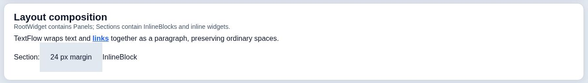

### Countdown

Начальное состояние; варианты подписаны внутри карточки.

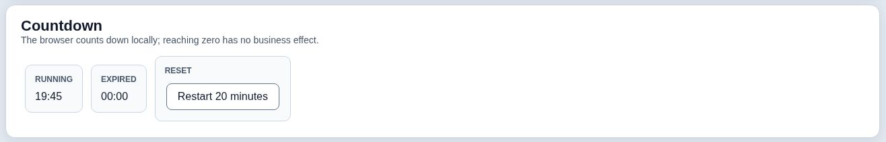

### Carousel

Начальное состояние; варианты подписаны внутри карточки.

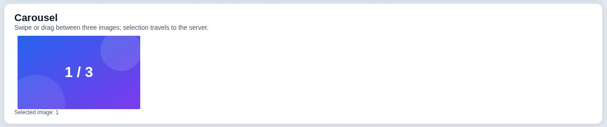

### MessagePopup

Открытое сообщение; видна модальная подложка вокруг окна.

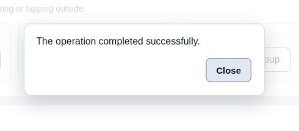

### Popup

Открытое немодальное окно; фон страницы остаётся активным.

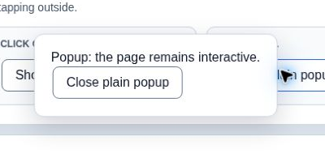

### ModalPopup

Открытое модальное окно с произвольным содержимым и полем ввода.

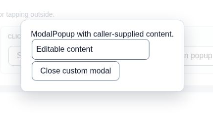

Вариант **Hide and reopen** показывает одно и то же окно до и после `hide()`.
При скрытии окна или его предка подложка тоже перестаёт блокировать страницу. Кнопка
**Count page click** позволяет это проверить. Внутри окна можно открыть вложенное,
а его подложка закроет только верхнее окно. Подробности в [контракте виджетов](WIDGETS.md#temporarily-hiding-a-modal).

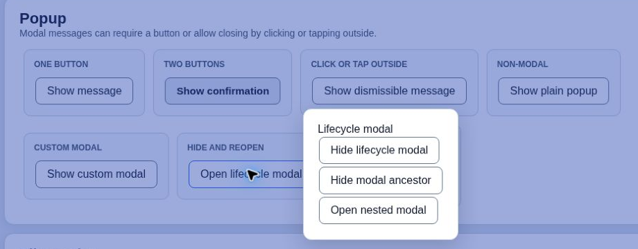
*Широкий экран: открытое окно и подложка.*

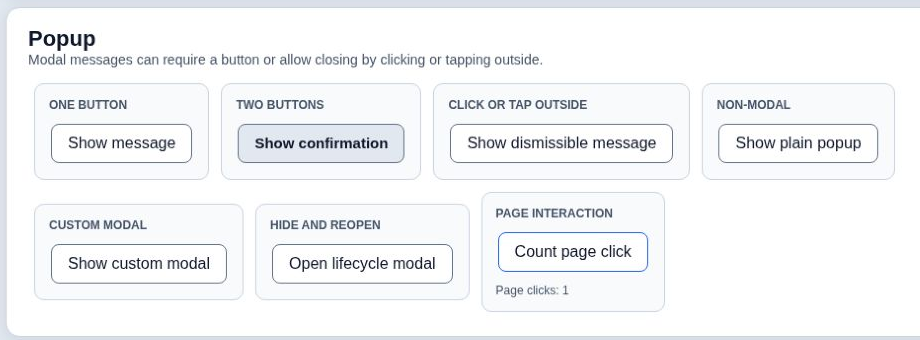
*Широкий экран: страница снова принимает клики.*

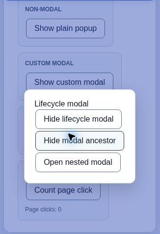
*Экран 390 px: окно и подложка.*

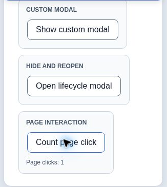
*Экран 390 px: после скрытия окна страница снова интерактивна.*

### SuggestionField — раскрытый список

Фокус в поле, открыт список подсказок перед выбором с клавиатуры.

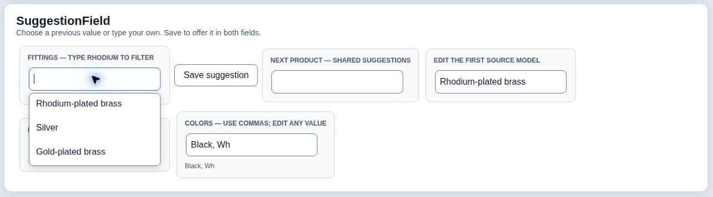

### Carousel — второй слайд

После drag браузер показал 2 / 3; Java обновила подпись Selected image: 2.

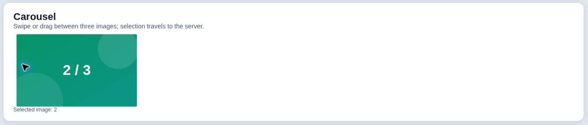

## Как обновлять каталог

1. Добавить новый виджет в API-документацию и AllWidgets. Показать обычное состояние и применимые disabled/invalid/loading/empty/open состояния.
2. Собрать текущую версию, открыть её в браузере облачного компьютера. Проверить действие до и после ответа Java, клавиатуру и узкий viewport. Автоматические браузерные тесты дополняют ручную проверку.
3. Снять интерфейс. Вырезать виджет с полезными отступами; для окна оставить немного подложки. Не заменять интерфейс рисованной имитацией, не включать посторонние окна, браузерные вкладки или личные данные.
4. Сохранить crop в `docs/images/widgets`, добавить alt и подпись, обновить `manifest.json` (класс, состояние, источник, координаты, хеш). Для существующего класса заменять устаревшие изображения.
5. Выполнить `npm run check:gallery`, `mvn verify`, `npm run test:browser`; проверить каждый crop визуально в документации. Известные дефекты фиксировать отдельной задачей, не маскировать снимком.
