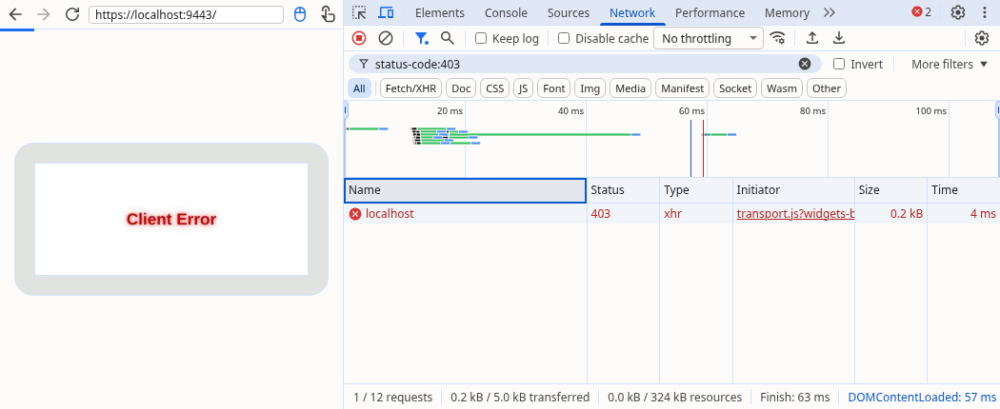

# Run the counter over HTTPS

[Web Widgets](../../README.md) · [Русский](../ru/https.md)

HTTPS uses TLS to encrypt the connection and lets the browser verify the site’s identity.
Choose [TLS in Java](#java) if the browser connects directly to your application. Choose
[TLS in Nginx](#nginx) if Nginx already serves your domain. Both routes run the same
counter. Clicking **Click me** twice should change the value from **0** to **1** to **2**.

## Prepare the counter and certificate

Use JDK 21, Maven 3.9 and the project from the [quick start](quick-start.md). Save the
[HTTPS version of Counter.java](../examples/https/Counter.java) as
`src/main/java/example/Counter.java`. Stop the previous example with Ctrl+C. In `pom.xml`, keep
`com.kniazkov:widgets-http:0.2.1` and set `<mainClass>` to `example.Counter`, including
when continuing from the navigation lesson. Run the commands from the directory containing the POM.

For a public site, obtain a certificate for the hostname people will open. The examples
use two PEM files. `fullchain.pem` contains the site's certificate followed by its
intermediate certificates, and `privkey.pem` contains its matching private key. Keep
the key outside the web root and restrict read access to the process that terminates TLS.
For the Java PEM loader, the key must be unencrypted PKCS#8 (`BEGIN PRIVATE KEY`).

To try either route on **localhost**, install [mkcert](https://github.com/FiloSottile/mkcert)
on the computer running the example and the browser. These Linux commands trust its development
CA on that computer and issue a test certificate. Restart the browser after installing the CA.
Keep the CA's private key on the development machine.

```sh
tls="$HOME/.config/widgets/tls"
mkdir -p "$tls"
chmod 700 "$tls"
mkcert -install
mkcert -cert-file "$tls/fullchain.pem" -key-file "$tls/privkey.pem" localhost
```

<a id="java"></a>

## Serve HTTPS directly from Java

Java reads the two files and listens on `127.0.0.1:8443`. In the `direct` branch of
`Counter.listener`, the two arguments after `direct` are the certificate and key paths.

```java
SslOptions tls = new SslOptions.Builder()
    .setCertificateChainFile(args[1])
    .setPrivateKeyFile(args[2])
    .build();
return options.setPort(8443).setSslOptions(tls).build();
```

```sh
mvn compile exec:java -Dexec.args="direct '$tls/fullchain.pem' '$tls/privkey.pem'"
```

Open [https://localhost:8443/](https://localhost:8443/) and click **Click me** twice.
The handler increments a Java model. Seeing **2** confirms the interaction made the
round trip. For a public deployment, pass the server’s network interface address to
`setBindAddress` in the `direct` branch. Open `https://app.example.com:8443/` using the
hostname on your certificate. Restart the Java listener after renewing its certificate.
If your certificate and private key are already in a PKCS#12 keystore, use `setKeyStoreFile` and
`setPassword(char[])` in place of the two PEM setters.

<a id="nginx"></a>

## Serve HTTPS through Nginx

Here Nginx owns the certificate and key. The browser opens `https://localhost:9443/`;
Nginx forwards requests over HTTP to Java on `127.0.0.1:8080`. Start Java in one terminal.

```sh
mvn compile exec:java -Dexec.args="proxy https://localhost:9443"
```

For this command the Java configuration is equivalent to the following.

```java
Options options = new Options.Builder()
    .setBindAddress(InetAddress.getByName("127.0.0.1"))
    .setPort(8080)
    .setPublicOrigin("https://localhost:9443")
    .build();
```

The **origin** is the browser's scheme, hostname and port. It applies to every page on the
site, so omit paths, queries and fragments.

On a Linux host with Nginx running, save [widgets.conf](../examples/https/widgets.conf)
next to the POM. Its `server` block belongs inside the main configuration's `http` block.

```nginx
server {
    listen 127.0.0.1:9443 ssl;
    server_name localhost;

    ssl_certificate     widgets-tls/fullchain.pem;
    ssl_certificate_key widgets-tls/privkey.pem;

    location / {
        proxy_pass http://127.0.0.1:8080;
        proxy_set_header Host $http_host;
        proxy_cache off;
    }
}
```

For a standard installation with `/etc/nginx/nginx.conf` including `conf.d/*.conf`,
run these commands in a second terminal from the project directory.

```sh
tls="$HOME/.config/widgets/tls"
sudo install -d -m 700 /etc/nginx/widgets-tls
sudo install -m 644 "$tls/fullchain.pem" /etc/nginx/widgets-tls/fullchain.pem
sudo install -m 600 "$tls/privkey.pem" /etc/nginx/widgets-tls/privkey.pem
sudo install -m 644 widgets.conf /etc/nginx/conf.d/widgets.conf
sudo nginx -t && sudo systemctl reload nginx
```

Open [https://localhost:9443/](https://localhost:9443/) and click **Click me** twice.
For a public domain, change `listen` to `443 ssl`, set `server_name` and the certificate
paths for that domain, and start Java with `proxy https://app.example.com`. Keep the Java
listener on loopback. When the certificate is renewed, reload Nginx so it reads the new files.
[Nginx HTTPS configuration](https://nginx.org/en/docs/http/configuring_https_servers.html)

## The page opens but the button does nothing

In the browser's developer tools, open **Network**, reload the page and look at `POST /`
as well as the initial `GET /`. If GET succeeds but POST returns **403**, the browser received the
page and Widgets rejected an interactive request. The page can show **Client Error** before
the button appears. Use the Network filter `status-code:403` to isolate the failed request.



1. Evaluate `location.origin` in the browser console. Copy that value to `setPublicOrigin`.
   For this proxy it includes `:9443`. Restart Java and reload the tab.
2. If the origin already matches, check that Nginx sends both GET and POST to the same
   Java listener and preserves `Origin`, `Sec-Fetch-Site`, `Cookie` and `X-Widgets-*`
   request headers. Forward the response's `Set-Cookie` and keep the initial HTML and
   protocol responses out of proxy caches. Widgets uses the configured public origin
   for its checks. Setting `X-Forwarded-Proto` alone cannot supply it.
3. Click twice again. A successful protocol POST and the visible **2** confirm recovery.

## Optional push updates

The counter works with the default HTTP transport over TLS. If the application explicitly
starts `PushServer`, also route `/widgets-stream` to its WebSocket listener with the
WebSocket Upgrade headers and the same public origin. [WebSocket proxying in Nginx](https://nginx.org/en/docs/http/websocket.html)
