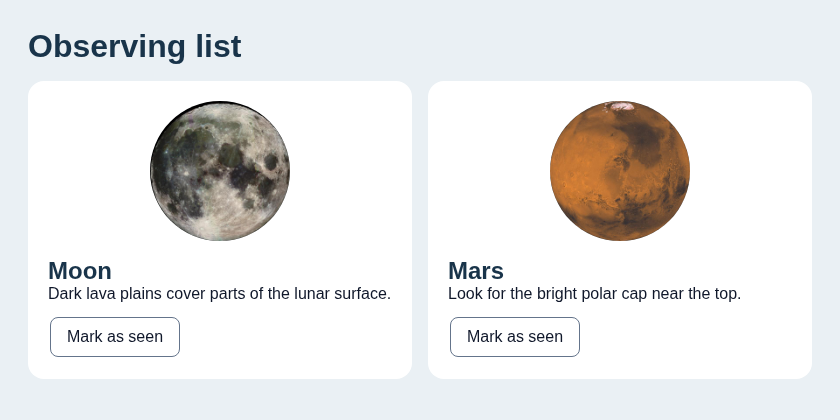
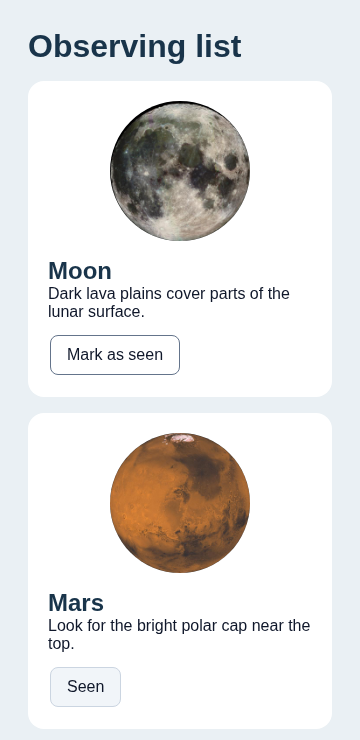

# Build a page from cards

[Validate and save a form](form-models.md) · [Русский](../ru/page-composition.md)

Build an observing list with two cards, one for the Moon and one for Mars. Each has a photo,
a description and a **Mark as seen** button. The cards sit side by side on a wide screen.



## Run the example

Open the Maven project from the [quick start](quick-start.md). If the server is still
running, stop it with Ctrl+C. Save these three files relative to the directory containing
`pom.xml`.

| File | Where to put it |
| --- | --- |
| [SkyCards.java](../examples/SkyCards.java) | `src/main/java/example/SkyCards.java` |
| [moon.jpg](../examples/sky/moon.jpg) | `www/moon.jpg` |
| [mars.jpg](../examples/sky/mars.jpg) | `www/mars.jpg` |

Create `www` if needed. The server serves files from this directory by default, so
`www/moon.jpg` is available at `/moon.jpg` in the browser. In `pom.xml`, set
`<mainClass>` to `example.SkyCards`. From the directory containing `pom.xml`, run
`mvn compile exec:java` and open [localhost:8080](http://localhost:8080/).

## Assemble one card

Look at the `SkyCard` class in the example. It extends `Panel`, a block container.
Inside the card, four blocks appear from top to bottom in the order of the `add` calls.

```java
add(portrait);
add(new Section(heading(name, HeadingLevel.H2, "24px")));
add(new Section(new TextWidget(description)));
add(actions);
```

Each **block** here occupies its own line. **Inline widgets** such as images, text and
buttons can sit side by side inside a single `Section`. That is why `portrait` is
`new Section(photo)` and `actions` is `new Section(button)`. Move `add(actions)` above the
description and the button will appear above the text in both cards.

The photo’s row controls its placement. `portrait.setCenterAlignment()` centers the image,
and `portrait.setBottomMargin(16)` leaves 16 pixels between it and the heading. Both cards
use a shared style created with `Panel.getDefaultStyle().derive()`. It sets the white
background, rounded corners and `setPadding(20)`, the distance from the edge of the card
to its contents.

## Arrange two cards

Trace the tree from the page root. The root contains the `content` panel, whose children
are the title and the `grid`. The grid receives two `new SkyCard(...)` instances, each with
its own name, photo and description. The constructor creates a button and its handler for
each instance. Click **Mark as seen** under Mars. Its button changes to **Seen**, and the
Moon’s button stays available.

```java
ResponsiveGrid grid = new ResponsiveGrid();
grid.setColumnWidths(280, 0);
grid.setGap(16);
```

`ResponsiveGrid` chooses the column count from the width of the grid itself. The first
argument is the preferred minimum column width in pixels. A zero second argument lets
the columns share the available space equally. Two columns need `280 + 16 + 280 = 576`
pixels inside the grid. Narrow the window and Mars moves below the Moon. Its button
still reads **Seen**.



**Try changing the layout.** Replace `setColumnWidths(280, 0)` with
`setColumnWidths(460, 0)`, restart the application and reopen the page. At a window
width of 840 pixels the cards now stack. Widen the window to 1000 pixels and the cards
fit side by side again.

Image credits — [Moon, NASA/JPL/USGS](https://science.nasa.gov/photojournal/earths-moon/) and
[Mars, NASA/JPL-Caltech/USGS](https://science.nasa.gov/resource/global-color-views-of-mars/).
