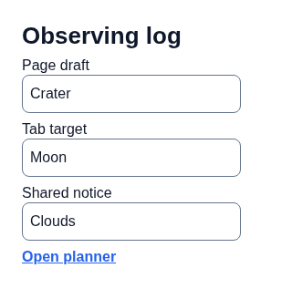
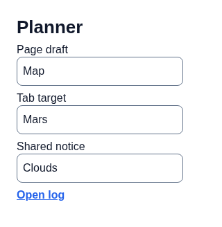

# Two pages and three places to keep a note

[Build a page from cards](page-composition.md) · [Русский](../ru/page-navigation.md)

An observing planner has two pages, a plan and a log. You can write on both. A draft
belongs to the page you are editing, the observing target should follow you between pages
in the same tab, and everyone using the application should see the weather notice.
What happens to each field when you open the log and come back?

## Run the two pages

In the Maven project from the [quick start](quick-start.md), save [ObservingNotes.java](../examples/ObservingNotes.java)
as `src/main/java/example/ObservingNotes.java`. In `pom.xml`, set `<mainClass>` to
`example.ObservingNotes`. Stop the previous example with Ctrl+C, run `mvn compile exec:java`
and open the [planner](http://localhost:8080/). All three fields start empty.

```java
Page planner = notes.page("Planner", "Open log", "/log");
Page log = notes.page("Observing log", "Open planner", "/");
Application app = new Application(planner);
app.addPage("log", log);
```

The `Application` constructor assigns the planner to `/`. The call to `addPage("log", log)`
registers the log at `/log`. On each page, `new Link(linkText, destination)` creates a link
to the other page. You can reach the log by clicking **Open log** or by opening
[localhost:8080/log](http://localhost:8080/log) directly.

## Where each field gets its value

The `page(...)` method returns a lambda, `(root, context) -> { ... }`. Widgets calls it
when it needs to create a page instance. The example picks a model for each field at
that point, and `setTextModel(model)` binds the field to that model.

| Field | Where the model is created | Who sees edits |
| --- | --- | --- |
| **Page draft** | `new StringModel()` inside the lambda | Only this page instance. The log and the planner have separate drafts. |
| **Tab target** | `targets.computeIfAbsent(context.tabContext, ...)` | Both pages in one tab context get the same model. Another tab gets its own. |
| **Shared notice** | The `notice` field on the single `ObservingNotes` object created in `main` | All pages and tabs using this application. Restarting the server clears the notice. |

`context.tabContext` supplies the key. The application stores the model in its `targets`
map. Weak keys let the map release an entry once its context is no longer in use.
The example calls `asSynchronized()` on models shared between page instances because
requests from those pages can arrive concurrently.

## Follow a link, go Back and go Forward

In tab A, enter `Sketch`, `Moon` and `Clear` in the planner’s three fields. Follow the
rows in order, using the browser’s history buttons where indicated.

| Action | Path | Page draft | Tab target | Shared notice |
| --- | --- | --- | --- | --- |
| Click the **Open log** link | `/log` | empty | Moon | Clear |
| Enter `Crater` in the log’s draft | `/log` | Crater | Moon | Clear |
| Click the browser’s Back button | `/` | Sketch | Moon | Clear |
| Click the browser’s Forward button | `/log` | Crater | Moon | Clear |
| Click the **Open planner** link | `/` | empty | Moon | Clear |
| Click the browser’s Back button | `/log` | Crater | Moon | Clear |

The **Open planner** link adds a history entry and opens a fresh planner instance at the
same address, `/`. Back restores an earlier instance while it is still cached. The tab
keeps up to three inactive pages for about two minutes after you leave them. If the
instance has been evicted, Widgets builds the page again and its draft is empty.

## Compare two tabs and reload

1. Leave tab A on the log. In a new tab B, open the [planner](http://localhost:8080/).
   Its draft and target are empty, and its notice already reads `Clear`.
2. In tab B, enter `Map`, `Mars` and `Clouds`. Return to tab A. Its draft still reads
   `Crater` and its target is still `Moon`, while the notice has updated to `Clouds`.

| Tab A · log | Tab B · planner |
| --- | --- |
|  |  |

Now reload tab A using the browser’s Reload button. The address stays at `/log`.
A full reload creates both a new page instance and a new tab context, so the first two
fields are empty. The notice still reads `Clouds`. Tab B keeps `Map`, `Mars` and `Clouds`.

As the pages grow, you can move them into separate Java classes as in
[TwoPages](../../src/main/java/com/kniazkov/widgets/example/TwoPages.java).
[TabContextExample](../../src/main/java/com/kniazkov/widgets/example/TabContextExample.java)
lets you inspect the tab IDs and end the current context with a button.

[Run an application over HTTPS](https.md)
