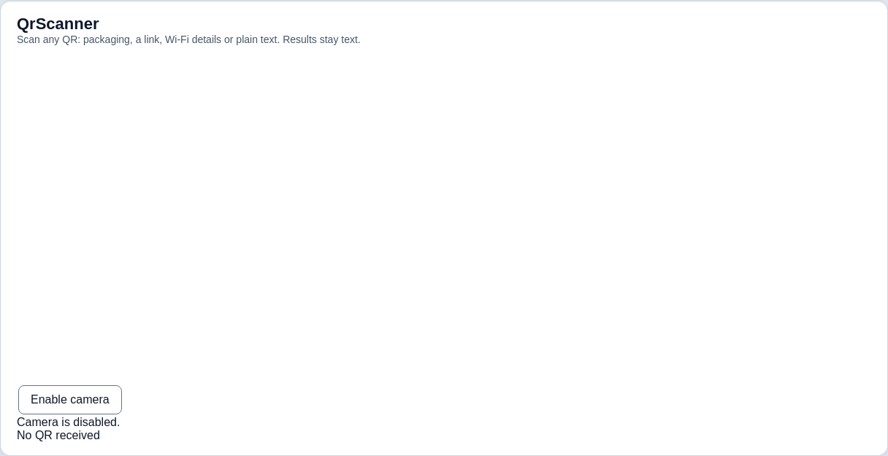

# Scan QR codes

[Catalog](../../WIDGETS.md) · [ru](../../ru/widgets/camera.md)

## QrScanner

Starts the camera only after a click and decodes frames locally. The two-argument constructor accepts arbitrary QR text, including packaging links and Wi-Fi data. Results are displayed as text, never executed or automatically opened. The three-argument constructor retains the optional URL-prefix-plus-UUID filter. Validate the code and permissions in the server handler, then acknowledge with `setPaused(false)`. Use `setPaused(true)` while awaiting confirmation. HTTPS or localhost is required. Closing or hiding the scanner stops the camera.

```java
final Map<String, String> messages = Map.of(
    "start", "Enable camera",
    "idle", "Allow camera access to scan any QR code.",
    "opening", "Opening camera…",
    "ready", "Show a QR code. Remove it before scanning it again.",
    "waiting", "Processing QR…",
    "https", "Camera access requires HTTPS.",
    "denied", "Camera permission was denied.",
    "unavailable", "Camera unavailable.",
    "invalid", "No readable QR text.",
    "closed", "Camera stopped. Reload to start again.");
final TextWidget result = new TextWidget("No QR received");
final QrScanner[] scanner = new QrScanner[1];
scanner[0] = new QrScanner(messages, code -> {
    result.setText(code);
    scanner[0].setPaused(false);
});
root.add(scanner[0]);
root.add(new Section(result));
```

[Java](../../../src/main/java/com/kniazkov/widgets/view/QrScanner.java) · [Screenshot](#shot-qr-scanner)

<a id="shot-qr-scanner"></a>


