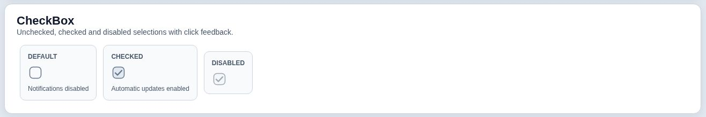
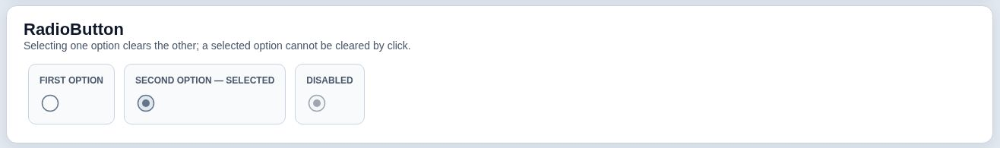
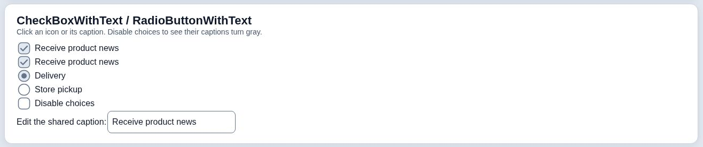
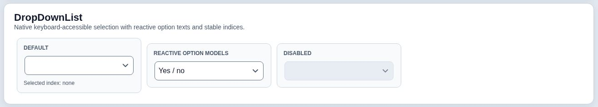
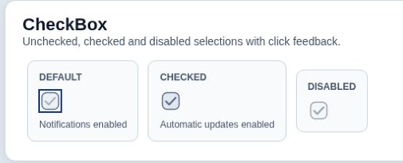
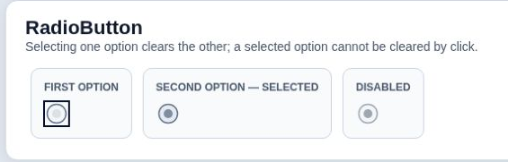
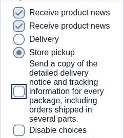
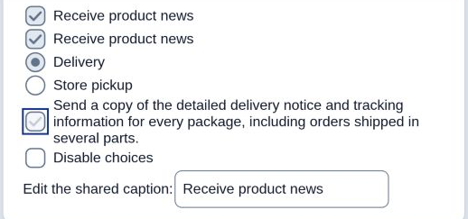
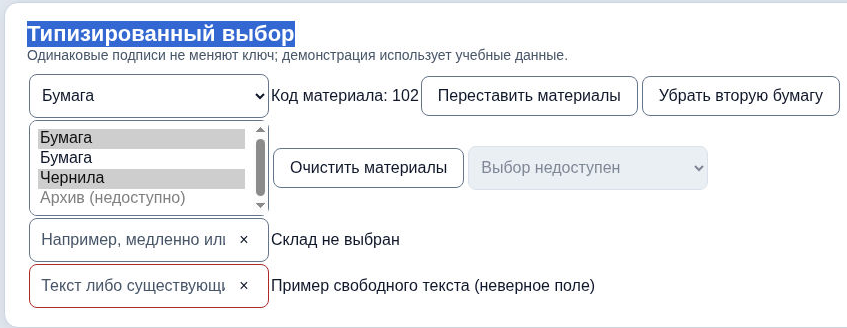
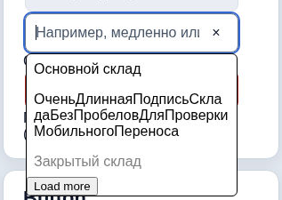

# Choose one or more values

[Widget catalog](../../WIDGETS.md) · [Русский](../../ru/widgets/choices.md)

Select is a native single-choice list. ComboBox adds a search field and can accept free text. MultiSelect keeps a set of chosen options. A checkbox fits an independent on/off setting.

[Typed choices](../../TYPED_CHOICES.md)

[CheckBox](#checkbox) · [CheckBoxWithText](#checkboxwithtext) · [RadioButton](#radiobutton) · [RadioButtonWithText](#radiobuttonwithtext) · [DropDownList](#dropdownlist) · [Select](#select) · [ComboBox](#combobox) · [MultiSelect](#multiselect)

## CheckBox

Toggle one boolean. Read or bind its checked-state model; name the control when it appears without a visible caption. Space toggles a focused checkbox.

```java
var visible = new CheckBox();
visible.setAccessibleName("Show labels");
```

[Checked and unchecked controls](#shot-check-box) · [Java](../../../src/main/java/com/kniazkov/widgets/view/CheckBox.java)

## CheckBoxWithText

Use a visible clickable caption for a boolean choice. The constructor can bind the caption and checked state separately; disabling the composite also disables its labeled control.

```java
var labels = new CheckBoxWithText(new StringModel("Show labels"), new BooleanModel(true));
```

[Radio buttons and checkboxes with clickable captions](#shot-labeled-choices) · [Java](../../../src/main/java/com/kniazkov/widgets/view/CheckBoxWithText.java)

## RadioButton

Select one option with a boolean checked model. Clicking a selected radio keeps it selected. Add related controls to the same RadioGroup for mutual exclusion.

```java
var first = new RadioButton();
var second = new RadioButton();
first.setAccessibleName("Day");
second.setAccessibleName("Night");
var group = new RadioGroup(first, second);
root.onClose(group::close);
```

[Radio selection controls](#shot-radio-button) · [Java](../../../src/main/java/com/kniazkov/widgets/view/RadioButton.java)

## RadioButtonWithText

Use a labeled radio when the choice should be readable and clickable as one item. Supply a text model and a boolean model as needed. Register the inner radio in the group.

```java
var day = new RadioButtonWithText("Day");
var night = new RadioButtonWithText("Night");
var group = new RadioGroup(day.getRadioButton(), night.getRadioButton());
root.onClose(group::close);
```

[Radio buttons and checkboxes with clickable captions](#shot-labeled-choices) · [Java](../../../src/main/java/com/kniazkov/widgets/view/RadioButtonWithText.java)

## DropDownList

Choose a position in a fixed list of labels. Each label can change through its model. `onSelect` receives the index and −1 denotes no selection. Use stable keys if options will be replaced or reordered.

```java
var view = new DropDownList("Day", "Night");
view.setSelectedIndex(1);
```

[Native dropdown examples](#shot-drop-down-list) · [Java](../../../src/main/java/com/kniazkov/widgets/view/DropDownList.java)

## Select

Pick one typed value from a known list using a native dropdown. A ChoiceOption separates the stable key, visible label and application value. Replacing options preserves selected keys that still exist and are enabled. Use `onChoose` to react to the new keys and `getSelectedValues()` to read typed values.

```java
var moon = new ChoiceOption<>("moon", "Moon", 301);
var target = new Select<>(List.of(moon));
target.setAccessibleName("Target");
```

[Single, searchable and multiple typed choices](#shot-typed-choices-wide) · [Java](../../../src/main/java/com/kniazkov/widgets/view/Select.java)

## ComboBox

Search options by typing. Use strict mode to commit only an option key; enable free text to keep a separate custom string. The search provider can return pages asynchronously. For a short list with no search, use Select.

```java
var moon = new ChoiceOption<>("moon", "Moon", 301);
var target = new ComboBox<>(List.of(moon), false);
target.setAccessibleName("Find a target");
```

[Single, searchable and multiple typed choices](#shot-typed-choices-wide) · [Java](../../../src/main/java/com/kniazkov/widgets/view/ComboBox.java)

## MultiSelect

Select several keyed options in a native list. The selection model contains keys; `getSelectedValues()` resolves them to application values. Multiple selection follows platform keyboard and pointer conventions.

```java
var tags = new MultiSelect<>(List.of(new ChoiceOption<>("sky", "Sky", 1),
    new ChoiceOption<>("sea", "Sea", 2)));
tags.setAccessibleName("Tags");
```

[Single, searchable and multiple typed choices](#shot-typed-choices-wide) · [Java](../../../src/main/java/com/kniazkov/widgets/view/MultiSelect.java)

## AllWidgets screenshots

<a id="shot-check-box"></a>

**Checked and unchecked controls**



<a id="shot-radio-button"></a>

**Radio selection controls**



<a id="shot-labeled-choices"></a>

**Radio buttons and checkboxes with clickable captions**



<a id="shot-drop-down-list"></a>

**Native dropdown examples**



<a id="shot-checkbox-keyboard-focus"></a>

**Keyboard focus around a checkbox**



<a id="shot-radio-keyboard-focus"></a>

**Keyboard focus in a radio group**



<a id="shot-labeled-choices-320"></a>

**Captions wrap on a 320-pixel screen**



<a id="shot-labeled-choices-200-percent"></a>

**Labeled controls at 200% zoom**



<a id="shot-typed-choices-wide"></a>

**Single, searchable and multiple typed choices**



<a id="shot-typed-choices-narrow"></a>

**Searchable combobox in a narrow window**


