# Open a window, menu or dialog

[Widget catalog](../../WIDGETS.md) · [Русский](../../ru/widgets/dialogs.md)

Use ModalPopup for a custom blocking window, Dialog to await a result and Popover for controls that stay beside their trigger.

[Popup](#popup) · [ModalPopup](#modalpopup) · [MessagePopup](#messagepopup) · [Dialog](#dialog) · [Menu](#menu) · [Popover](#popover) · [Tooltip](#tooltip)

## Popup

Show a floating, nonmodal block of controls. Its size and alignment are reactive. Attach the popup to the page when opening it; controls in the rest of the page remain available.

```java
var open = new Button("Preview");
open.onClick(event -> root.add(new Popup(new Section(new TextWidget("Preview")))));
root.add(new Section(open));
```

[Open nonmodal window](#shot-popup) · [Java](../../../src/main/java/com/kniazkov/widgets/view/Popup.java)

## ModalPopup

Open a modal with a backdrop and a focus boundary. Close explicitly or enable outside-click dismissal. `hide()` and `show()` preserve the content while toggling the backdrop with the window.

```java
var close = new Button("Close");
var modal = new ModalPopup(new Section(close));
close.onClick(event -> modal.remove());
root.add(modal);
```

[Open modal window and backdrop](#shot-modal-popup) · [Java](../../../src/main/java/com/kniazkov/widgets/view/ModalPopup.java)

## MessagePopup

Show a message with one or two application-supplied buttons. Change the text through the message widget. Attach handlers to the buttons, including the action that closes the popup.

```java
var ok = new Button("OK");
var message = new MessagePopup("Observation saved", ok);
ok.onClick(event -> message.remove());
root.add(message);
```

[Open message and action buttons](#shot-message-popup) · [Java](../../../src/main/java/com/kniazkov/widgets/view/MessagePopup.java)

## Dialog

Ask for a decision or collect a validated form and await a typed result. `result()` completes once, including on cancel or close. Supply localized button and error messages; use a fresh dialog for the next decision.

```java
var labels = new Dialog.Messages("Confirm", "Cancel", "Close", "Saving", "Failed", "Check fields");
var dialog = Dialog.confirmation("Observation", "Publish this note?", labels);
root.add(dialog);
```

[Open confirmation dialog with its actions](#shot-dialog-confirm) · [Java](../../../src/main/java/com/kniazkov/widgets/view/Dialog.java)

## Menu

Open a list of actions beside a button. Items have unique keys and runnable callbacks. Disabled entries are skipped; choosing an enabled item closes the menu and runs its action once.

```java
var trigger = new Button("Actions");
var menu = new Menu(trigger, "Page actions", List.of(
    new Menu.Item("log", "Open log", true, () -> root.goToPage("/log"))));
root.add(new Section(trigger));
root.add(menu);
```

[Open menu with keyboard focus](#shot-anchored-menu) · [Java](../../../src/main/java/com/kniazkov/widgets/view/Menu.java)

## Popover

Attach a small interactive panel to a trigger button. Add block controls to the body; they keep their state between openings. The anchor and popover must be mounted in the same page and modal context.

```java
var trigger = new Button("Settings");
var settings = new Popover(trigger, "Display settings");
settings.addBody(new Section(new CheckBoxWithText("Show labels")));
root.add(new Section(trigger));
root.add(settings);
```

[Open panel with an editor and buttons](#shot-anchored-popover) · [Java](../../../src/main/java/com/kniazkov/widgets/view/Popover.java)

## Tooltip

Explain a control on hover or focus without moving focus. The text can change with `setText`. Keep the hint brief; put buttons and other interactive content in a Popover.

```java
var trigger = new Button("Help");
root.add(new Section(trigger));
root.add(new Tooltip(trigger, "Use a short title for the observation."));
```

[Hint shown for the focused anchor](#shot-anchored-tooltip) · [Java](../../../src/main/java/com/kniazkov/widgets/view/Tooltip.java)

## AllWidgets screenshots

<a id="shot-popup-launchers"></a>

**Buttons that launch different windows**

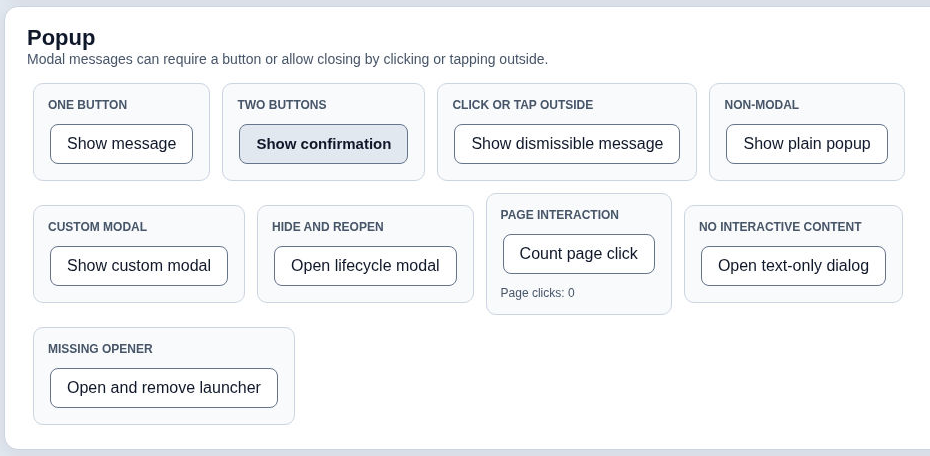

<a id="shot-message-popup"></a>

**Open message and action buttons**

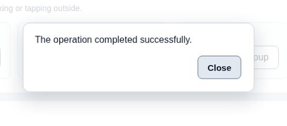

<a id="shot-popup"></a>

**Open nonmodal window**

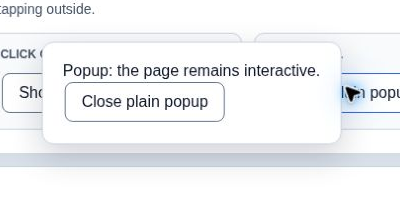

<a id="shot-modal-popup"></a>

**Open modal window and backdrop**

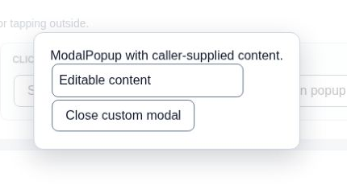

<a id="shot-modal-lifecycle-desktop-open"></a>

**Modal before hiding on a wide screen**

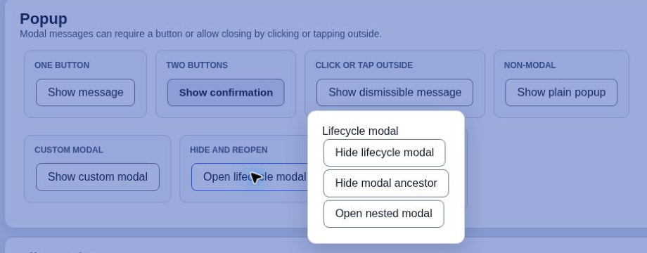

<a id="shot-modal-lifecycle-desktop-restored"></a>

**Modal after showing it again on a wide screen**

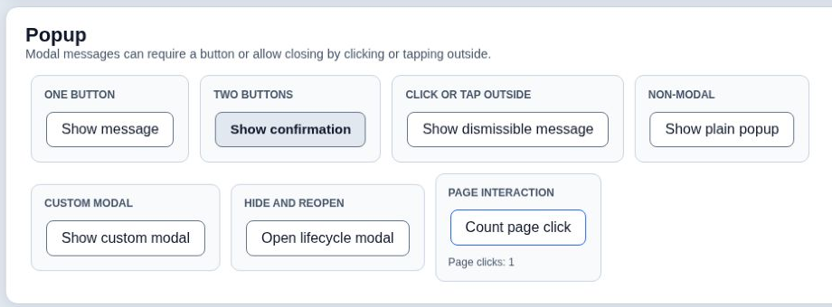

<a id="shot-modal-lifecycle-mobile-open"></a>

**Modal before hiding on a narrow screen**

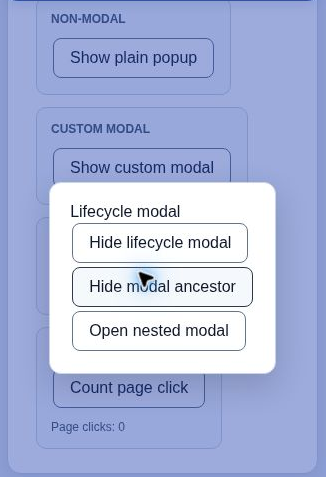

<a id="shot-modal-lifecycle-mobile-restored"></a>

**Modal restored on a narrow screen**

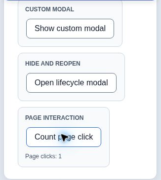

<a id="shot-modal-focus-desktop"></a>

**Keyboard focus inside the open modal**

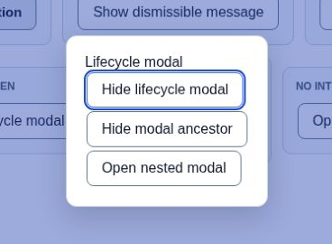

<a id="shot-modal-nested-desktop"></a>

**Nested modal on a wide screen**

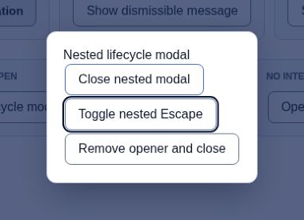

<a id="shot-modal-empty-mobile"></a>

**Empty modal on a narrow screen**

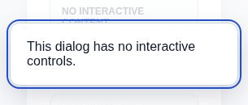

<a id="shot-modal-nested-mobile"></a>

**Nested modal on a narrow screen**

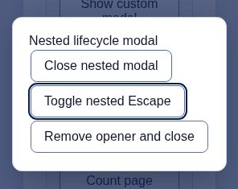

<a id="shot-message-popup-narrow"></a>

**Open message on a narrow screen**

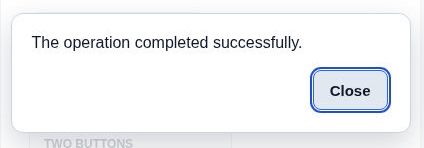

<a id="shot-dialog-confirm"></a>

**Open confirmation dialog with its actions**

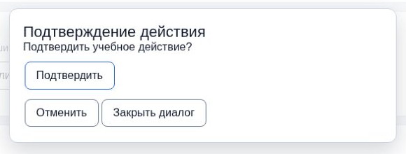

<a id="shot-dialog-error"></a>

**Dialog showing an asynchronous action error**

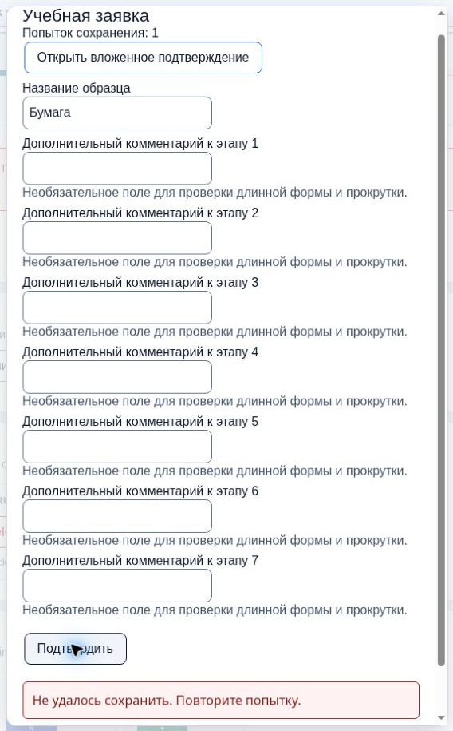

<a id="shot-dialog-mobile"></a>

**Long dialog form in a narrow viewport**

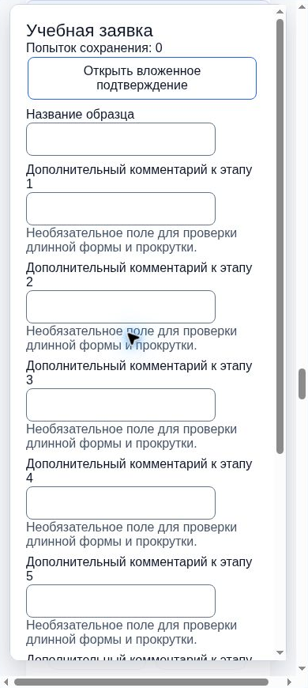

<a id="shot-anchored-menu"></a>

**Open menu with keyboard focus**

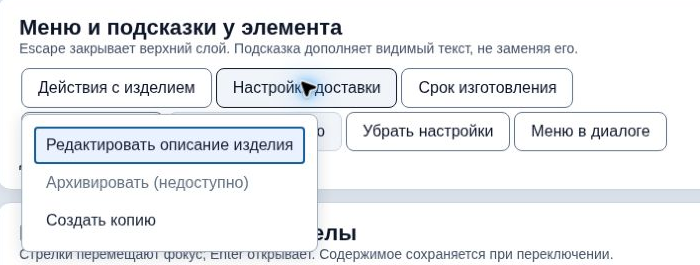

<a id="shot-anchored-popover"></a>

**Open panel with an editor and buttons**

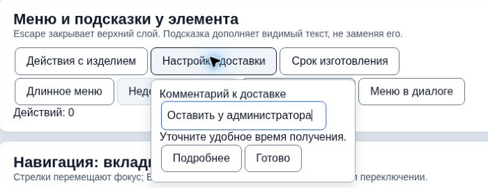

<a id="shot-anchored-tooltip"></a>

**Hint shown for the focused anchor**

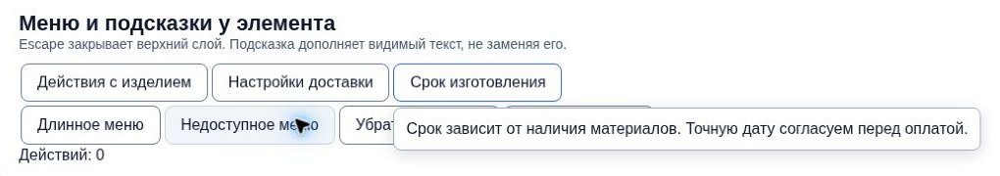

<a id="shot-anchored-popover-flipped"></a>

**Panel opens on the other side of its anchor**

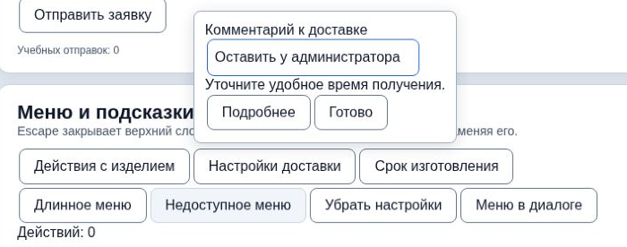

<a id="shot-anchored-menu-mobile"></a>

**Long menu on a 320-pixel screen**

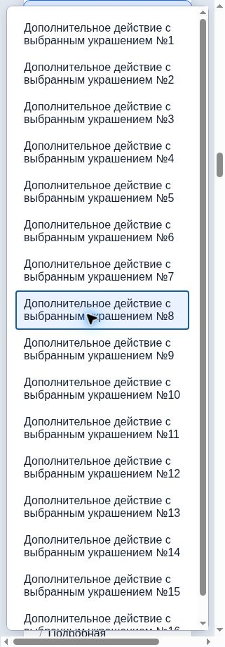
