# Show text, images and actions

[Widget catalog](../../WIDGETS.md) · [Русский](../../ru/widgets/display.md)

Use TextWidget for a single piece of live text, Markdown for formatted blocks, Link for a destination and Button for a command.

[Markdown](../../MARKDOWN.md) · [Countdown](../../COUNTDOWN.md)

[TextWidget](#textwidget) · [Markdown](#markdown) · [HorizontalLine](#horizontalline) · [ImageWidget](#imagewidget) · [ActiveImage](#activeimage) · [Carousel](#carousel) · [ZoomDecorator](#zoomdecorator) · [Countdown](#countdown) · [Button](#button) · [ActiveText](#activetext) · [Link](#link)

## TextWidget

Show a price, a heading or a status as plain text. Bind a `Model<String>` with `setTextModel` to refresh it when the value changes. Use `setHeadingLevel` for a heading that screen readers can navigate.

```java
var title = new TextWidget("Observing log");
title.setHeadingLevel(HeadingLevel.H1);
```

[Text sizes, weights and colors](#shot-text-widget) · [Java](../../../src/main/java/com/kniazkov/widgets/view/TextWidget.java)

## Markdown

Render a block of formatted instructions from a string or a `Model<String>`. Use the supported Markdown subset for headings, lists and emphasis. Raw HTML is displayed as text.

```java
var help = new Markdown("## Setup\n\n- Open the planner\n- Choose a target");
```

[Formatted Markdown inside the page](#shot-markdown) · [Java](../../../src/main/java/com/kniazkov/widgets/view/Markdown.java)

## HorizontalLine

Separate two page sections with a horizontal rule. Height and color are reactive style properties. Add the rule directly to a block container.

```java
var rule = new HorizontalLine();
rule.setHeight(2);
root.add(rule);
```

[Separators with different widths and colors](#shot-horizontal-line) · [Java](../../../src/main/java/com/kniazkov/widgets/view/HorizontalLine.java)

## ImageWidget

Show a photo from a URL or an `ImageSource`. Replace the source model to follow a selection. Set alternative text for informative images and cap the width to fit a narrow screen.

```java
var photo = new ImageWidget("/moon.jpg");
photo.setAlternativeText("Moon with dark lava plains");
photo.setMaxWidth("100%");
```

[Images with different sizes and styles](#shot-image-widget) · [Java](../../../src/main/java/com/kniazkov/widgets/view/ImageWidget.java)

## ActiveImage

Give an image different sources for normal, hover and pressed states. Use its pointer handlers for mouse interaction. For a keyboard-operable icon action, wrap an image with `Button.icon` and give the button a name.

```java
var preview = new ActiveImage("/moon.jpg");
preview.setSource(State.HOVERED, ImageSource.fromHyperlink("/moon-detail.jpg"));
```

[Interactive image variants](#shot-active-image) · [Java](../../../src/main/java/com/kniazkov/widgets/view/ActiveImage.java)

## Carousel

Let readers swipe through a fixed, nonempty sequence of images. Each slide can use a source model. The selected index and selection callback track slide changes; swiping stops at the ends.

```java
var photos = new Carousel("/moon.jpg", "/mars.jpg");
photos.setSelectedIndex(1);
```

[First carousel slide](#shot-carousel) · [Java](../../../src/main/java/com/kniazkov/widgets/view/Carousel.java)

## ZoomDecorator

Allow wheel or pinch zoom and panning of one inline child inside a clipped viewport. Set the maximum scale, and call `resetZoom()` to restore the original view.

```java
var zoom = new ZoomDecorator(new ImageWidget("/moon.jpg"));
zoom.setMaxScale(4);
```

[Image inside a zoomable viewport](#shot-zoom-decorator) · [Java](../../../src/main/java/com/kniazkov/widgets/view/ZoomDecorator.java)

## Countdown

Display time remaining until a server-side `Instant`. The browser updates the digits and stops at zero. Use `setDeadline` to change the deadline; enforce any expiry action in application code.

```java
var timer = new Countdown(Instant.now().plusSeconds(300));
root.add(new Section(timer));
```

[Remaining time on the countdown](#shot-countdown) · [Java](../../../src/main/java/com/kniazkov/widgets/view/Countdown.java)

## Button

Run a Java handler on activation by pointer or keyboard. The button decorates one inline child and has a reactive disabled flag. For an icon-only button, supply an accessible name.

```java
var save = new Button("Save");
save.onClick(event -> save.disable());
```

[Standard and custom action buttons](#shot-button) · [Java](../../../src/main/java/com/kniazkov/widgets/view/Button.java)

## ActiveText

Style a short piece of text on hover or press. The text model supplies the caption and pointer events can change it. For navigation use a Link; for keyboard activation use a Button.

```java
var hint = new ActiveText("Show hint");
hint.onClick(event -> hint.setText("Use the arrow keys"));
```

[Interactive text variants](#shot-active-text) · [Java](../../../src/main/java/com/kniazkov/widgets/view/ActiveText.java)

## Link

Navigate to a URL with a native hyperlink. Its string href model controls the destination. Set a real path so opening in a new tab and copying the link both work.

```java
var link = new Link("Open log", "/log");
root.add(new Section(link));
```

[Links with different captions and styles](#shot-link) · [Java](../../../src/main/java/com/kniazkov/widgets/view/Link.java)

## AllWidgets screenshots

<a id="shot-horizontal-line"></a>

**Separators with different widths and colors**

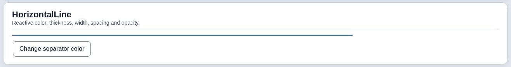

<a id="shot-text-widget"></a>

**Text sizes, weights and colors**

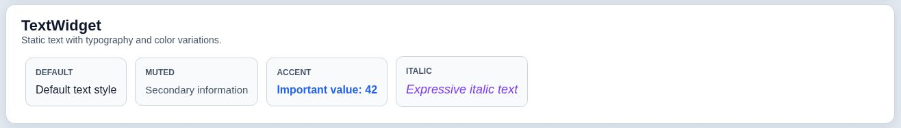

<a id="shot-markdown"></a>

**Formatted Markdown inside the page**

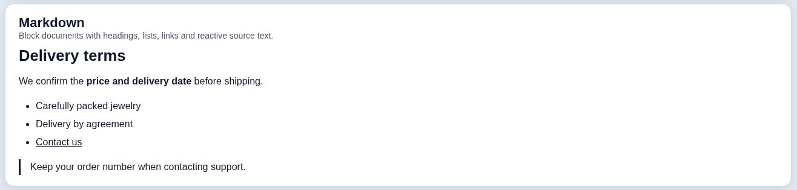

<a id="shot-active-text"></a>

**Interactive text variants**

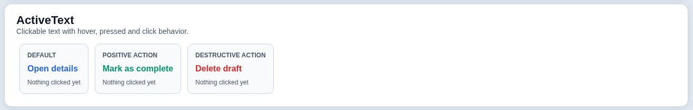

<a id="shot-link"></a>

**Links with different captions and styles**

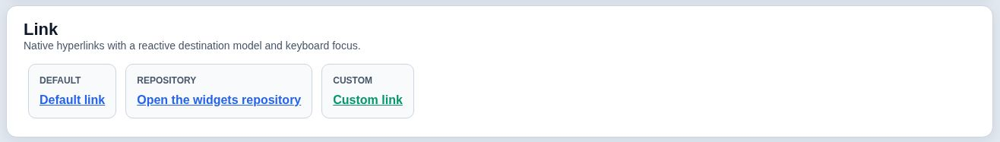

<a id="shot-button"></a>

**Standard and custom action buttons**

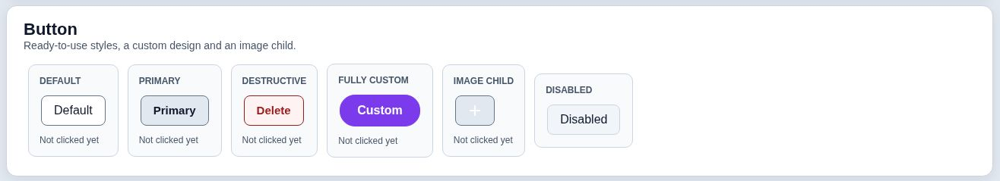

<a id="shot-image-widget"></a>

**Images with different sizes and styles**

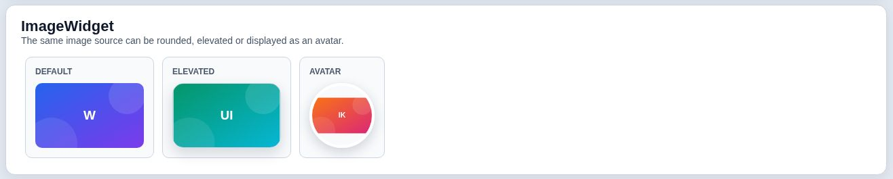

<a id="shot-active-image"></a>

**Interactive image variants**

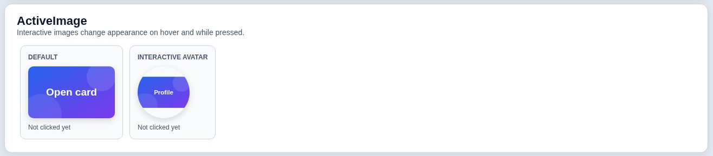

<a id="shot-zoom-decorator"></a>

**Image inside a zoomable viewport**

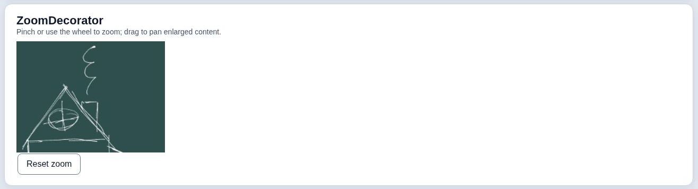

<a id="shot-countdown"></a>

**Remaining time on the countdown**

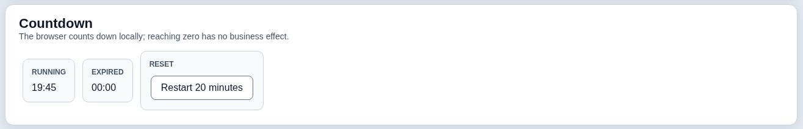

<a id="shot-carousel"></a>

**First carousel slide**

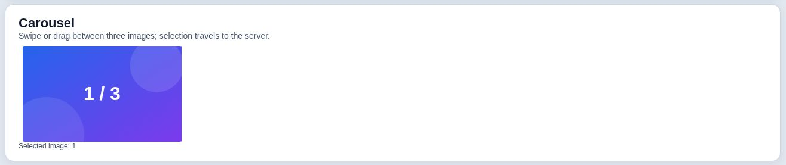

<a id="shot-carousel-selected"></a>

**Second carousel slide selected**

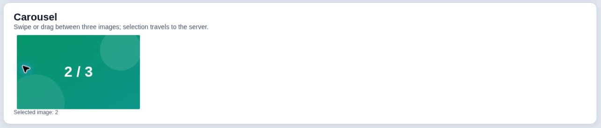

<a id="shot-semantics-desktop"></a>

**Named buttons, images and labeled editor**

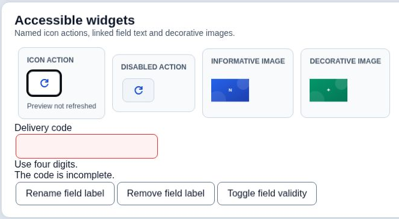

<a id="shot-semantics-icon-mobile"></a>

**Icon button in the narrow layout**

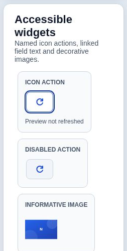
