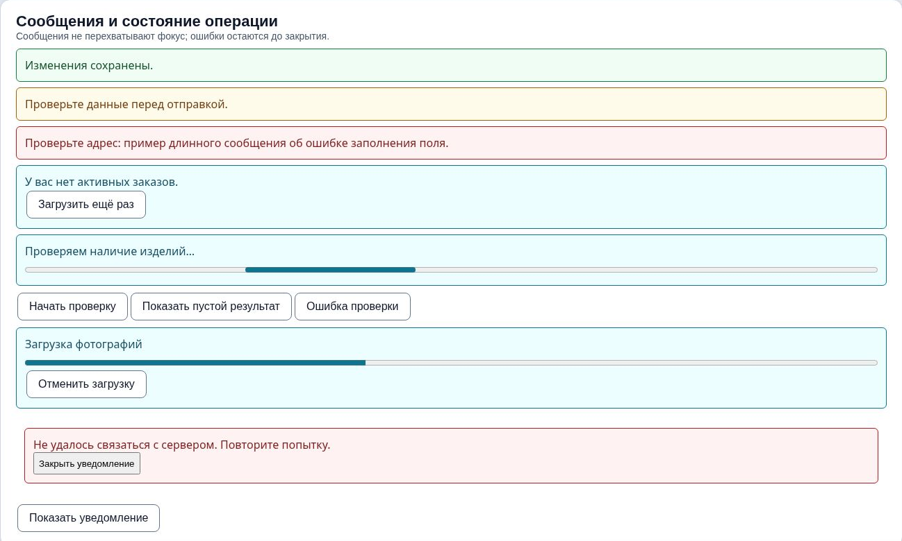
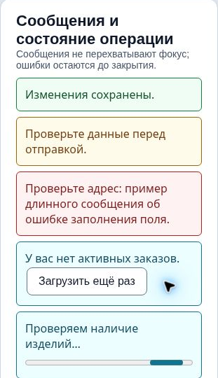
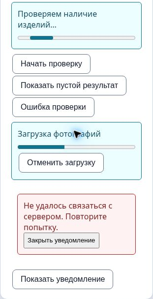

# Report progress, errors and outcomes

[Widget catalog](../../WIDGETS.md) · [Русский](../../ru/widgets/feedback.md)

Keep FieldError beside the editor it describes. Use an Alert for a persistent page message and a Toast for a short notification.

[Alert](#alert) · [FieldError](#fielderror) · [EmptyState](#emptystate) · [Progress](#progress) · [Busy](#busy) · [Toast](#toast)

## Alert

Keep a status or warning visible on the page. Update its text and severity when the outcome changes. Empty text hides the message itself; the reader can keep focus on the current control.

```java
var notice = new Alert("Observation saved");
notice.setSeverity(Feedback.Severity.SUCCESS);
```

[Messages, empty state, progress and notifications](#shot-feedback-desktop) · [Java](../../../src/main/java/com/kniazkov/widgets/view/Alert.java)

## FieldError

Explain an individual validation failure. Associate the error with its editor and update its text as the model changes. Empty text hides the message; FormField can manage its own error for a submitted form.

```java
var input = new InputField();
var error = new FieldError("Enter a target");
input.setAccessibleError(error);
root.add(new Section(input));
root.add(error);
```

[Messages, empty state, progress and notifications](#shot-feedback-desktop) · [Java](../../../src/main/java/com/kniazkov/widgets/view/FieldError.java)

## EmptyState

Explain why a result area is empty and optionally offer an action. The application updates the message with `setText` and supplies the button handler for retrying or clearing a filter.

```java
var empty = new EmptyState("No observations yet");
empty.add(new Section(new Link("Start an observation", "/log")));
```

[Messages, empty state, progress and notifications](#shot-feedback-desktop) · [Java](../../../src/main/java/com/kniazkov/widgets/view/EmptyState.java)

## Progress

Report the progress of one operation in percent. Update it on the page thread and call `finish` with the outcome. An optional cancel handler must ask the underlying work to stop.

```java
var progress = new Progress("Processing photos");
progress.setPercentage(40);
```

[Messages, empty state, progress and notifications](#shot-feedback-desktop) · [Java](../../../src/main/java/com/kniazkov/widgets/view/Progress.java)

## Busy

Show that work is running when its completion percentage is unknown. The application calls `finish` on completion. A finished indicator belongs to that operation; create another for the next one.

```java
var busy = new Busy("Looking up the target");
root.add(busy);
```

[Messages, empty state, progress and notifications](#shot-feedback-desktop) · [Java](../../../src/main/java/com/kniazkov/widgets/view/Busy.java)

## Toast

Queue short, dismissible notifications without moving focus. `offer` returns false when the queue is full. Success messages can expire; errors remain until dismissed.

```java
var toasts = new Toast(3, "Dismiss");
root.add(toasts);
toasts.offer("Saved", Feedback.Severity.SUCCESS, 3000);
```

[Messages, empty state, progress and notifications](#shot-feedback-desktop) · [Java](../../../src/main/java/com/kniazkov/widgets/view/Toast.java)

## AllWidgets screenshots

<a id="shot-feedback-desktop"></a>

**Messages, empty state, progress and notifications**



<a id="shot-feedback-mobile-messages"></a>

**Status and error messages in a narrow window**



<a id="shot-feedback-mobile-operation"></a>

**Operation and notification in a narrow window**


