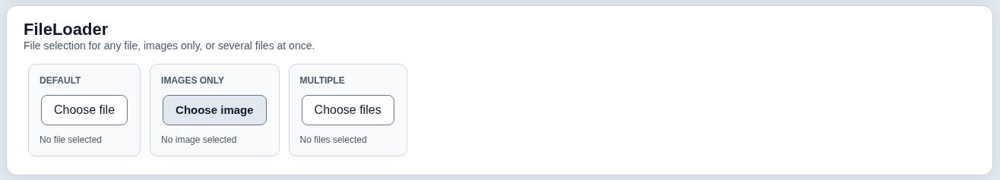
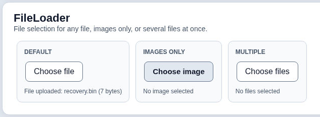
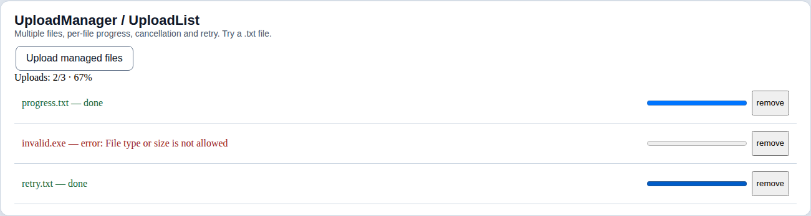
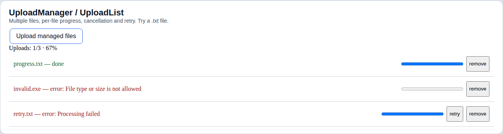
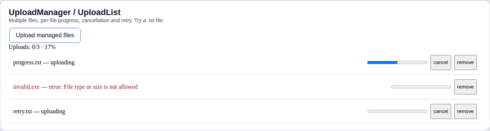
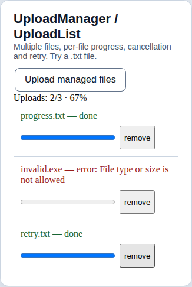
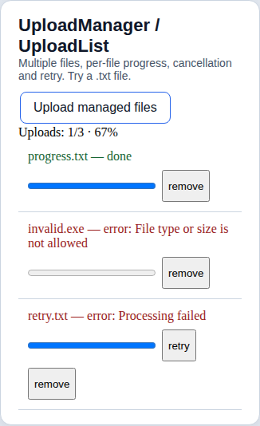
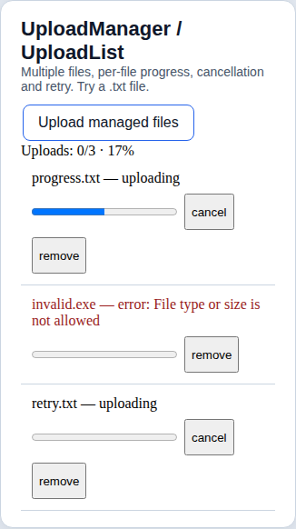

# Select and upload files

[Widget catalog](../../WIDGETS.md) · [Русский](../../ru/widgets/files.md)

FileLoader exposes each transfer to your handler. UploadManager and UploadList provide progress, cancellation and retry controls together.

[FileLoader](#fileloader) · [UploadManager](#uploadmanager) · [UploadList](#uploadlist)

## FileLoader

Open a file picker and handle each selected transfer with `onSelect`. The file exposes a percentage model and calls `onLoad` when its bytes are available. The accept filter guides the picker; validate the file in application code.

```java
var picker = new FileLoader("Choose a photo");
picker.acceptImagesOnly();
picker.onSelect(file -> file.onLoad(done -> System.out.println(done.getSize())));
```

[File selection buttons](#shot-file-loader) · [Java](../../../src/main/java/com/kniazkov/widgets/view/FileLoader.java)

## UploadManager

Manage several transfers with cancellation, retry and an application processor. The limits bound file count and bytes per file. A retry reuses the operation key; use that key for idempotent writes. Copy temporary content during the processor callback if it must outlive it.

```java
var list = new UploadList();
var uploads = new UploadManager("Add files", list, 4, 1024 * 1024,
    (key, file) -> System.out.println(key + " " + file.getSize()));
root.add(new Section(uploads));
root.add(list);
```

[Completed transfer in the upload list](#shot-upload-desktop-done) · [Java](../../../src/main/java/com/kniazkov/widgets/view/UploadManager.java)

## UploadList

Show per-file progress, errors and available actions for an UploadManager. The manager supplies the row state and handles cancel/retry commands. Mount the same list instance that you pass to the manager.

```java
var transfers = new UploadList();
var picker = new UploadManager("Upload", transfers, 2, 4096,
    (key, file) -> System.out.println(file.getSize()));
root.add(new Section(picker));
root.add(transfers);
```

[Completed transfer in the upload list](#shot-upload-desktop-done) · [Java](../../../src/main/java/com/kniazkov/widgets/view/UploadList.java)

## AllWidgets screenshots

<a id="shot-file-loader"></a>

**File selection buttons**



<a id="shot-file-loader-upload-complete"></a>

**File selection after the transfer completes**



<a id="shot-upload-desktop-done"></a>

**Completed transfer in the upload list**



<a id="shot-upload-desktop-error"></a>

**Failed transfer with retry controls**



<a id="shot-upload-desktop-progress"></a>

**File and overall progress during transfer**



<a id="shot-upload-mobile-done"></a>

**Completed transfer on a narrow screen**



<a id="shot-upload-mobile-error"></a>

**Retryable transfer error on a narrow screen**



<a id="shot-upload-mobile-progress"></a>

**Active transfer on a narrow screen**


