# Enter text and submit a form

[Widget catalog](../../WIDGETS.md) · [Русский](../../ru/widgets/forms.md)

Start with InputField for a single line. Add a FormField for a label, help and errors, then a Form when several values must be submitted together.

[Form tutorial](../form-models.md)

[InputField](#inputfield) · [PasswordInput](#passwordinput) · [TextArea](#textarea) · [SuggestionField](#suggestionfield) · [Label](#label) · [FormField](#formfield) · [Form](#form)

## InputField

Edit one line of text. `setTextModel` binds both text and validity, and `onEnter` handles an explicit action. An input-mode hint changes the mobile keyboard; validation belongs in the model.

```java
var input = new InputField();
input.setTextModel(new StringModel("Moon"));
```

[Single-line text editors](#shot-input-field) · [Java](../../../src/main/java/com/kniazkov/widgets/view/InputField.java)

## PasswordInput

Mask a single-line entry while typing. It has the same text binding and Enter handler as InputField. The Java model still contains the entered string.

```java
var password = new PasswordInput();
password.setAccessibleName("Password");
```

[Masked password entries](#shot-password-input) · [Java](../../../src/main/java/com/kniazkov/widgets/view/PasswordInput.java)

## TextArea

Edit a multiline note with a string model. Enter inserts a line break, so use a separate button to submit the note.

```java
var note = new TextArea();
note.setTextModel(new StringModel("First observation"));
```

[Multiline text entry](#shot-text-area) · [Java](../../../src/main/java/com/kniazkov/widgets/view/TextArea.java)

## SuggestionField

Offer completions while keeping the text freely editable. Suggestions have their own string models. Arrow keys and Enter select a match; a new value can remain in the text model.

```java
var target = new SuggestionField("Moon", "Mars", "Venus");
target.setPlaceholder("Find or type a target");
```

[Text editor with suggestions](#shot-suggestion-field) · [Java](../../../src/main/java/com/kniazkov/widgets/view/SuggestionField.java)

## Label

Provide a visible caption for an input. `setTarget` links it to the editor so clicking the label focuses the input. The caption inherits the text model from TextWidget.

```java
var input = new InputField();
var label = new Label("Target");
label.setTarget(input);
root.add(new Section(label, input));
```

[Labeled fields, help and submit button](#shot-form-desktop) · [Java](../../../src/main/java/com/kniazkov/widgets/view/Label.java)

## FormField

Group a label, an InputField-compatible editor, help and a field error. Its stable name is the key in submitted values. Bind the editor’s text model and set constraints on the wrapper.

```java
var target = new FormField("target", "Target");
target.setRequired(true);
target.setHelp("Use the object's common name.");
```

[Labeled fields, help and submit button](#shot-form-desktop) · [Java](../../../src/main/java/com/kniazkov/widgets/view/FormField.java)

## Form

Submit several named fields together. Add fields with `addField`; the validator and `onSubmit` receive a snapshot. Return a completion stage from the submit handler so the page stays responsive.

```java
var form = new Form("Observation", "Save");
form.addField(new FormField("target", "Target"));
form.onSubmit(values -> CompletableFuture.completedFuture(Form.Result.success()));
root.add(form);
```

[Labeled fields, help and submit button](#shot-form-desktop) · [Java](../../../src/main/java/com/kniazkov/widgets/view/Form.java)

## AllWidgets screenshots

<a id="shot-input-field"></a>

**Single-line text editors**

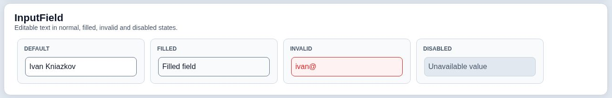

<a id="shot-numeric-hints"></a>

**Input fields with numeric keyboard hints**

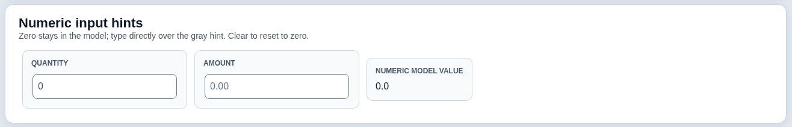

<a id="shot-suggestion-field"></a>

**Text editor with suggestions**

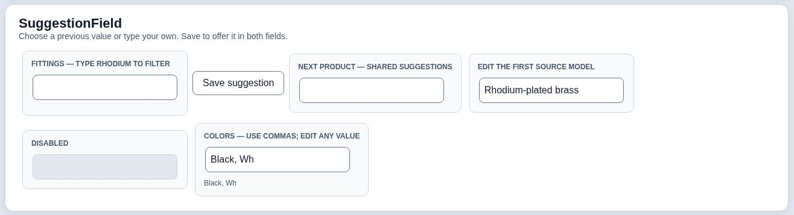

<a id="shot-password-input"></a>

**Masked password entries**

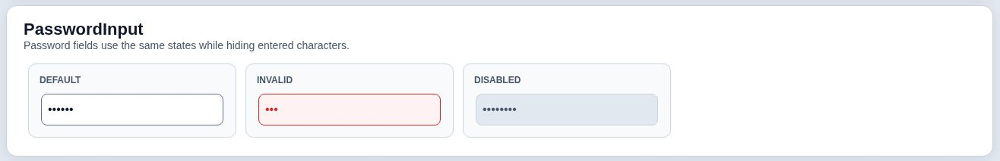

<a id="shot-text-area"></a>

**Multiline text entry**

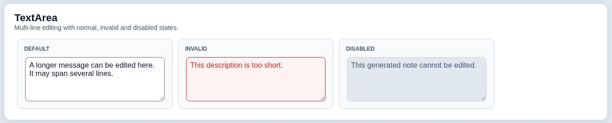

<a id="shot-suggestion-open"></a>

**Suggestion list open below the editor**

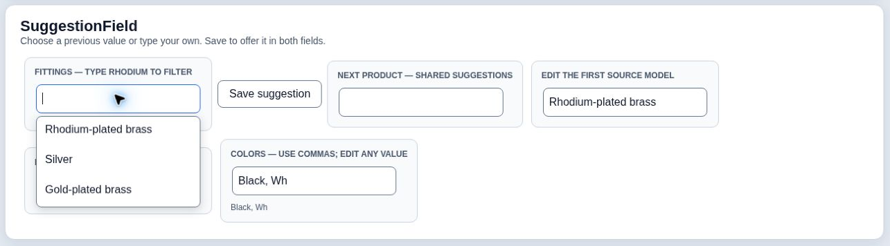

<a id="shot-semantics-field-updated"></a>

**Editor with an updated label or description**

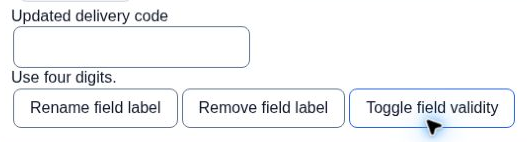

<a id="shot-semantics-field-mobile"></a>

**Labeled editor in the narrow layout**

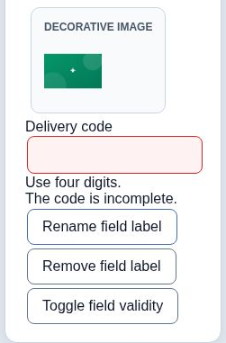

<a id="shot-keyboard-demo-desktop"></a>

**Submitting the sample login form with Enter**

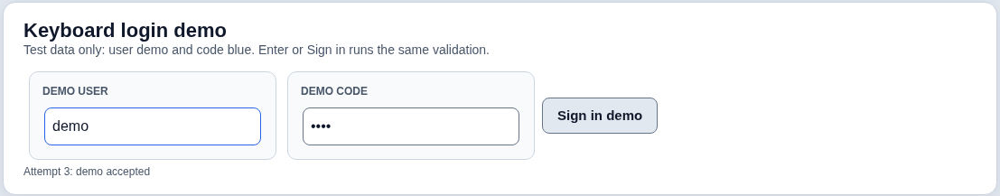

<a id="shot-keyboard-demo-narrow"></a>

**Login fields and submit button in a narrow window**

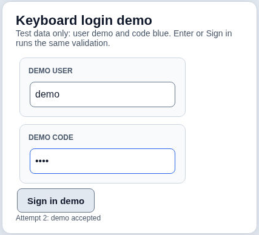

<a id="shot-form-desktop"></a>

**Labeled fields, help and submit button**

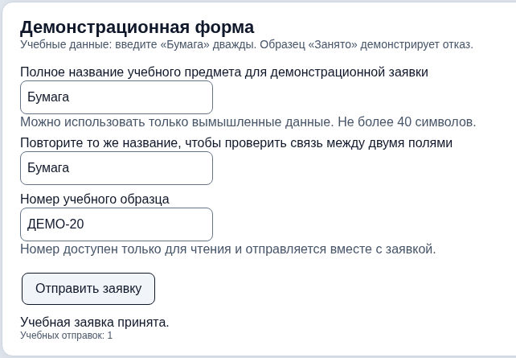

<a id="shot-form-narrow-error"></a>

**Validation message on a narrow form**

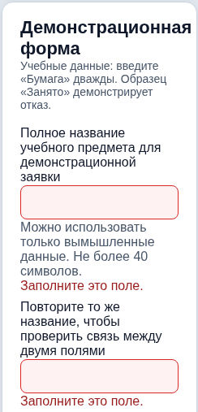

<a id="shot-form-mobile-busy"></a>

**Form while submission is in progress**

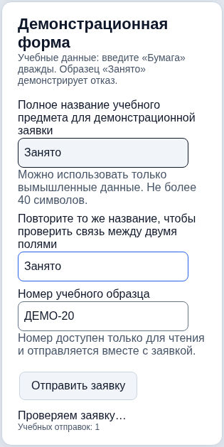
