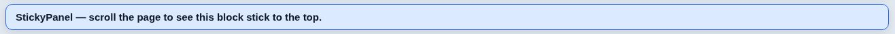
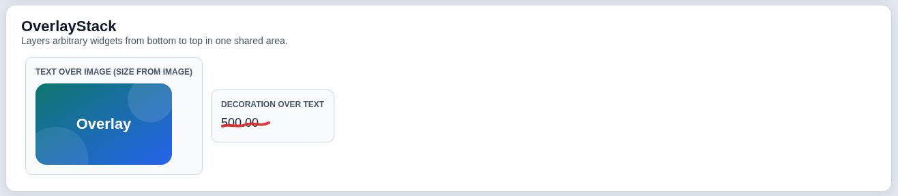
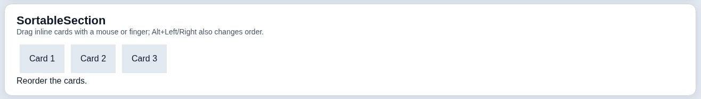
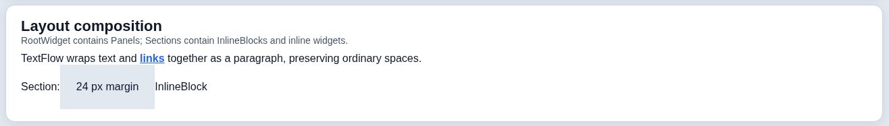
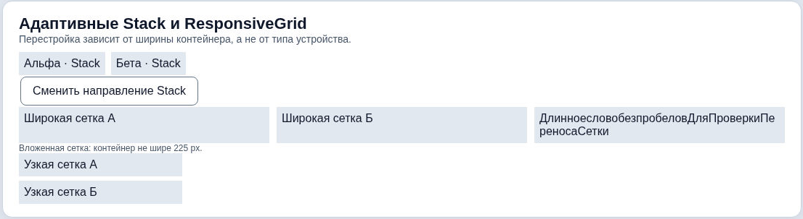
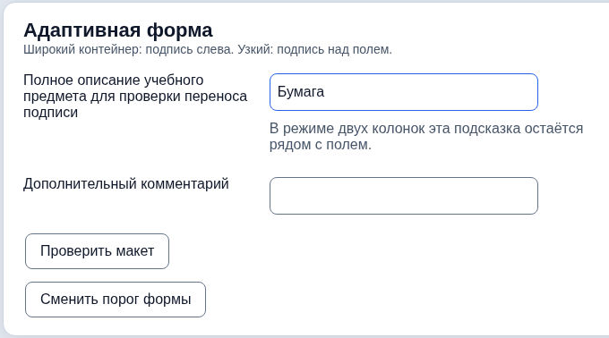
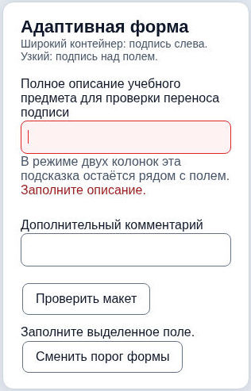
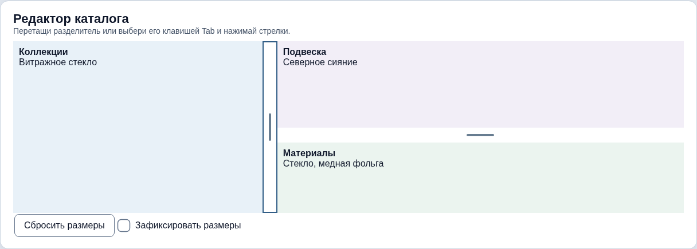
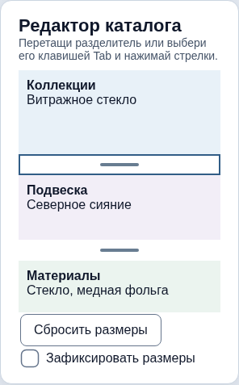

# Arrange blocks and inline content

[Widget catalog](../../WIDGETS.md) · [Русский](../../ru/widgets/layout.md)

Use Section for a row of inline widgets, Panel for a group of blocks and ResponsiveGrid for columns that adapt to the available width.

[Card tutorial](../page-composition.md)

[RootWidget](#rootwidget) · [Panel](#panel) · [Section](#section) · [TextFlow](#textflow) · [Stack](#stack) · [ResponsiveGrid](#responsivegrid) · [FormLayout](#formlayout) · [StickyPanel](#stickypanel) · [InlineBlock](#inlineblock) · [NoWrap](#nowrap) · [MarginDecorator](#margindecorator) · [SortableSection](#sortablesection) · [OverlayStack](#overlaystack) · [SplitPane](#splitpane)

## RootWidget

Start from the root passed to the page factory. It owns top-level blocks, the document title model and page-level actions such as navigation. Add block children here; wrap inline children in a Section.

```java
root.setTitle("Observing log");
root.add(new Section(new TextWidget("Tonight")));
```

[Top of the AllWidgets page](#shot-root-widget) · [Java](../../../src/main/java/com/kniazkov/widgets/view/RootWidget.java)

## Panel

Group blocks into a card or page region. Padding, background, border and size are reactive; panels can also receive pointer events. Use Section inside a panel for inline content.

```java
var card = new Panel(new Section(new TextWidget("Moon")));
card.setPadding(16);
```

[Nested block and inline containers](#shot-layout-composition) · [Java](../../../src/main/java/com/kniazkov/widgets/view/Panel.java)

## Section

Arrange inline children in one block with alignment and spacing. A Section can host buttons, text and inputs. Use a Panel when the children are blocks.

```java
var actions = new Section(new Button("Apply"), new Button("Cancel"));
actions.setCenterAlignment();
```

[Nested block and inline containers](#shot-layout-composition) · [Java](../../../src/main/java/com/kniazkov/widgets/view/Section.java)

## TextFlow

Set a paragraph containing several text widgets and links. Children flow on the same baseline and wrap across lines; add spaces explicitly between text fragments. Child text models remain independent.

```java
var line = new TextFlow();
line.add(new TextWidget("Read the "));
line.add(new Link("observing log", "/log"));
```

[Nested block and inline containers](#shot-layout-composition) · [Java](../../../src/main/java/com/kniazkov/widgets/view/TextFlow.java)

## Stack

Arrange blocks on one axis and set a gap and cross-axis alignment. A horizontal stack wraps by default; turn wrapping off only if the content will fit.

```java
var tools = new Stack(Stack.Direction.HORIZONTAL);
tools.setGap(12);
tools.add(new Section(new Button("Apply")));
```

[Stack and responsive grid in a wide container](#shot-adaptive-layouts-wide) · [Java](../../../src/main/java/com/kniazkov/widgets/view/Stack.java)

## ResponsiveGrid

Let container width determine how many blocks fit side by side. Set a preferred minimum column width and a gap. A maximum of zero distributes remaining space among the columns.

```java
var cards = new ResponsiveGrid();
cards.setColumnWidths(240, 0);
cards.setGap(12);
cards.add(new Panel(new Section(new TextWidget("Moon"))));
```

[Stack and responsive grid in a wide container](#shot-adaptive-layouts-wide) · [Java](../../../src/main/java/com/kniazkov/widgets/view/ResponsiveGrid.java)

## FormLayout

Align labels beside editors when space permits and stack them in a narrow container. Set the breakpoint in CSS pixels. Give an empty layout to Form and register the fields through the form.

```java
var layout = new FormLayout();
layout.setBreakpoint(480);
var form = new Form("Planner", "Save", layout);
form.addField(new FormField("target", "Target"));
```

[Form labels beside the editors](#shot-adaptive-form-wide) · [Java](../../../src/main/java/com/kniazkov/widgets/view/FormLayout.java)

## StickyPanel

Keep a block such as a toolbar at the top or bottom edge as the reader scrolls. The sticky side is reactive. The panel occupies its normal place in the page before reaching that edge.

```java
var toolbar = new StickyPanel(new Section(new Button("Save")));
root.add(toolbar);
```

[Toolbar that stays at the viewport edge](#shot-sticky-panel) · [Java](../../../src/main/java/com/kniazkov/widgets/view/StickyPanel.java)

## InlineBlock

Put a group of block children inside an inline row. It can have its own reactive dimensions, background and padding. Its parent sees one inline child.

```java
var badge = new InlineBlock(new Section(new TextWidget("New")));
root.add(new Section(badge));
```

[Nested block and inline containers](#shot-layout-composition) · [Java](../../../src/main/java/com/kniazkov/widgets/view/InlineBlock.java)

## NoWrap

Keep inline fragments together, for example a value and its unit. Each fragment keeps its own model. An unbreakable group can overflow a narrow container, so keep groups short.

```java
var distance = new NoWrap(new TextWidget("42"), new TextWidget(" km"));
```

[Inline content kept together](#shot-no-wrap) · [Java](../../../src/main/java/com/kniazkov/widgets/view/NoWrap.java)

## MarginDecorator

Add outer spacing to one inline widget through the decorator’s margin properties. Replace its single child with `put`; the wrapped widget keeps its own event handlers.

```java
var padded = new MarginDecorator(new TextWidget("km"));
padded.setLeftMargin(4);
```

[Nested block and inline containers](#shot-layout-composition) · [Java](../../../src/main/java/com/kniazkov/widgets/view/MarginDecorator.java)

## SortableSection

Let people reorder inline children by dragging or with Alt and the arrow keys. `onReorder` receives the new order. Keep stable application IDs if the order will be saved.

```java
var order = new SortableSection(new TextWidget("Moon"), new TextWidget("Mars"));
order.move(1, 0);
```

[Inline items in a reorderable section](#shot-sortable-section) · [Java](../../../src/main/java/com/kniazkov/widgets/view/SortableSection.java)

## OverlayStack

Layer a label or marker over an image in insertion order. Bind the fit-to-first-child flag when the first layer should size the stack. Other layers then overlay that footprint.

```java
var layers = new OverlayStack(new ImageWidget("/moon.jpg"), new TextWidget("North"));
layers.setFitToFirstChild(true);
```

[Image and marker in overlaid layers](#shot-overlay-stack) · [Java](../../../src/main/java/com/kniazkov/widgets/view/OverlayStack.java)

## SplitPane

Let the user resize two blocks with a pointer or the keyboard. The integer position model keeps the percentage within configured bounds. Provide an accessible name for the divider and exactly two panes. After a drag, read the committed split from `getPositionModel()`.

```java
var split = new SplitPane(SplitPane.Axis.HORIZONTAL, "List width", 20, 80,
    new IntegerModel(40), new Panel(), new Panel());
```

[List and details separated by a draggable divider](#shot-split-desktop) · [Java](../../../src/main/java/com/kniazkov/widgets/view/SplitPane.java)

## AllWidgets screenshots

<a id="shot-root-widget"></a>

**Top of the AllWidgets page**


<a id="shot-sticky-panel"></a>

**Toolbar that stays at the viewport edge**



<a id="shot-no-wrap"></a>

**Inline content kept together**


<a id="shot-overlay-stack"></a>

**Image and marker in overlaid layers**



<a id="shot-sortable-section"></a>

**Inline items in a reorderable section**



<a id="shot-layout-composition"></a>

**Nested block and inline containers**



<a id="shot-adaptive-layouts-wide"></a>

**Stack and responsive grid in a wide container**



<a id="shot-adaptive-form-wide"></a>

**Form labels beside the editors**



<a id="shot-adaptive-form-narrow"></a>

**Form labels above the editors**



<a id="shot-split-desktop"></a>

**List and details separated by a draggable divider**



<a id="shot-split-mobile"></a>

**Split view stacked in a narrow container**


