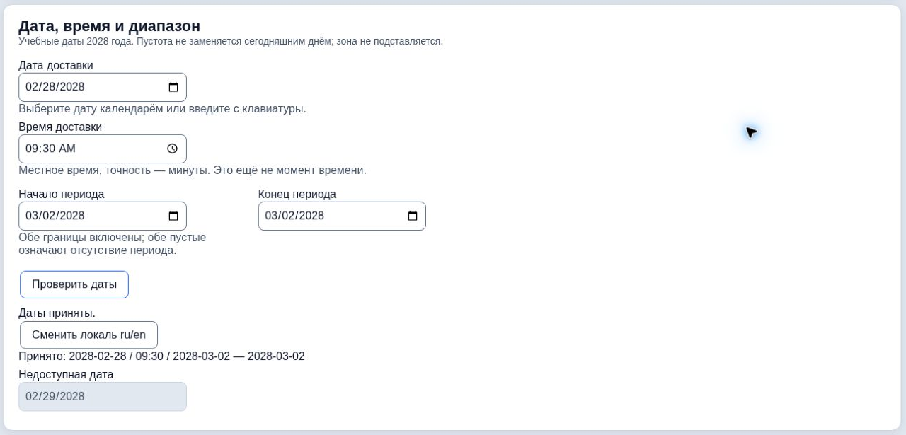
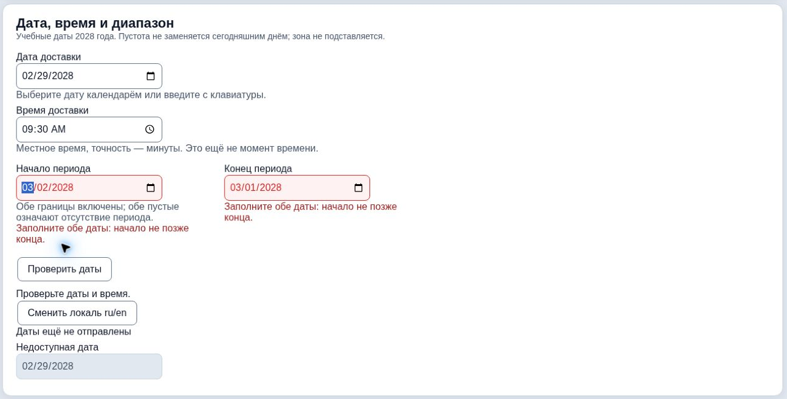
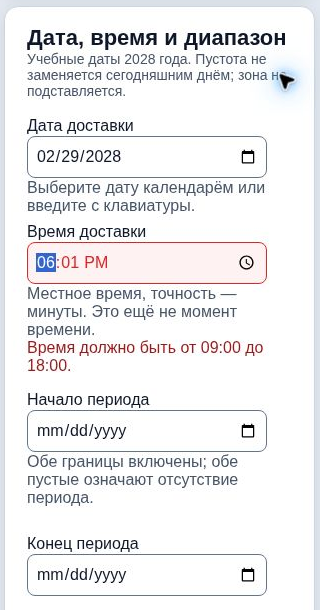
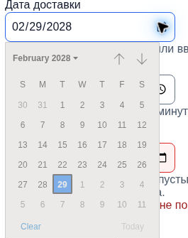
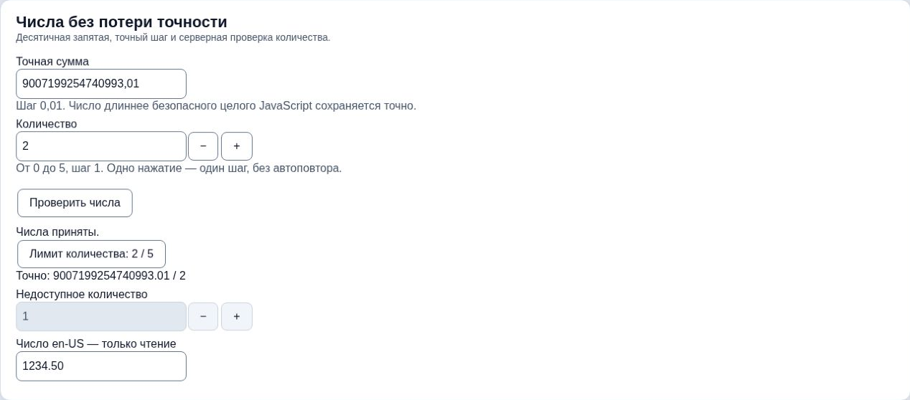
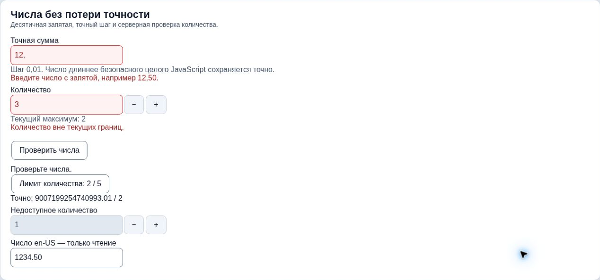
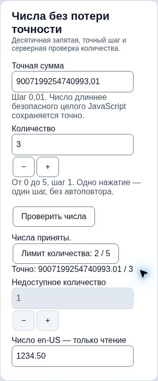
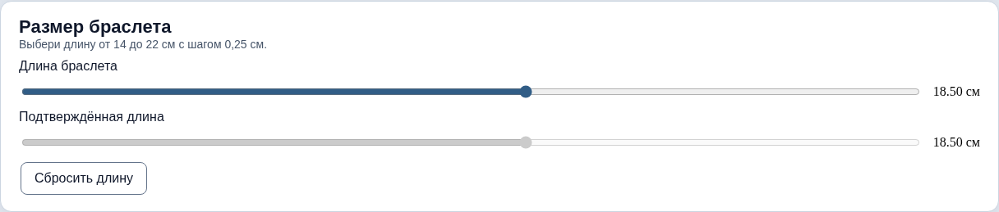
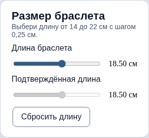

# Enter a number, date or time

[Widget catalog](../../WIDGETS.md) · [Русский](../../ru/widgets/numbers.md)

Choose NumberField for exact decimal input, QuantityField for step buttons or Slider to pick a position on a bounded scale.

[NumberField](#numberfield) · [QuantityField](#quantityfield) · [Slider](#slider) · [DateField](#datefield) · [TimeField](#timefield) · [DateRange](#daterange)

## NumberField

Enter an exact integer or decimal with the keyboard. NumberModel keeps the raw draft, conversion status and optional BigDecimal value. Configure the locale and bounds before interpreting a draft such as a lone minus sign. Read the converted value with `getValueModel().value()`.

```java
var price = new NumberField(NumberModel.decimals());
price.setLocale(Locale.US);
price.setValue(new BigDecimal("12.50"));
```

[Exact number and quantity controls](#shot-numbers-desktop) · [Java](../../../src/main/java/com/kniazkov/widgets/view/NumberField.java)

## QuantityField

Offer decrement and increment buttons beside a numeric editor. Both use the same NumberModel and honor its step and limits. As a FormField it can be registered directly with a form.

```java
var form = new Form("Order", "Save");
form.addField(new QuantityField("quantity", "Quantity", NumberModel.integers()));
```

[Exact number and quantity controls](#shot-numbers-desktop) · [Java](../../../src/main/java/com/kniazkov/widgets/view/QuantityField.java)

## Slider

Pick a value from a bounded range by dragging or using the keyboard. SliderModel stores exact decimal steps. The interval must divide evenly by the step. Use NumberField when the user needs to type an exact value or edit an incomplete draft. During a drag the browser previews the value and updates the Java model on release.

```java
var scale = new SliderModel(BigDecimal.ZERO, BigDecimal.TEN, BigDecimal.ONE, BigDecimal.ONE);
var rating = new Slider(scale, "Rating", "points");
```

[Slider with its labeled value and unit](#shot-slider-desktop) · [Java](../../../src/main/java/com/kniazkov/widgets/view/Slider.java)

## DateField

Choose a calendar day. Its TemporalModel exposes a local date and validation state. Bounds are inclusive; a date has no time zone. Attach a label or use a FormField around the editor.

```java
var date = new DateField();
date.setValue(LocalDate.of(2027, 1, 1));
```

[Date, time and paired date editors](#shot-temporal-desktop) · [Java](../../../src/main/java/com/kniazkov/widgets/view/DateField.java)

## TimeField

Enter a local wall-clock time with minute precision. Read the optional LocalTime from the typed model. Choose a date and time zone in the application if you need an instant.

```java
var time = new TimeField();
time.setValue(LocalTime.of(19, 30));
```

[Date, time and paired date editors](#shot-temporal-desktop) · [Java](../../../src/main/java/com/kniazkov/widgets/view/TimeField.java)

## DateRange

Collect a start and end date. The range owns its two labeled editors and exposes the interval model. Register it with `addDateRange` to check the order of the endpoints during submission.

```java
var form = new Form("Observing season", "Apply");
form.addDateRange(new DateRange("season", "From", "Until"));
```

[Date, time and paired date editors](#shot-temporal-desktop) · [Java](../../../src/main/java/com/kniazkov/widgets/view/DateRange.java)

## AllWidgets screenshots

<a id="shot-temporal-desktop"></a>

**Date, time and paired date editors**



<a id="shot-temporal-error"></a>

**Validation error for a date range**



<a id="shot-temporal-mobile"></a>

**Date and time editors on a narrow screen**



<a id="shot-temporal-picker"></a>

**Native calendar opened from a date field**



<a id="shot-numbers-desktop"></a>

**Exact number and quantity controls**



<a id="shot-numbers-error"></a>

**Invalid numeric draft with a message**



<a id="shot-numbers-mobile"></a>

**Numeric fields and step buttons on a narrow screen**



<a id="shot-slider-desktop"></a>

**Slider with its labeled value and unit**



<a id="shot-slider-mobile"></a>

**Slider on a narrow screen**


