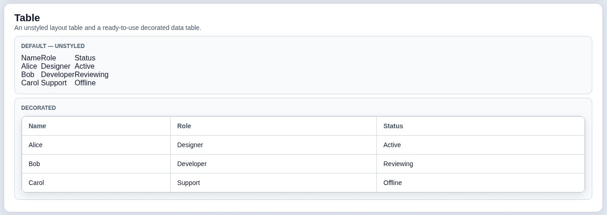
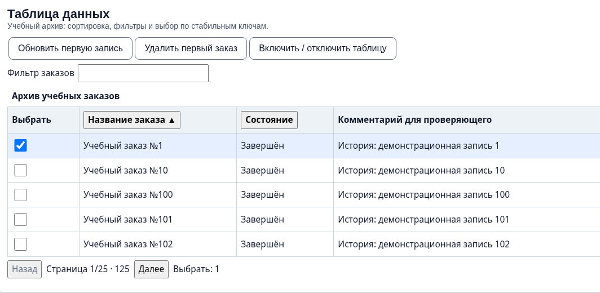
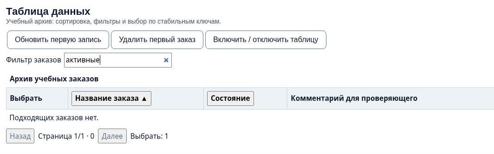
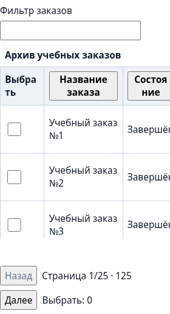

# Show a table or browse records

[Widget catalog](../../WIDGETS.md) · [Русский](../../ru/widgets/tables.md)

Choose Table when cells contain widgets. Choose DataTable when rows come from a provider and the reader needs to filter, sort or page through records.

[DataTable](../../DATA_TABLE.md)

[Table](#table) · [Row](#row) · [Cell](#cell) · [DataTable](#datatable)

## Table

Build a table whose cells hold actual widgets such as buttons or input fields. Rows and cells belong to the view tree. `getCell(row, column)` creates missing positions; your application supplies any paging or sorting.

```java
var table = new Table();
table.getCell(0, 0).add(new Section(new Button("Open log")));
```

[Tables with styled rows and cells](#shot-table) · [Java](../../../src/main/java/com/kniazkov/widgets/view/Table.java)

## Row

Group cells within a Table. `getCell` grows the row to the requested zero-based index. Row styles and pointer events apply across its cells.

```java
var table = new Table();
Row row = table.getRow(0);
row.getCell(1).add(new Section(new TextWidget("Moon")));
```

[Tables with styled rows and cells](#shot-table) · [Java](../../../src/main/java/com/kniazkov/widgets/view/Row.java)

## Cell

Put blocks inside a table cell. Set padding, alignment and background on the cell, and bind displayed values on its children. Wrap inline widgets in a Section.

```java
var cell = new Cell(new Section(new TextWidget("Moon")));
cell.setPadding(8);
var table = new Table(new Row(cell));
```

[Tables with styled rows and cells](#shot-table) · [Java](../../../src/main/java/com/kniazkov/widgets/view/Cell.java)

## DataTable

Browse records with paging, filtering, sorting and selection by stable key. The asynchronous DataProvider returns display strings plus the filtered total; the provider must apply the query. Use Table for editable widgets in cells. A page holds up to 32 records. `onSelect` receives the set of selected row keys.

```java
var column = new DataTable.DataColumn("name", "Target", false);
var moon = new DataProvider.DataRow("moon", Map.of("name", "Moon"));
var table = new DataTable("Targets", List.of(column), 10, query -> {
    var matches = "moon".contains(query.filter().toLowerCase(Locale.ROOT))
        ? List.of(moon) : List.<DataProvider.DataRow>of();
    var page = query.offset() == 0 ? matches : List.<DataProvider.DataRow>of();
    return CompletableFuture.completedFuture(new DataProvider.Page(page, matches.size()));
});
root.add(table);
```

[Data table with sortable headers and paging](#shot-data-table-wide) · [Java](../../../src/main/java/com/kniazkov/widgets/view/DataTable.java)

## AllWidgets screenshots

<a id="shot-table"></a>

**Tables with styled rows and cells**



<a id="shot-data-table-wide"></a>

**Data table with sortable headers and paging**



<a id="shot-data-table-empty"></a>

**Table after a filter returns no matches**



<a id="shot-data-table-narrow"></a>

**Scrollable table region in a narrow window**


