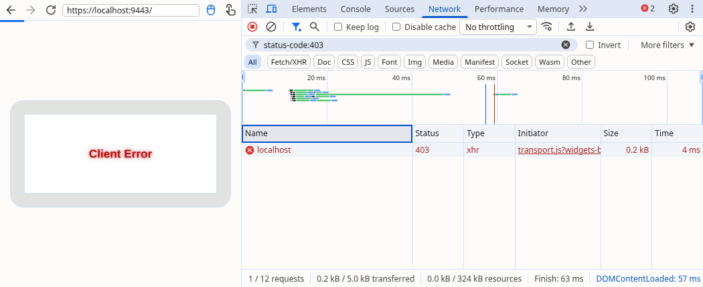

# Как запустить счётчик по HTTPS

[Web Widgets](../../README.ru.md) · [English](../en/https.md)

HTTPS использует TLS для шифрования соединения. По сертификату браузер проверяет имя сайта.
Если браузер подключается прямо к приложению, выбери [TLS в Java](#java). Если домен
уже обслуживает Nginx, выбери [TLS в Nginx](#nginx). В обоих случаях открывается один
и тот же счётчик. После первого нажатия на **Click me** значение должно измениться с **0** на **1**, после второго — на **2**.

## Подготовь счётчик и сертификат

Понадобятся JDK 21, Maven 3.9 и проект из [быстрого старта](quick-start.md).
Сохрани [HTTPS-версию Counter.java](../examples/https/Counter.java) в
`src/main/java/example/Counter.java`. Останови предыдущий пример сочетанием Ctrl+C. В `pom.xml` сохрани
зависимость `com.kniazkov:widgets-http:0.2.1` и укажи `example.Counter` в `<mainClass>`,
в том числе после урока о навигации. Выполняй команды из каталога с POM.

Для публичного сайта получи сертификат на имя, которое пользователи вводят в браузере.
В примерах используются два PEM-файла. В `fullchain.pem` лежит сертификат сайта, а за
ним промежуточные сертификаты. В `privkey.pem` лежит соответствующий закрытый ключ.
Храни ключ вне каталога веб-страниц и дай доступ на чтение процессу, который принимает
TLS-соединения. Для загрузки PEM в Java нужен незашифрованный ключ PKCS#8 (`BEGIN PRIVATE KEY`).

Чтобы попробовать любой вариант на **localhost**, установи [mkcert](https://github.com/FiloSottile/mkcert)
на компьютер, где запускаешь пример и браузер. Эти команды для Linux добавят локальный центр сертификации в
доверенные на этом компьютере и выпустят тестовый сертификат. После установки центра
перезапусти браузер. Закрытый ключ центра оставь на компьютере разработчика.

```sh
tls="$HOME/.config/widgets/tls"
mkdir -p "$tls"
chmod 700 "$tls"
mkcert -install
mkcert -cert-file "$tls/fullchain.pem" -key-file "$tls/privkey.pem" localhost
```

<a id="java"></a>

## HTTPS напрямую в Java

Java читает оба файла и слушает `127.0.0.1:8443`. В методе `Counter.listener` ветка
`direct` берёт пути к сертификату и ключу из двух аргументов после `direct`.

```java
SslOptions tls = new SslOptions.Builder()
    .setCertificateChainFile(args[1])
    .setPrivateKeyFile(args[2])
    .build();
return options.setPort(8443).setSslOptions(tls).build();
```

```sh
mvn compile exec:java -Dexec.args="direct '$tls/fullchain.pem' '$tls/privkey.pem'"
```

Открой [https://localhost:8443/](https://localhost:8443/) и дважды нажми **Click me**.
Обработчик увеличивает значение модели в Java. Цифра **2** на странице означает, что
сервер получил нажатия, а браузер получил обновления. Для публичного сайта укажи адрес нужного
сетевого интерфейса в `setBindAddress` для ветки `direct` и открывай `https://app.example.com:8443/`
по имени из сертификата. После продления сертификата перезапусти Java-сервер.
Если сертификат с ключом уже лежат в хранилище PKCS#12,
вместо двух методов для PEM используй `setKeyStoreFile` и `setPassword(char[])`.

<a id="nginx"></a>

## HTTPS через Nginx

Сертификат и ключ читает Nginx. Браузер открывает `https://localhost:9443/`, а Nginx
передаёт запросы по HTTP в Java на `127.0.0.1:8080`. Запусти Java в первом терминале.

```sh
mvn compile exec:java -Dexec.args="proxy https://localhost:9443"
```

Эта команда запускает Java со следующими настройками.

```java
Options options = new Options.Builder()
    .setBindAddress(InetAddress.getByName("127.0.0.1"))
    .setPort(8080)
    .setPublicOrigin("https://localhost:9443")
    .build();
```

**Origin** — это схема, имя хоста и порт, видимые браузеру. Он общий для всех страниц
сайта, поэтому путь, параметры запроса и фрагмент указывать не нужно.

На компьютере с работающим Nginx сохрани [widgets.conf](../examples/https/widgets.conf)
рядом с POM. Блок `server` должен попасть внутрь блока `http` основной конфигурации.

```nginx
server {
    listen 127.0.0.1:9443 ssl;
    server_name localhost;

    ssl_certificate     widgets-tls/fullchain.pem;
    ssl_certificate_key widgets-tls/privkey.pem;

    location / {
        proxy_pass http://127.0.0.1:8080;
        proxy_set_header Host $http_host;
        proxy_cache off;
    }
}
```

Для обычной установки Linux, где `/etc/nginx/nginx.conf` подключает `conf.d/*.conf`,
выполни эти команды во втором терминале из каталога проекта.

```sh
tls="$HOME/.config/widgets/tls"
sudo install -d -m 700 /etc/nginx/widgets-tls
sudo install -m 644 "$tls/fullchain.pem" /etc/nginx/widgets-tls/fullchain.pem
sudo install -m 600 "$tls/privkey.pem" /etc/nginx/widgets-tls/privkey.pem
sudo install -m 644 widgets.conf /etc/nginx/conf.d/widgets.conf
sudo nginx -t && sudo systemctl reload nginx
```

Открой [https://localhost:9443/](https://localhost:9443/) и дважды нажми **Click me**.
Для публичного домена укажи в Nginx `listen 443 ssl`, имя в `server_name` и пути к
сертификату и ключу этого домена. Запусти Java с `proxy https://app.example.com`.
Оставь Java на `127.0.0.1`. После продления сертификата перезагрузи конфигурацию Nginx,
чтобы он прочитал новые файлы. [Настройка HTTPS в Nginx](https://nginx.org/ru/docs/http/configuring_https_servers.html)

## Страница открылась, а кнопка не работает

В инструментах разработчика браузера открой вкладку **Network** («Сеть»), перезагрузи
страницу и найди `POST /` рядом с начальным `GET /`. Если GET прошёл, а POST вернул **403**, браузер получил
страницу, но Widgets отклонил запрос. Сообщение **Client Error** может появиться ещё до
того, как на странице станет видна кнопка. Фильтр `status-code:403` на вкладке «Сеть»
поможет найти отказ.



1. Выполни в консоли браузера `location.origin`. Передай полученное значение в
   `setPublicOrigin`. В нашем примере в него входит `:9443`. Перезапусти Java и обнови вкладку.
2. Если адрес уже совпадает, проверь, что Nginx передаёт и GET, и POST на один Java-сервер
   и сохраняет заголовки запроса `Origin`, `Sec-Fetch-Site`, `Cookie` и `X-Widgets-*`.
   Пропускай `Set-Cookie` из ответа. Начальный HTML и ответы протокола должны проходить
   без кеширования на прокси. Widgets сверяет запрос с настроенным внешним адресом.
   Одного заголовка `X-Forwarded-Proto` для этого недостаточно.
3. Снова нажми кнопку два раза. Успешный POST и цифра **2** подтвердят, что связь восстановилась.

## Дополнительный канал для push-обновлений

Счётчику достаточно стандартного обмена по HTTP поверх TLS. Если приложение явно запускает
`PushServer`, направь также `/widgets-stream` на его WebSocket-порт, передай заголовки
Upgrade и укажи тот же внешний origin. [Проксирование WebSocket в Nginx](https://nginx.org/ru/docs/http/websocket.html)
