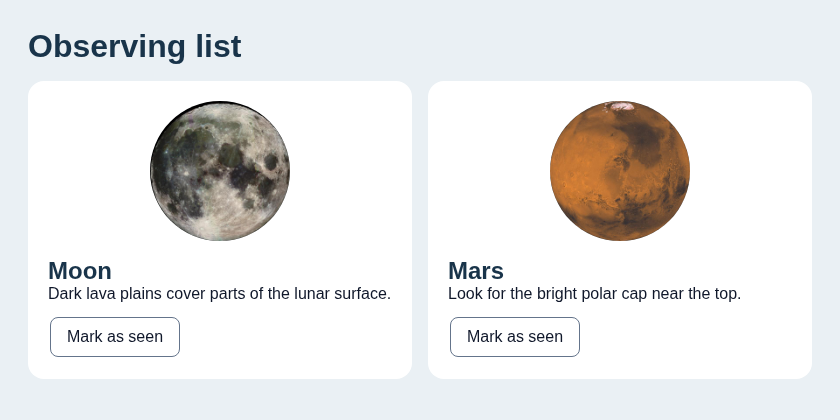
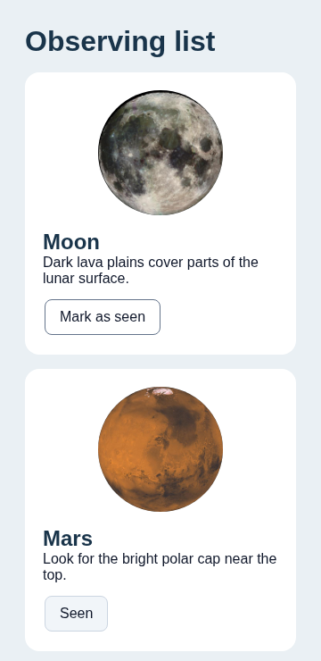

# Собери страницу из карточек

[Форма с проверкой и сохранением](form-models.md) · [English](../en/page-composition.md)

Соберём список наблюдений с двумя карточками — Луны и Марса. У каждой есть фотография,
описание и кнопка **Mark as seen**. На широком экране карточки стоят рядом.



## Запусти пример

Открой Maven-проект из [быстрого старта](quick-start.md). Если сервер ещё запущен,
останови его сочетанием Ctrl+C. Сохрани три файла относительно каталога с `pom.xml`.

| Файл | Куда положить |
| --- | --- |
| [SkyCards.java](../examples/SkyCards.java) | `src/main/java/example/SkyCards.java` |
| [moon.jpg](../examples/sky/moon.jpg) | `www/moon.jpg` |
| [mars.jpg](../examples/sky/mars.jpg) | `www/mars.jpg` |

Создай каталог `www`, если его ещё нет. Сервер по умолчанию раздаёт из него файлы.
Например, изображению `www/moon.jpg` в браузере соответствует адрес `/moon.jpg`.
В `pom.xml` укажи `example.SkyCards` в `<mainClass>`. Из каталога с `pom.xml` выполни
`mvn compile exec:java` и открой [localhost:8080](http://localhost:8080/).

## Собери одну карточку

Посмотри на класс `SkyCard` в примере. Он наследует `Panel` — блочный контейнер.
Внутри карточки четыре блока идут сверху вниз в порядке вызовов `add`.

```java
add(portrait);
add(new Section(heading(name, HeadingLevel.H2, "24px")));
add(new Section(new TextWidget(description)));
add(actions);
```

**Блок** здесь занимает отдельную строку. **Строчные виджеты** — изображение, текст и
кнопка — можно разместить рядом внутри одного `Section`. Поэтому `portrait` — это
`new Section(photo)`, а `actions` — `new Section(button)`. Перенеси `add(actions)` выше
строки с описанием, и кнопка окажется над текстом в обеих карточках.

Положение фотографии задаёт её строка. `portrait.setCenterAlignment()` ставит снимок
по центру, а `portrait.setBottomMargin(16)` оставляет под ним 16 пикселей до заголовка.
У двух карточек общий стиль, созданный через `Panel.getDefaultStyle().derive()`.
В нём заданы белый фон, скругления и `setPadding(20)` — расстояние от края карточки до
содержимого.

## Размести две карточки

Проследи дерево от корня страницы. В `root` добавлен контейнер `content` с заголовком и
сеткой `grid`. В сетку добавлены два экземпляра `SkyCard`. Первому переданы имя,
фотография и описание Луны, второму — Марса. Конструктор создаёт для каждой карточки свою кнопку и обработчик.
Нажми **Mark as seen** под Марсом. На его кнопке появится **Seen**, а кнопка Луны останется
доступной.

```java
ResponsiveGrid grid = new ResponsiveGrid();
grid.setColumnWidths(280, 0);
grid.setGap(16);
```

`ResponsiveGrid` выбирает число колонок по ширине самой сетки. Первый аргумент задаёт
желаемый минимум колонки в пикселях. Ноль во втором аргументе позволяет колонкам поровну
разделить свободное место. Для двух колонок нужно `280 + 16 + 280 = 576` пикселей
внутри сетки. Сузь окно, и Марс переместится под Луну. Его кнопка сохранит отметку **Seen**.



**Попробуй изменить компоновку.** Замени `setColumnWidths(280, 0)` на
`setColumnWidths(460, 0)`, перезапусти приложение и открой страницу заново.
При ширине окна 840 пикселей карточки теперь стоят друг под другом. Расширь окно
до 1000 пикселей — они снова поместятся рядом.

Фотографии — [Луна, NASA/JPL/USGS](https://science.nasa.gov/photojournal/earths-moon/) и
[Марс, NASA/JPL-Caltech/USGS](https://science.nasa.gov/resource/global-color-views-of-mars/).

Виджеты в примере · [Panel](widgets/layout.md#panel) · [ResponsiveGrid](widgets/layout.md#responsivegrid) · [ImageWidget](widgets/display.md#imagewidget)

[Дальше — свяжи две страницы и сравни состояние вкладок](page-navigation.md)
