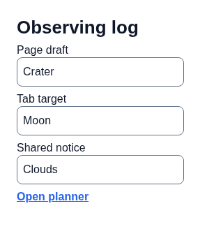
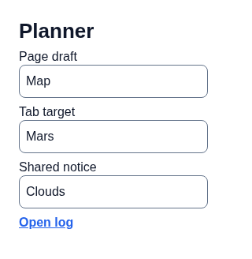

# Две страницы и три места для заметки

[Компоновка страницы](page-composition.md) · [English](../en/page-navigation.md)

В планировщике наблюдений две страницы — план и журнал. На обеих можно писать.
Черновик относится к открытой странице, выбранный небесный объект нужен на обеих
страницах вкладки, а сводку погоды видят все, кто открыл приложение. Что произойдёт
с каждым полем, если перейти в журнал и вернуться?

## Запусти две страницы

В Maven-проекте из [быстрого старта](quick-start.md) сохрани [ObservingNotes.java](../examples/ObservingNotes.java)
в `src/main/java/example/ObservingNotes.java`. В `pom.xml` укажи `example.ObservingNotes`
в `<mainClass>`. Останови предыдущий пример сочетанием Ctrl+C, выполни `mvn compile exec:java`
и открой [планировщик](http://localhost:8080/). При первом запуске все три поля пусты.

```java
Page planner = notes.page("Planner", "Open log", "/log");
Page log = notes.page("Observing log", "Open planner", "/");
Application app = new Application(planner);
app.addPage("log", log);
```

Конструктор `Application` назначает планировщик на `/`. Вызов `addPage("log", log)`
регистрирует журнал по адресу `/log`. На каждой странице `new Link(linkText, destination)`
создаёт обычную ссылку на другую. Благодаря этому журнал можно открыть и по ссылке
**Open log**, и напрямую по адресу [localhost:8080/log](http://localhost:8080/log).

## Откуда поле берёт значение

Метод `page(...)` возвращает лямбду `(root, context) -> { ... }`. Widgets вызывает её,
когда нужно создать экземпляр страницы. В этот момент пример выбирает модели для полей,
а `setTextModel(model)` связывает каждое поле с его моделью.

| Поле | Где создаётся модель | Кто видит изменения |
| --- | --- | --- |
| **Page draft** | `new StringModel()` внутри лямбды | Только этот экземпляр страницы. У журнала и планировщика свои черновики. |
| **Tab target** | `targets.computeIfAbsent(context.tabContext, ...)` | Обе страницы одного контекста вкладки получают одну модель. Другая вкладка получает свою. |
| **Shared notice** | Поле `notice` одного объекта `ObservingNotes`, созданного в `main` | Все страницы и вкладки этого приложения. После перезапуска сервера сводка снова пуста. |

`context.tabContext` служит ключом. Саму модель хранит приложение в карте `targets`.
У карты слабые ключи, поэтому она может освободить запись, когда контекст перестанет
использоваться. Для моделей, доступных нескольким экземплярам страниц, пример вызывает
`asSynchronized()`, поскольку запросы к ним могут приходить одновременно.

## Ссылка, «Назад» и «Вперёд»

Во вкладке A введи в три поля планировщика `Sketch`, `Moon` и `Clear`. Пройди строки
таблицы по порядку. В браузере используй именно кнопки истории там, где они указаны.

| Действие | Адрес | Page draft | Tab target | Shared notice |
| --- | --- | --- | --- | --- |
| Нажми ссылку **Open log** | `/log` | пусто | Moon | Clear |
| Введи `Crater` в черновик журнала | `/log` | Crater | Moon | Clear |
| Нажми «Назад» в браузере | `/` | Sketch | Moon | Clear |
| Нажми «Вперёд» в браузере | `/log` | Crater | Moon | Clear |
| Нажми ссылку **Open planner** | `/` | пусто | Moon | Clear |
| Нажми «Назад» в браузере | `/log` | Crater | Moon | Clear |

Ссылка **Open planner** добавляет новую запись в историю и открывает новый экземпляр
планировщика по тому же адресу `/`. Кнопка «Назад» возвращает прежний экземпляр, пока
он есть в кэше. Вкладка хранит до трёх неактивных страниц примерно две минуты после ухода.
Если экземпляр уже удалён, Widgets построит страницу заново и её черновик будет пуст.

## Сравни две вкладки и обнови страницу

1. Оставь вкладку A на журнале. В новой вкладке B открой [планировщик](http://localhost:8080/).
   Черновик и объект пусты, сводка уже показывает `Clear`.
2. Во вкладке B введи `Map`, `Mars` и `Clouds`. Вернись во вкладку A. Её черновик
   по-прежнему `Crater`, объект — `Moon`, а сводка сама изменилась на `Clouds`.

| Вкладка A · журнал | Вкладка B · планировщик |
| --- | --- |
|  |  |

Теперь обнови вкладку A кнопкой браузера. Адрес останется `/log`. Полная перезагрузка
создаёт и страницу, и контекст вкладки заново, поэтому первые два поля пусты.
Сводка по-прежнему показывает `Clouds`. Во вкладке B остаются `Map`, `Mars` и `Clouds`.

Если страницы разрастутся, их можно вынести в отдельные Java-классы, как в
[TwoPages](../../src/main/java/com/kniazkov/widgets/example/TwoPages.java).
В [TabContextExample](../../src/main/java/com/kniazkov/widgets/example/TabContextExample.java)
можно посмотреть идентификаторы вкладок и завершить текущий контекст кнопкой.

Виджеты в примере · [Link](widgets/display.md#link) · [FormField](widgets/forms.md#formfield)

[Запуск приложения по HTTPS](https.md)
