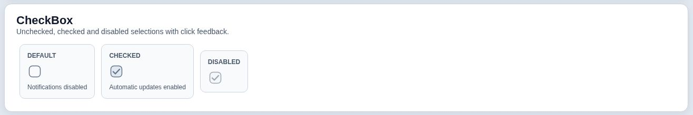
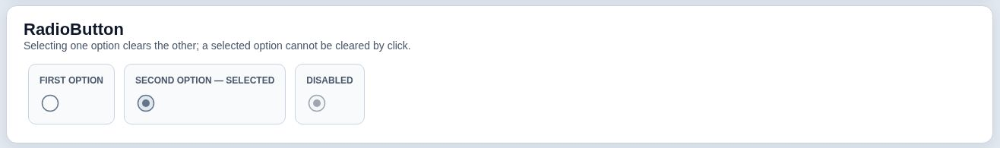
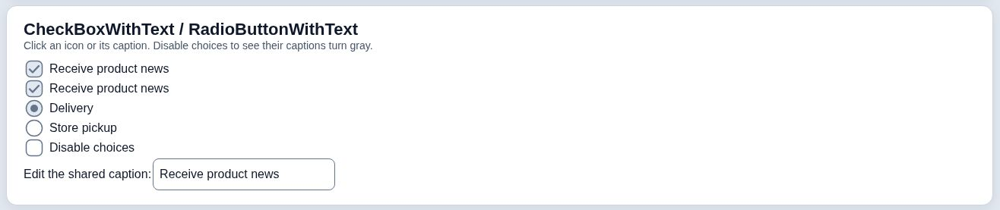
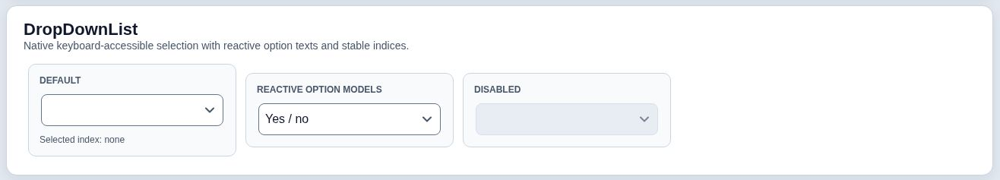
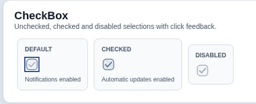
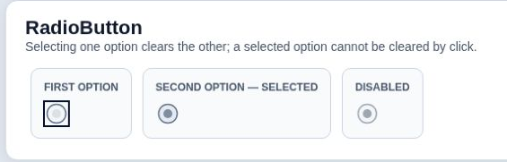
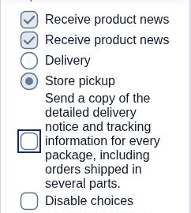
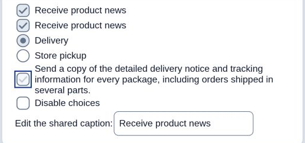
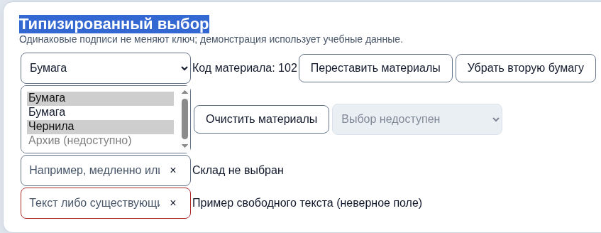
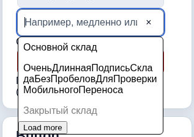

# Выбрать одно или несколько значений

[Каталог виджетов](../../WIDGET_GALLERY.ru.md) · [English](../../en/widgets/choices.md)

Select даёт нативный список для одного значения. ComboBox добавляет поиск и может разрешать свободный ввод. MultiSelect хранит несколько выбранных вариантов. Для независимой настройки «да/нет» удобен флажок.

[Типизированный выбор](../../TYPED_CHOICES.ru.md)

[CheckBox](#checkbox) · [CheckBoxWithText](#checkboxwithtext) · [RadioButton](#radiobutton) · [RadioButtonWithText](#radiobuttonwithtext) · [DropDownList](#dropdownlist) · [Select](#select) · [ComboBox](#combobox) · [MultiSelect](#multiselect)

## CheckBox

Переключи логическое значение. Его можно читать или привязывать через модель отметки. Для элемента без видимой подписи задай доступное имя. Пробел меняет отметку в фокусе.

```java
var visible = new CheckBox();
visible.setAccessibleName("Show labels");
```

[Флажки с отметкой и без](#shot-check-box) · [Java](../../../src/main/java/com/kniazkov/widgets/view/CheckBox.java)

## CheckBoxWithText

Дай флажку видимую подпись, по которой тоже можно нажать. Конструктор принимает отдельные модели текста и отметки. Отключение составного виджета отключает подписанный элемент.

```java
var labels = new CheckBoxWithText(new StringModel("Show labels"), new BooleanModel(true));
```

[Переключатели и флажки с нажимаемыми подписями](#shot-labeled-choices) · [Java](../../../src/main/java/com/kniazkov/widgets/view/CheckBoxWithText.java)

## RadioButton

Выбери один вариант через модель логической отметки. Повторное нажатие сохраняет выбор. Объедини связанные переключатели в RadioGroup, чтобы выбор одного снимал отметку с остальных.

```java
var first = new RadioButton();
var second = new RadioButton();
first.setAccessibleName("Day");
second.setAccessibleName("Night");
var group = new RadioGroup(first, second);
root.onClose(group::close);
```

[Переключатели выбора варианта](#shot-radio-button) · [Java](../../../src/main/java/com/kniazkov/widgets/view/RadioButton.java)

## RadioButtonWithText

Сделай единый вариант выбора с видимой нажимаемой подписью. При необходимости передай модели текста и отметки. В группу добавляй внутренний RadioButton.

```java
var day = new RadioButtonWithText("Day");
var night = new RadioButtonWithText("Night");
var group = new RadioGroup(day.getRadioButton(), night.getRadioButton());
root.onClose(group::close);
```

[Переключатели и флажки с нажимаемыми подписями](#shot-labeled-choices) · [Java](../../../src/main/java/com/kniazkov/widgets/view/RadioButtonWithText.java)

## DropDownList

Выбери позицию в списке фиксированной длины. Текст каждого пункта можно менять через модель. `onSelect` получает индекс; −1 означает пустой выбор. Если состав или порядок часто меняется, удобнее виджет со стабильными ключами.

```java
var view = new DropDownList("Day", "Night");
view.setSelectedIndex(1);
```

[Примеры выпадающих списков](#shot-drop-down-list) · [Java](../../../src/main/java/com/kniazkov/widgets/view/DropDownList.java)

## Select

Выбери одно типизированное значение в обычном выпадающем списке. У ChoiceOption есть стабильный ключ, видимая подпись и значение приложения. При замене вариантов сохраняются доступные выбранные ключи. В `onChoose` приходят ключи выбора, а `getSelectedValues()` возвращает соответствующие типизированные значения.

```java
var moon = new ChoiceOption<>("moon", "Moon", 301);
var target = new Select<>(List.of(moon));
target.setAccessibleName("Target");
```

[Одиночный выбор, поиск и множественный выбор](#shot-typed-choices-wide) · [Java](../../../src/main/java/com/kniazkov/widgets/view/Select.java)

## ComboBox

Ищи вариант по введённому тексту. В строгом режиме выбор фиксируется по ключу варианта. В свободном режиме пользовательская строка хранится отдельно. Поиск можно подключить к асинхронному источнику. Для короткого списка без поиска удобен Select.

```java
var moon = new ChoiceOption<>("moon", "Moon", 301);
var target = new ComboBox<>(List.of(moon), false);
target.setAccessibleName("Find a target");
```

[Одиночный выбор, поиск и множественный выбор](#shot-typed-choices-wide) · [Java](../../../src/main/java/com/kniazkov/widgets/view/ComboBox.java)

## MultiSelect

Выбери несколько вариантов в нативном списке. Модель выбора содержит ключи; `getSelectedValues()` возвращает соответствующие значения приложения. Жесты и сочетания клавиш зависят от платформы.

```java
var tags = new MultiSelect<>(List.of(new ChoiceOption<>("sky", "Sky", 1),
    new ChoiceOption<>("sea", "Sea", 2)));
tags.setAccessibleName("Tags");
```

[Одиночный выбор, поиск и множественный выбор](#shot-typed-choices-wide) · [Java](../../../src/main/java/com/kniazkov/widgets/view/MultiSelect.java)

## Снимки AllWidgets

<a id="shot-check-box"></a>

**Флажки с отметкой и без**



<a id="shot-radio-button"></a>

**Переключатели выбора варианта**



<a id="shot-labeled-choices"></a>

**Переключатели и флажки с нажимаемыми подписями**



<a id="shot-drop-down-list"></a>

**Примеры выпадающих списков**



<a id="shot-checkbox-keyboard-focus"></a>

**Клавиатурный фокус на флажке**



<a id="shot-radio-keyboard-focus"></a>

**Клавиатурный фокус в группе переключателей**



<a id="shot-labeled-choices-320"></a>

**Перенос подписей при ширине 320 пикселей**



<a id="shot-labeled-choices-200-percent"></a>

**Подписанные элементы при масштабе 200%**



<a id="shot-typed-choices-wide"></a>

**Одиночный выбор, поиск и множественный выбор**



<a id="shot-typed-choices-narrow"></a>

**Поле выбора с поиском в узком окне**


