# Открыть окно, меню или диалог

[Каталог виджетов](../../WIDGET_GALLERY.ru.md) · [English](../../en/widgets/dialogs.md)

Для своего модального окна подойдёт ModalPopup, для получения результата — Dialog, а для панели рядом с вызвавшей её кнопкой — Popover.

[Диалоги](../../DIALOGS.ru.md) · [Панели у кнопок](../../ANCHORED_OVERLAYS.ru.md)

[Popup](#popup) · [ModalPopup](#modalpopup) · [MessagePopup](#messagepopup) · [Dialog](#dialog) · [Menu](#menu) · [Popover](#popover) · [Tooltip](#tooltip)

## Popup

Покажи поверх страницы немодальное окно с блоками. Размеры и выравнивание окна реактивны. При открытии добавь окно на страницу; остальными элементами по-прежнему можно пользоваться.

```java
var open = new Button("Preview");
open.onClick(event -> root.add(new Popup(new Section(new TextWidget("Preview")))));
root.add(new Section(open));
```

[Открытое немодальное окно](#shot-popup) · [Java](../../../src/main/java/com/kniazkov/widgets/view/Popup.java)

## ModalPopup

Открой модальное окно с подложкой, внутри которого остаётся фокус. Закрывай его явно или разреши закрытие нажатием снаружи. Методы `hide()` и `show()` скрывают и показывают окно вместе с подложкой, сохраняя содержимое.

```java
var close = new Button("Close");
var modal = new ModalPopup(new Section(close));
close.onClick(event -> modal.remove());
root.add(modal);
```

[Открытое модальное окно с подложкой](#shot-modal-popup) · [Java](../../../src/main/java/com/kniazkov/widgets/view/ModalPopup.java)

## MessagePopup

Покажи сообщение с одной или двумя кнопками приложения. Текст можно менять через виджет надписи. Назначь кнопкам обработчики, в том числе действие закрытия окна.

```java
var ok = new Button("OK");
var message = new MessagePopup("Observation saved", ok);
ok.onClick(event -> message.remove());
root.add(message);
```

[Открытое сообщение и кнопки действий](#shot-message-popup) · [Java](../../../src/main/java/com/kniazkov/widgets/view/MessagePopup.java)

## Dialog

Запроси подтверждение или собери форму с проверкой и получи типизированный результат. `result()` завершается однократно, в том числе при отмене или закрытии. Передай локализованные подписи и сообщения; для следующего запроса создай новый диалог.

```java
var labels = new Dialog.Messages("Confirm", "Cancel", "Close", "Saving", "Failed", "Check fields");
var dialog = Dialog.confirmation("Observation", "Publish this note?", labels);
root.add(dialog);
```

[Открытый диалог подтверждения с кнопками](#shot-dialog-confirm) · [Java](../../../src/main/java/com/kniazkov/widgets/view/Dialog.java)

## Menu

Открой меню действий рядом с кнопкой. У пунктов есть уникальные ключи и обработчики Runnable. Отключённые пункты пропускаются; выбор доступного пункта закрывает меню и однократно запускает действие.

```java
var trigger = new Button("Actions");
var menu = new Menu(trigger, "Page actions", List.of(
    new Menu.Item("log", "Open log", true, () -> root.goToPage("/log"))));
root.add(new Section(trigger));
root.add(menu);
```

[Открытое меню с клавиатурным фокусом](#shot-anchored-menu) · [Java](../../../src/main/java/com/kniazkov/widgets/view/Menu.java)

## Popover

Привяжи к кнопке небольшую панель с элементами управления. Добавь в неё блоки; они сохраняют состояние между открытиями. Кнопка и панель должны находиться на одной странице и в одном модальном контексте.

```java
var trigger = new Button("Settings");
var settings = new Popover(trigger, "Display settings");
settings.addBody(new Section(new CheckBoxWithText("Show labels")));
root.add(new Section(trigger));
root.add(settings);
```

[Открытая панель с полем и кнопками](#shot-anchored-popover) · [Java](../../../src/main/java/com/kniazkov/widgets/view/Popover.java)

## Tooltip

Поясни элемент при наведении или фокусе, оставив фокус на самом элементе. Текст меняется через `setText`. Подсказка подходит для короткой справки, а для кнопок и другого интерактивного содержимого есть Popover.

```java
var trigger = new Button("Help");
root.add(new Section(trigger));
root.add(new Tooltip(trigger, "Use a short title for the observation."));
```

[Подсказка у элемента в фокусе](#shot-anchored-tooltip) · [Java](../../../src/main/java/com/kniazkov/widgets/view/Tooltip.java)

## Снимки AllWidgets

<a id="shot-popup-launchers"></a>

**Кнопки открытия разных окон**

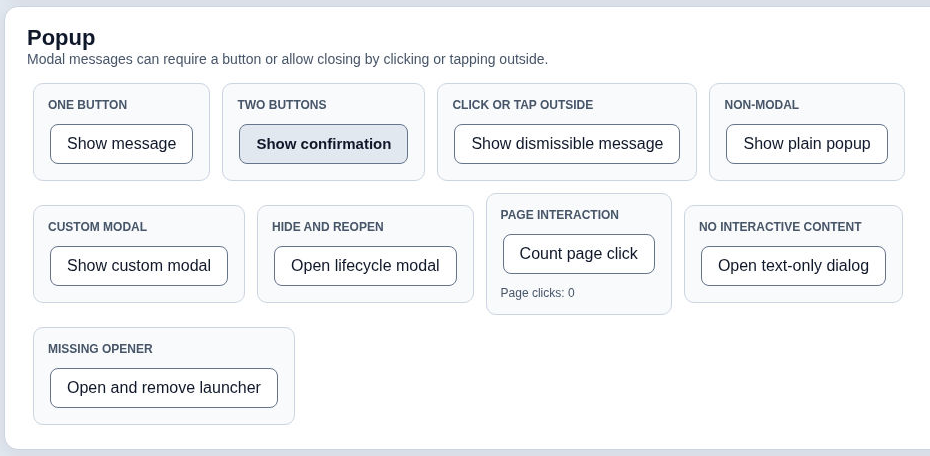

<a id="shot-message-popup"></a>

**Открытое сообщение и кнопки действий**

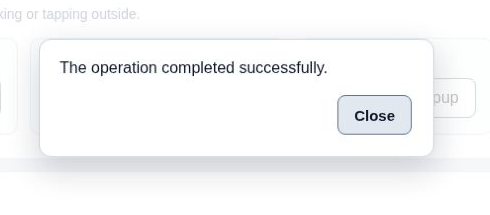

<a id="shot-popup"></a>

**Открытое немодальное окно**

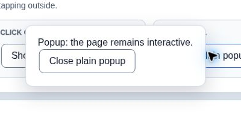

<a id="shot-modal-popup"></a>

**Открытое модальное окно с подложкой**

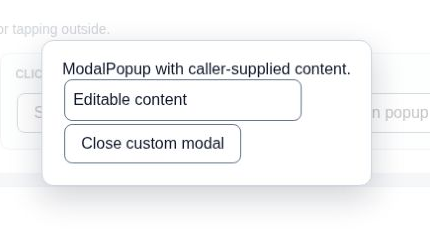

<a id="shot-modal-lifecycle-desktop-open"></a>

**Окно перед скрытием на широком экране**

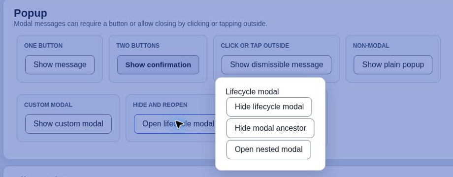

<a id="shot-modal-lifecycle-desktop-restored"></a>

**Окно после повторного показа на широком экране**

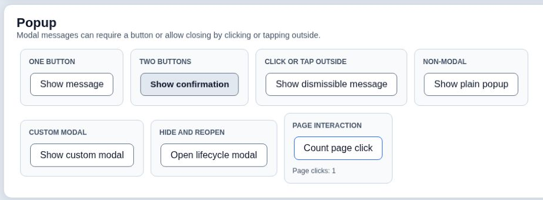

<a id="shot-modal-lifecycle-mobile-open"></a>

**Окно перед скрытием на узком экране**

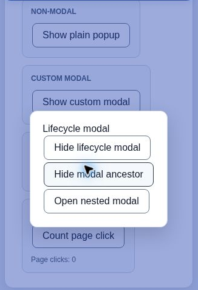

<a id="shot-modal-lifecycle-mobile-restored"></a>

**Восстановленное окно на узком экране**

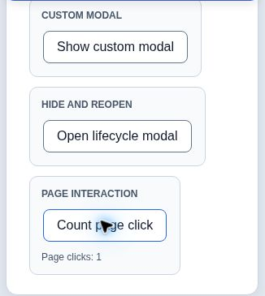

<a id="shot-modal-focus-desktop"></a>

**Клавиатурный фокус внутри окна**

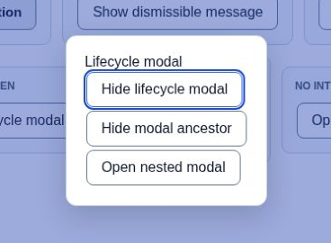

<a id="shot-modal-nested-desktop"></a>

**Вложенное окно на широком экране**

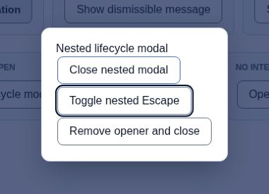

<a id="shot-modal-empty-mobile"></a>

**Пустое окно на узком экране**

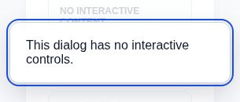

<a id="shot-modal-nested-mobile"></a>

**Вложенное окно на узком экране**

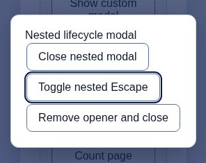

<a id="shot-message-popup-narrow"></a>

**Открытое сообщение на узком экране**

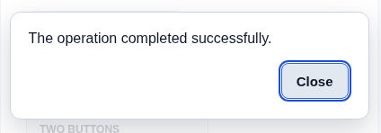

<a id="shot-dialog-confirm"></a>

**Открытый диалог подтверждения с кнопками**

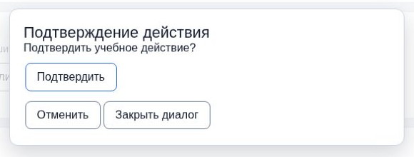

<a id="shot-dialog-error"></a>

**Ошибка асинхронного действия в диалоге**

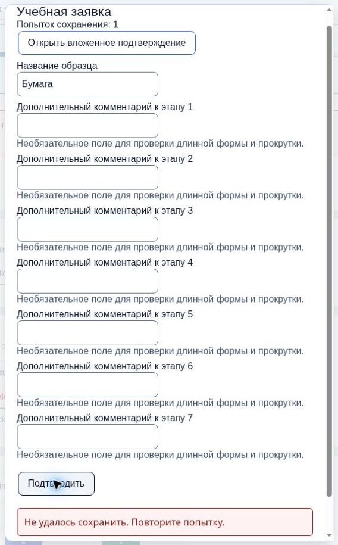

<a id="shot-dialog-mobile"></a>

**Длинная форма диалога в узком окне**

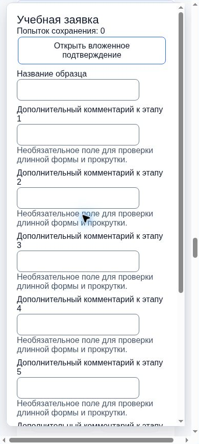

<a id="shot-anchored-menu"></a>

**Открытое меню с клавиатурным фокусом**

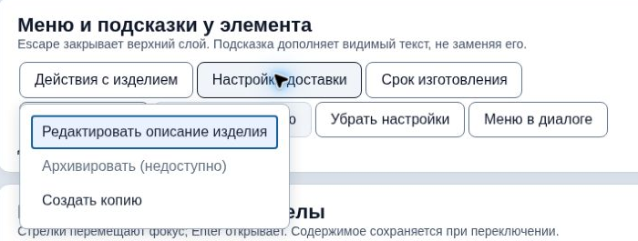

<a id="shot-anchored-popover"></a>

**Открытая панель с полем и кнопками**

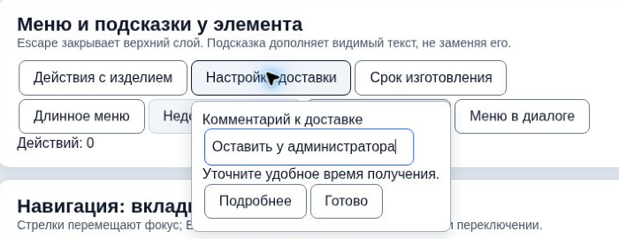

<a id="shot-anchored-tooltip"></a>

**Подсказка у элемента в фокусе**

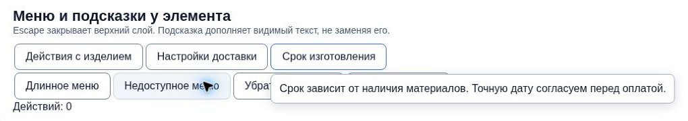

<a id="shot-anchored-popover-flipped"></a>

**Панель открылась с другой стороны кнопки**

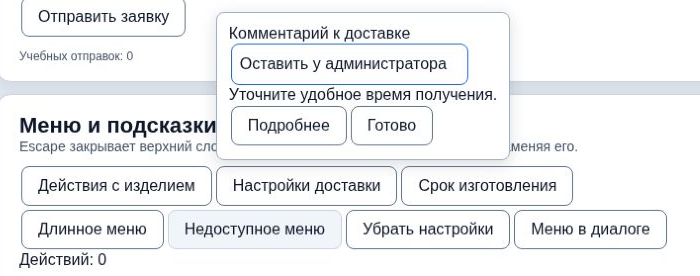

<a id="shot-anchored-menu-mobile"></a>

**Длинное меню при ширине 320 пикселей**

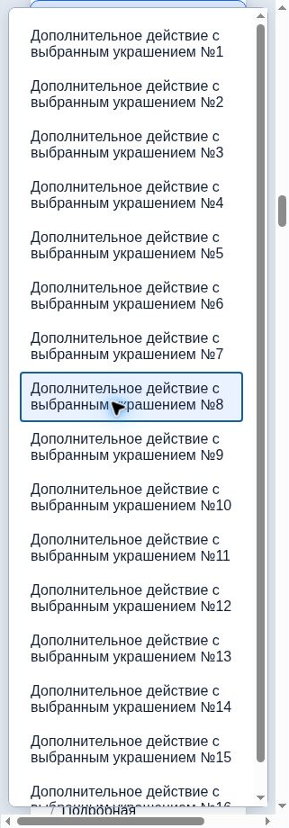
