# Вывести текст, изображения и кнопки

[Каталог виджетов](../../WIDGET_GALLERY.ru.md) · [English](../../en/widgets/display.md)

Для меняющейся надписи подойдёт TextWidget, для форматированного блока — Markdown, для перехода — Link, для команды — Button.

[Markdown (EN)](../../MARKDOWN.md)

[TextWidget](#textwidget) · [Markdown](#markdown) · [HorizontalLine](#horizontalline) · [ImageWidget](#imagewidget) · [ActiveImage](#activeimage) · [Carousel](#carousel) · [ZoomDecorator](#zoomdecorator) · [Countdown](#countdown) · [Button](#button) · [ActiveText](#activetext) · [Link](#link)

## TextWidget

Выведи цену, заголовок или статус обычным текстом. Привяжи `Model<String>` через `setTextModel`, чтобы надпись менялась вместе со значением. Для заголовка задай `setHeadingLevel`, чтобы его можно было найти при чтении с экрана.

```java
var title = new TextWidget("Observing log");
title.setHeadingLevel(HeadingLevel.H1);
```

[Размеры, начертания и цвета текста](#shot-text-widget) · [Java](../../../src/main/java/com/kniazkov/widgets/view/TextWidget.java)

## Markdown

Покажи инструкцию с заголовками, списками и выделением. Виджет принимает строку или `Model<String>` и поддерживает подмножество Markdown. Встроенный HTML отображается как текст.

```java
var help = new Markdown("## Setup\n\n- Open the planner\n- Choose a target");
```

[Форматированный Markdown на странице](#shot-markdown) · [Java](../../../src/main/java/com/kniazkov/widgets/view/Markdown.java)

## HorizontalLine

Отдели одну часть страницы от другой горизонтальной линией. Цвет и толщина меняются через свойства стиля. Линию можно добавить прямо в блочный контейнер.

```java
var rule = new HorizontalLine();
rule.setHeight(2);
root.add(rule);
```

[Линии разной ширины и цвета](#shot-horizontal-line) · [Java](../../../src/main/java/com/kniazkov/widgets/view/HorizontalLine.java)

## ImageWidget

Покажи фотографию по URL или из `ImageSource`. Модель источника можно менять при выборе другой фотографии. Для смыслового изображения задай текстовое описание и ограничь ширину для узкого экрана.

```java
var photo = new ImageWidget("/moon.jpg");
photo.setAlternativeText("Moon with dark lava plains");
photo.setMaxWidth("100%");
```

[Изображения разных размеров и стилей](#shot-image-widget) · [Java](../../../src/main/java/com/kniazkov/widgets/view/ImageWidget.java)

## ActiveImage

Покажи разные изображения в покое, при наведении и нажатии. У виджета есть обработчики указателя. Для действия, которое надо выполнять и с клавиатуры, используй `Button.icon` с изображением и названием кнопки.

```java
var preview = new ActiveImage("/moon.jpg");
preview.setSource(State.HOVERED, ImageSource.fromHyperlink("/moon-detail.jpg"));
```

[Варианты интерактивных изображений](#shot-active-image) · [Java](../../../src/main/java/com/kniazkov/widgets/view/ActiveImage.java)

## Carousel

Дай читателю пролистать изображения жестом. Набор слайдов фиксирован и содержит хотя бы один элемент. У каждого слайда может быть модель источника. Смена слайда обновляет индекс и вызывает обработчик выбора; на краях прокрутка останавливается.

```java
var photos = new Carousel("/moon.jpg", "/mars.jpg");
photos.setSelectedIndex(1);
```

[Первый слайд карусели](#shot-carousel) · [Java](../../../src/main/java/com/kniazkov/widgets/view/Carousel.java)

## ZoomDecorator

Разреши приближать один строчный виджет колёсиком или жестом и перемещать его в пределах рамки. Задай максимальный масштаб. Вызов `resetZoom()` возвращает исходный вид.

```java
var zoom = new ZoomDecorator(new ImageWidget("/moon.jpg"));
zoom.setMaxScale(4);
```

[Изображение в области масштабирования](#shot-zoom-decorator) · [Java](../../../src/main/java/com/kniazkov/widgets/view/ZoomDecorator.java)

## Countdown

Покажи, сколько времени осталось до момента `Instant`, заданного сервером. Браузер обновляет цифры и останавливается на нуле. Срок можно изменить через `setDeadline`; действие по истечении срока выполняет приложение.

```java
var timer = new Countdown(Instant.now().plusSeconds(300));
root.add(new Section(timer));
```

[Отображение оставшегося времени](#shot-countdown) · [Java](../../../src/main/java/com/kniazkov/widgets/view/Countdown.java)

## Button

Выполни Java-обработчик по нажатию мышью или с клавиатуры. В кнопке один строчный дочерний виджет, доступность меняется через модель отключённого состояния. У кнопки-пиктограммы должно быть доступное имя.

```java
var save = new Button("Save");
save.onClick(event -> save.disable());
```

[Стандартные и пользовательские кнопки](#shot-button) · [Java](../../../src/main/java/com/kniazkov/widgets/view/Button.java)

## ActiveText

Выдели короткую надпись при наведении или нажатии. Содержимое даёт текстовая модель, а обработчик указателя может его менять. Для перехода по адресу используй Link, для команды с клавиатуры — Button.

```java
var hint = new ActiveText("Show hint");
hint.onClick(event -> hint.setText("Use the arrow keys"));
```

[Варианты интерактивной надписи](#shot-active-text) · [Java](../../../src/main/java/com/kniazkov/widgets/view/ActiveText.java)

## Link

Перейди по адресу с помощью обычной ссылки. Строковая модель href задаёт назначение. Укажи путь, чтобы адрес можно было скопировать или открыть в новой вкладке.

```java
var link = new Link("Open log", "/log");
root.add(new Section(link));
```

[Ссылки с разными подписями и стилями](#shot-link) · [Java](../../../src/main/java/com/kniazkov/widgets/view/Link.java)

## Снимки AllWidgets

<a id="shot-horizontal-line"></a>

**Линии разной ширины и цвета**

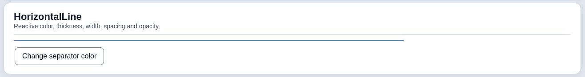

<a id="shot-text-widget"></a>

**Размеры, начертания и цвета текста**

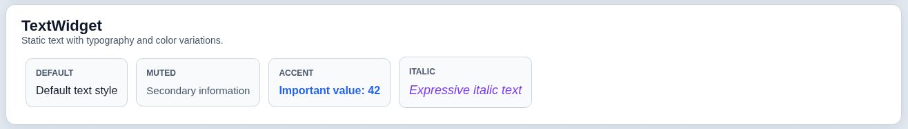

<a id="shot-markdown"></a>

**Форматированный Markdown на странице**

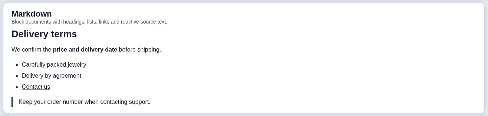

<a id="shot-active-text"></a>

**Варианты интерактивной надписи**

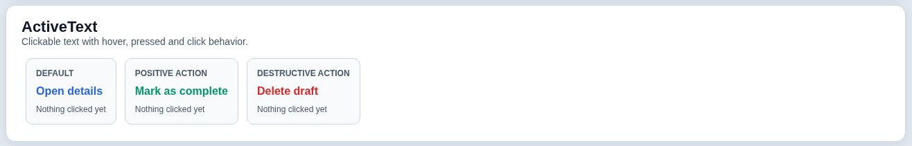

<a id="shot-link"></a>

**Ссылки с разными подписями и стилями**

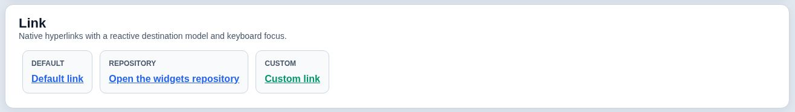

<a id="shot-button"></a>

**Стандартные и пользовательские кнопки**

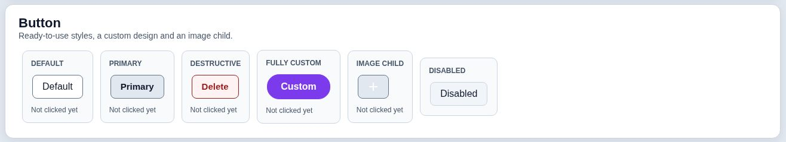

<a id="shot-image-widget"></a>

**Изображения разных размеров и стилей**

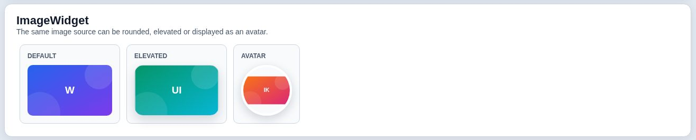

<a id="shot-active-image"></a>

**Варианты интерактивных изображений**

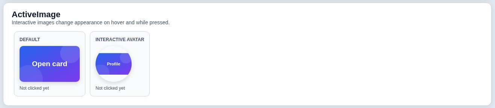

<a id="shot-zoom-decorator"></a>

**Изображение в области масштабирования**

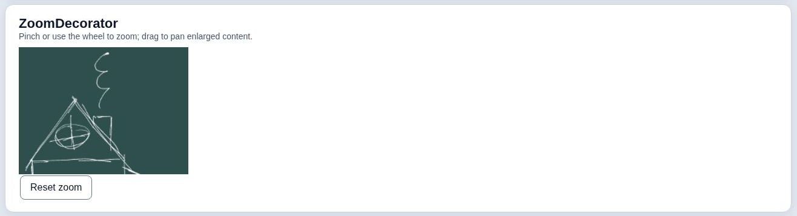

<a id="shot-countdown"></a>

**Отображение оставшегося времени**

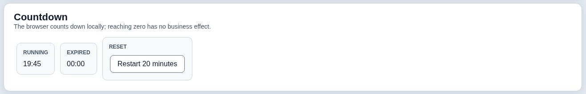

<a id="shot-carousel"></a>

**Первый слайд карусели**

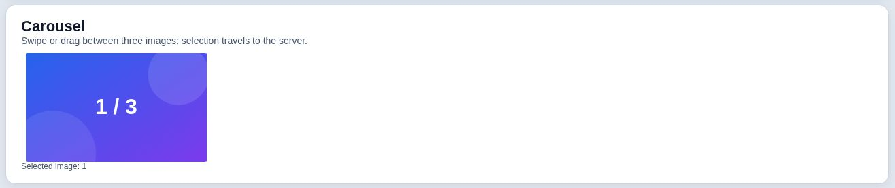

<a id="shot-carousel-selected"></a>

**Выбран второй слайд карусели**

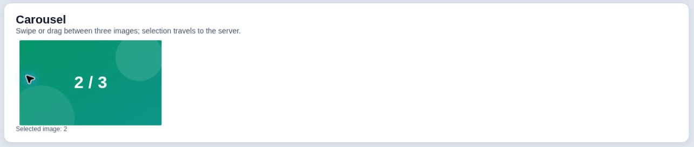

<a id="shot-semantics-desktop"></a>

**Именованные кнопки, изображения и подписанное поле**

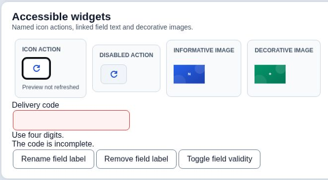

<a id="shot-semantics-icon-mobile"></a>

**Кнопка-пиктограмма в узком окне**

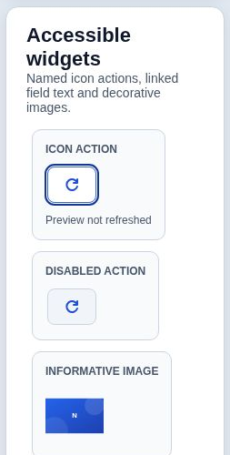
