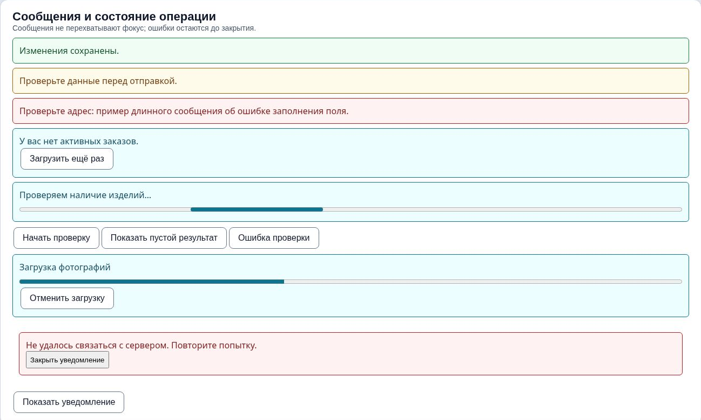
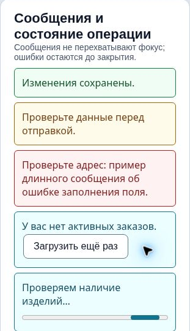
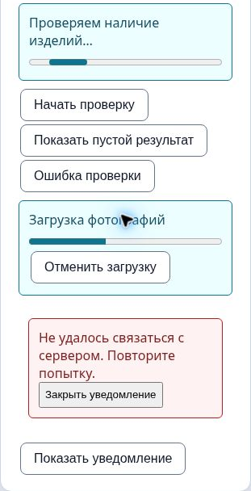

# Показать прогресс, ошибку или результат

[Каталог виджетов](../../WIDGET_GALLERY.ru.md) · [English](../../en/widgets/feedback.md)

FieldError ставь рядом с полем, которое нужно исправить. Для постоянного сообщения подойдёт Alert, для короткого уведомления — Toast.

[Сообщения и операции](../../FEEDBACK.ru.md)

[Alert](#alert) · [FieldError](#fielderror) · [EmptyState](#emptystate) · [Progress](#progress) · [Busy](#busy) · [Toast](#toast)

## Alert

Оставь на странице статус или предупреждение. При смене результата обнови текст и уровень важности. Пустой текст скрывает само сообщение; фокус остаётся у текущего элемента.

```java
var notice = new Alert("Observation saved");
notice.setSeverity(Feedback.Severity.SUCCESS);
```

[Сообщения, пустое состояние, прогресс и уведомления](#shot-feedback-desktop) · [Java](../../../src/main/java/com/kniazkov/widgets/view/Alert.java)

## FieldError

Объясни ошибку конкретного поля. Свяжи сообщение с редактором и обновляй текст при изменении модели. Пустая строка скрывает сообщение. В отправляемой форме FormField может управлять собственной ошибкой.

```java
var input = new InputField();
var error = new FieldError("Enter a target");
input.setAccessibleError(error);
root.add(new Section(input));
root.add(error);
```

[Сообщения, пустое состояние, прогресс и уведомления](#shot-feedback-desktop) · [Java](../../../src/main/java/com/kniazkov/widgets/view/FieldError.java)

## EmptyState

Объясни, почему область результатов пуста, и при необходимости предложи действие. Приложение меняет сообщение через `setText` и задаёт кнопке обработчик повторного поиска или сброса фильтра.

```java
var empty = new EmptyState("No observations yet");
empty.add(new Section(new Link("Start an observation", "/log")));
```

[Сообщения, пустое состояние, прогресс и уведомления](#shot-feedback-desktop) · [Java](../../../src/main/java/com/kniazkov/widgets/view/EmptyState.java)

## Progress

Покажи ход одной операции в процентах. Обновляй значение в потоке страницы и вызывай `finish` с результатом. Обработчик отмены должен сам попросить фоновую задачу остановиться.

```java
var progress = new Progress("Processing photos");
progress.setPercentage(40);
```

[Сообщения, пустое состояние, прогресс и уведомления](#shot-feedback-desktop) · [Java](../../../src/main/java/com/kniazkov/widgets/view/Progress.java)

## Busy

Покажи, что работа продолжается, когда процент выполнения неизвестен. По завершении приложение вызывает `finish`. Завершённый индикатор относится к своей операции; для следующей создай новый.

```java
var busy = new Busy("Looking up the target");
root.add(busy);
```

[Сообщения, пустое состояние, прогресс и уведомления](#shot-feedback-desktop) · [Java](../../../src/main/java/com/kniazkov/widgets/view/Busy.java)

## Toast

Покажи очередь коротких уведомлений, не перемещая фокус. Когда очередь заполнена, `offer` возвращает false. Успешные уведомления могут исчезать по таймеру, а ошибки остаются до закрытия.

```java
var toasts = new Toast(3, "Dismiss");
root.add(toasts);
toasts.offer("Saved", Feedback.Severity.SUCCESS, 3000);
```

[Сообщения, пустое состояние, прогресс и уведомления](#shot-feedback-desktop) · [Java](../../../src/main/java/com/kniazkov/widgets/view/Toast.java)

## Снимки AllWidgets

<a id="shot-feedback-desktop"></a>

**Сообщения, пустое состояние, прогресс и уведомления**



<a id="shot-feedback-mobile-messages"></a>

**Статус и ошибки в узком окне**



<a id="shot-feedback-mobile-operation"></a>

**Индикатор операции и уведомление в узком окне**


