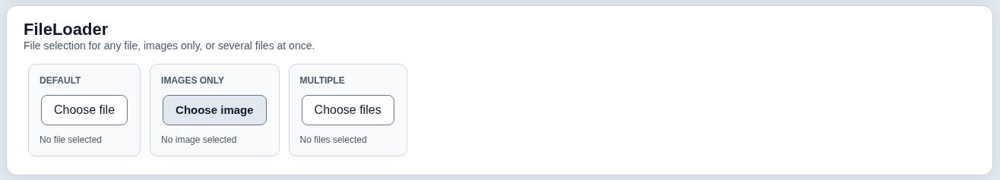
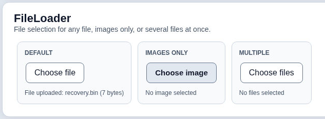
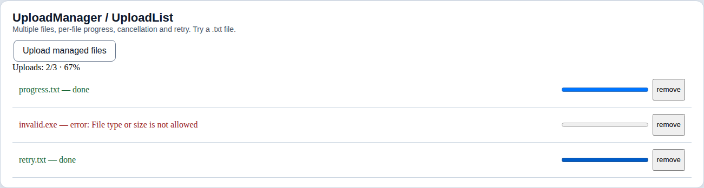
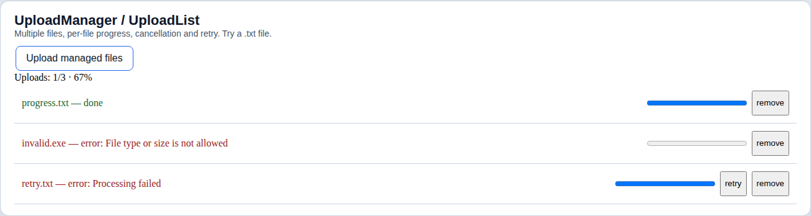
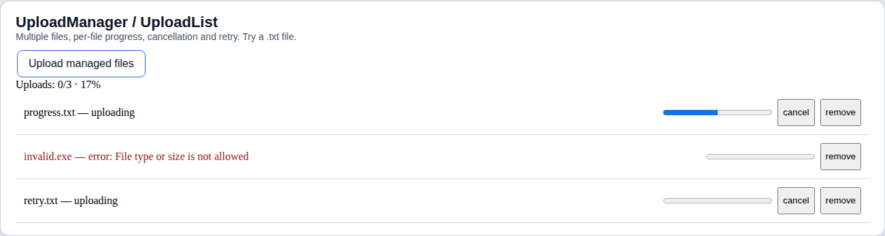
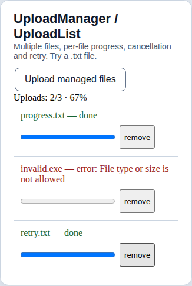
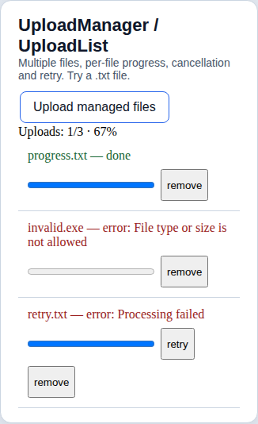
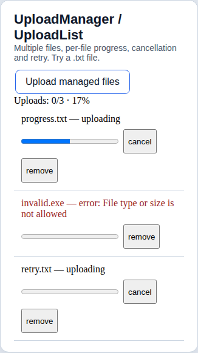

# Выбрать и загрузить файл

[Каталог виджетов](../../WIDGET_GALLERY.ru.md) · [English](../../en/widgets/files.md)

FileLoader передаёт каждую загрузку твоему обработчику. UploadManager и UploadList вместе дают прогресс, отмену и повтор.

[Управляемые загрузки](../../UPLOAD_MANAGER.ru.md)

[FileLoader](#fileloader) · [UploadManager](#uploadmanager) · [UploadList](#uploadlist)

## FileLoader

Открой выбор файла и получи каждую передачу в `onSelect`. У передачи есть модель процента загрузки и обработчик `onLoad`, который вызывается после получения данных. Фильтр помогает выбрать файл; содержимое проверяет приложение.

```java
var picker = new FileLoader("Choose a photo");
picker.acceptImagesOnly();
picker.onSelect(file -> file.onLoad(done -> System.out.println(done.getSize())));
```

[Кнопки выбора файлов](#shot-file-loader) · [Java](../../../src/main/java/com/kniazkov/widgets/view/FileLoader.java)

## UploadManager

Управляй несколькими передачами с отменой, повтором и обработкой в приложении. Лимиты задают число файлов и байты на файл. При повторе ключ операции сохраняется; используй его, чтобы не записать результат дважды. Скопируй временные данные внутри обработчика, если они нужны после его завершения.

```java
var list = new UploadList();
var uploads = new UploadManager("Add files", list, 4, 1024 * 1024,
    (key, file) -> System.out.println(key + " " + file.getSize()));
root.add(new Section(uploads));
root.add(list);
```

[Завершённая передача в списке загрузок](#shot-upload-desktop-done) · [Java](../../../src/main/java/com/kniazkov/widgets/view/UploadManager.java)

## UploadList

Покажи прогресс, ошибки и доступные действия по каждому файлу. Строками управляет UploadManager, он же принимает команды отмены и повтора. Добавь на страницу тот же экземпляр списка, который передаёшь менеджеру.

```java
var transfers = new UploadList();
var picker = new UploadManager("Upload", transfers, 2, 4096,
    (key, file) -> System.out.println(file.getSize()));
root.add(new Section(picker));
root.add(transfers);
```

[Завершённая передача в списке загрузок](#shot-upload-desktop-done) · [Java](../../../src/main/java/com/kniazkov/widgets/view/UploadList.java)

## Снимки AllWidgets

<a id="shot-file-loader"></a>

**Кнопки выбора файлов**



<a id="shot-file-loader-upload-complete"></a>

**Выбранный файл после завершения передачи**



<a id="shot-upload-desktop-done"></a>

**Завершённая передача в списке загрузок**



<a id="shot-upload-desktop-error"></a>

**Ошибка передачи с возможностью повтора**



<a id="shot-upload-desktop-progress"></a>

**Прогресс файла и всей передачи**



<a id="shot-upload-mobile-done"></a>

**Завершённая передача на узком экране**



<a id="shot-upload-mobile-error"></a>

**Ошибка с возможностью повтора на узком экране**



<a id="shot-upload-mobile-progress"></a>

**Текущая передача на узком экране**


