# Ввести текст и отправить форму

[Каталог виджетов](../../WIDGET_GALLERY.ru.md) · [English](../../en/widgets/forms.md)

Для одной строки начни с InputField. Добавь FormField, если нужны подпись, подсказка и ошибка. Несколько значений можно отправить одной формой Form.

[Урок о формах](../form-models.md)

[InputField](#inputfield) · [PasswordInput](#passwordinput) · [TextArea](#textarea) · [SuggestionField](#suggestionfield) · [Label](#label) · [FormField](#formfield) · [Form](#form)

## InputField

Введи одну строку. `setTextModel` связывает текст и валидность, а `onEnter` обрабатывает явное действие. Режим ввода подсказывает браузеру мобильную клавиатуру; правила проверки задаёт модель.

```java
var input = new InputField();
input.setTextModel(new StringModel("Moon"));
```

[Однострочные поля ввода](#shot-input-field) · [Java](../../../src/main/java/com/kniazkov/widgets/view/InputField.java)

## PasswordInput

Скрой вводимые символы. Привязка текста и обработчик Enter работают как у InputField. В Java-модели остаётся сама введённая строка.

```java
var password = new PasswordInput();
password.setAccessibleName("Password");
```

[Поля со скрытыми символами](#shot-password-input) · [Java](../../../src/main/java/com/kniazkov/widgets/view/PasswordInput.java)

## TextArea

Введи многострочную заметку. Значение хранится в строковой модели. Enter вставляет перевод строки, поэтому для отправки удобно дать отдельную кнопку.

```java
var note = new TextArea();
note.setTextModel(new StringModel("First observation"));
```

[Многострочное поле ввода](#shot-text-area) · [Java](../../../src/main/java/com/kniazkov/widgets/view/TextArea.java)

## SuggestionField

Предложи варианты, сохранив свободный ввод. У подсказок есть свои строковые модели. Стрелки и Enter выбирают совпадение, а введённое вручную новое значение может остаться в текстовой модели.

```java
var target = new SuggestionField("Moon", "Mars", "Venus");
target.setPlaceholder("Find or type a target");
```

[Текстовое поле с подсказками](#shot-suggestion-field) · [Java](../../../src/main/java/com/kniazkov/widgets/view/SuggestionField.java)

## Label

Подпиши поле видимым текстом. `setTarget` связывает подпись с редактором: при нажатии фокус переходит в поле. Текст подписи хранится в модели TextWidget.

```java
var input = new InputField();
var label = new Label("Target");
label.setTarget(input);
root.add(new Section(label, input));
```

[Подписи полей, подсказки и кнопка отправки](#shot-form-desktop) · [Java](../../../src/main/java/com/kniazkov/widgets/view/Label.java)

## FormField

Объедини подпись, редактор на базе InputField, подсказку и ошибку поля. Имя поля служит ключом в отправленных данных. Текстовую модель привязывают к редактору, а ограничения задают у FormField.

```java
var target = new FormField("target", "Target");
target.setRequired(true);
target.setHelp("Use the object's common name.");
```

[Подписи полей, подсказки и кнопка отправки](#shot-form-desktop) · [Java](../../../src/main/java/com/kniazkov/widgets/view/FormField.java)

## Form

Отправь несколько именованных полей вместе. Добавь их через `addField`. Валидатор и `onSubmit` получают снимок значений. Обработчик отправки возвращает CompletionStage, чтобы страница продолжала отвечать.

```java
var form = new Form("Observation", "Save");
form.addField(new FormField("target", "Target"));
form.onSubmit(values -> CompletableFuture.completedFuture(Form.Result.success()));
root.add(form);
```

[Подписи полей, подсказки и кнопка отправки](#shot-form-desktop) · [Java](../../../src/main/java/com/kniazkov/widgets/view/Form.java)

## Снимки AllWidgets

<a id="shot-input-field"></a>

**Однострочные поля ввода**

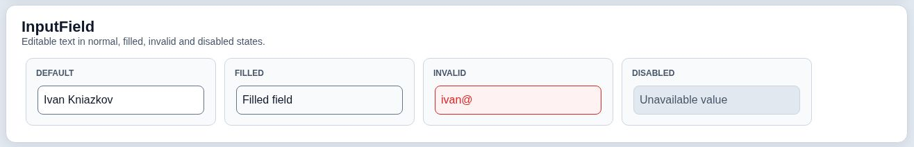

<a id="shot-numeric-hints"></a>

**Поля с подсказками для цифровой клавиатуры**

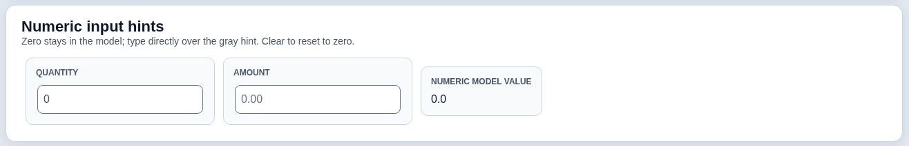

<a id="shot-suggestion-field"></a>

**Текстовое поле с подсказками**

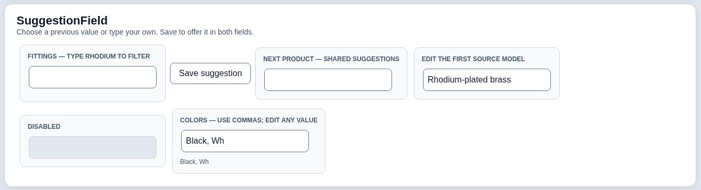

<a id="shot-password-input"></a>

**Поля со скрытыми символами**

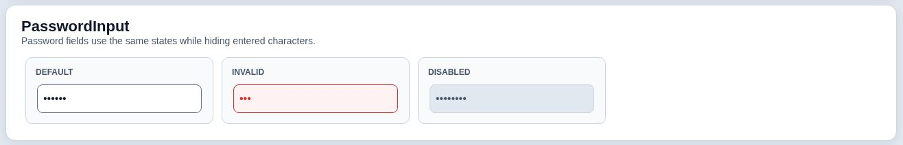

<a id="shot-text-area"></a>

**Многострочное поле ввода**

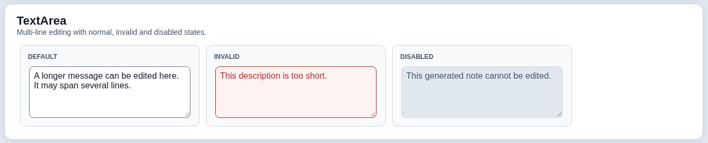

<a id="shot-suggestion-open"></a>

**Список подсказок открыт под полем**

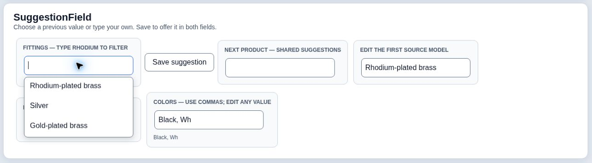

<a id="shot-semantics-field-updated"></a>

**Поле после изменения подписи или описания**

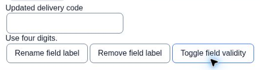

<a id="shot-semantics-field-mobile"></a>

**Подписанное поле в узком окне**

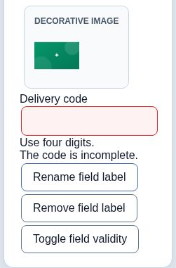

<a id="shot-keyboard-demo-desktop"></a>

**Отправка учебной формы входа клавишей Enter**

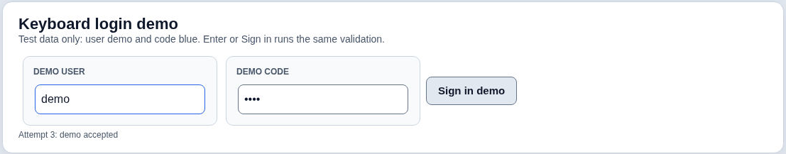

<a id="shot-keyboard-demo-narrow"></a>

**Поля входа и кнопка в узком окне**

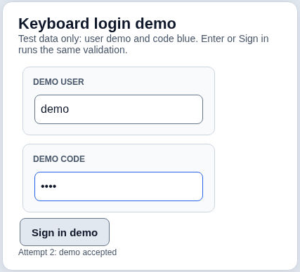

<a id="shot-form-desktop"></a>

**Подписи полей, подсказки и кнопка отправки**

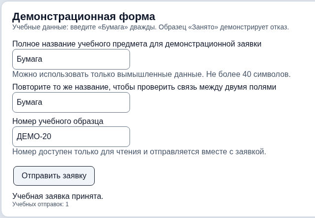

<a id="shot-form-narrow-error"></a>

**Сообщение проверки в узкой форме**

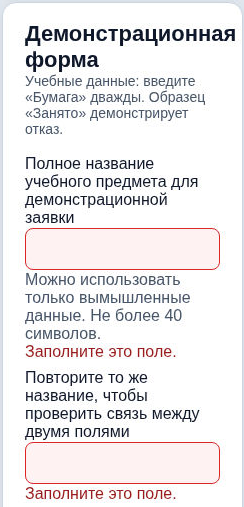

<a id="shot-form-mobile-busy"></a>

**Форма в процессе отправки**

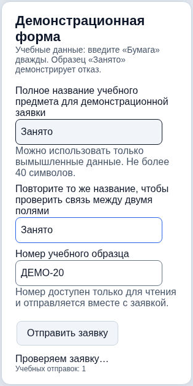
