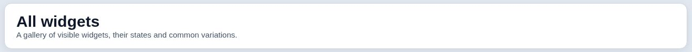
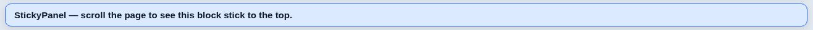
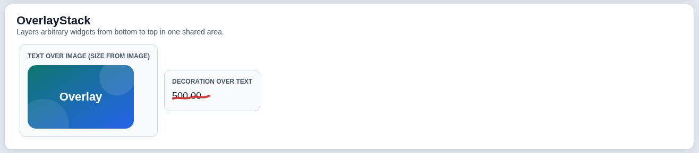
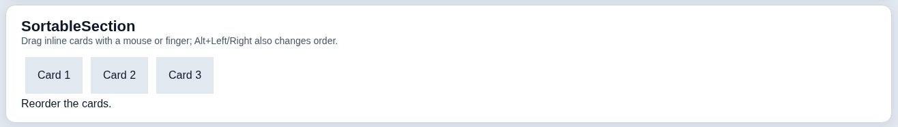
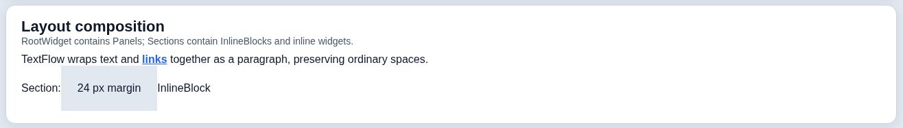
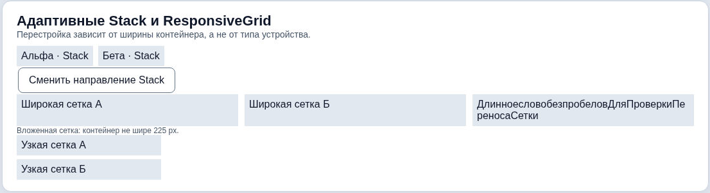
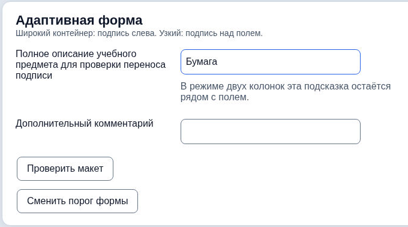
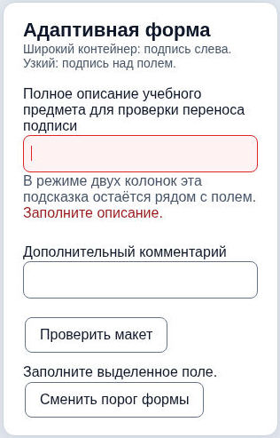
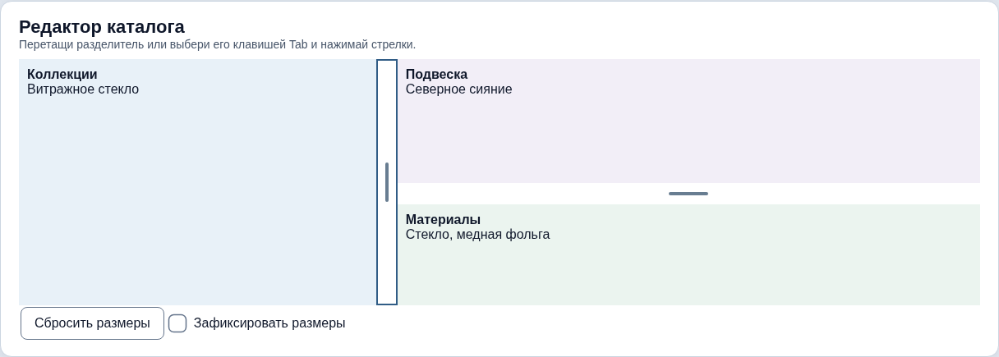
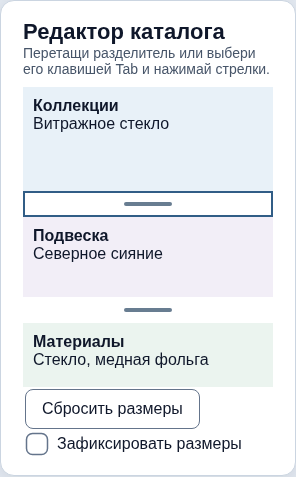

# Скомпоновать блоки и строчные элементы

[Каталог виджетов](../../WIDGET_GALLERY.ru.md) · [English](../../en/widgets/layout.md)

Для строки с надписями и кнопками подойдёт Section, для группы блоков — Panel, для колонок по ширине контейнера — ResponsiveGrid.

[Урок о карточках](../page-composition.md)

[RootWidget](#rootwidget) · [Panel](#panel) · [Section](#section) · [TextFlow](#textflow) · [Stack](#stack) · [ResponsiveGrid](#responsivegrid) · [FormLayout](#formlayout) · [StickyPanel](#stickypanel) · [InlineBlock](#inlineblock) · [NoWrap](#nowrap) · [MarginDecorator](#margindecorator) · [SortableSection](#sortablesection) · [OverlayStack](#overlaystack) · [SplitPane](#splitpane)

## RootWidget

Начни с корня, который передаётся в фабрику страницы. Он содержит верхние блоки, модель заголовка документа и команды страницы, включая навигацию. Добавляй в корень блоки, а строчные виджеты помещай в Section.

```java
root.setTitle("Observing log");
root.add(new Section(new TextWidget("Tonight")));
```

[Начало страницы AllWidgets](#shot-root-widget) · [Java](../../../src/main/java/com/kniazkov/widgets/view/RootWidget.java)

## Panel

Объедини блоки в карточку или область страницы. Внутренние отступы, фон, рамка и размеры реактивны; панель принимает события указателя. Для строчного содержимого вложи Section.

```java
var card = new Panel(new Section(new TextWidget("Moon")));
card.setPadding(16);
```

[Вложенные блочные и строчные контейнеры](#shot-layout-composition) · [Java](../../../src/main/java/com/kniazkov/widgets/view/Panel.java)

## Section

Размести строчные элементы в одном блоке с выравниванием и отступами. Section принимает кнопки, надписи и поля ввода. Для блочных дочерних элементов используй Panel.

```java
var actions = new Section(new Button("Apply"), new Button("Cancel"));
actions.setCenterAlignment();
```

[Вложенные блочные и строчные контейнеры](#shot-layout-composition) · [Java](../../../src/main/java/com/kniazkov/widgets/view/Section.java)

## TextFlow

Собери абзац из надписей и ссылок. Фрагменты идут по общей базовой линии и переносятся на следующую строку. Пробелы между ними добавляй явно. У каждой надписи остаётся своя модель.

```java
var line = new TextFlow();
line.add(new TextWidget("Read the "));
line.add(new Link("observing log", "/log"));
```

[Вложенные блочные и строчные контейнеры](#shot-layout-composition) · [Java](../../../src/main/java/com/kniazkov/widgets/view/TextFlow.java)

## Stack

Расположи блоки по одной оси и задай расстояние и выравнивание по поперечной оси. Горизонтальная группа по умолчанию переносится. Отключай перенос, когда места гарантированно хватает.

```java
var tools = new Stack(Stack.Direction.HORIZONTAL);
tools.setGap(12);
tools.add(new Section(new Button("Apply")));
```

[Stack и адаптивная сетка в широком контейнере](#shot-adaptive-layouts-wide) · [Java](../../../src/main/java/com/kniazkov/widgets/view/Stack.java)

## ResponsiveGrid

Расположи блоки в столько колонок, сколько помещается внутри контейнера. Задай желаемую минимальную ширину и промежуток. Нулевой максимум распределяет свободное место между колонками.

```java
var cards = new ResponsiveGrid();
cards.setColumnWidths(240, 0);
cards.setGap(12);
cards.add(new Panel(new Section(new TextWidget("Moon"))));
```

[Stack и адаптивная сетка в широком контейнере](#shot-adaptive-layouts-wide) · [Java](../../../src/main/java/com/kniazkov/widgets/view/ResponsiveGrid.java)

## FormLayout

Поставь подписи сбоку от полей, а в узком контейнере — над ними. Порог задаётся в CSS-пикселях. Передай пустой макет форме и добавляй поля через саму форму.

```java
var layout = new FormLayout();
layout.setBreakpoint(480);
var form = new Form("Planner", "Save", layout);
form.addField(new FormField("target", "Target"));
```

[Подписи сбоку от редакторов](#shot-adaptive-form-wide) · [Java](../../../src/main/java/com/kniazkov/widgets/view/FormLayout.java)

## StickyPanel

Оставь панель инструментов у верхнего или нижнего края при прокрутке. Сторона прилипания меняется через модель. До указанного края панель занимает обычное место в потоке страницы.

```java
var toolbar = new StickyPanel(new Section(new Button("Save")));
root.add(toolbar);
```

[Панель, которая остаётся у края окна](#shot-sticky-panel) · [Java](../../../src/main/java/com/kniazkov/widgets/view/StickyPanel.java)

## InlineBlock

Вставь группу блоков в строку. У InlineBlock могут быть собственные размеры, фон и внутренние отступы. Родитель видит всю группу как один строчный элемент.

```java
var badge = new InlineBlock(new Section(new TextWidget("New")));
root.add(new Section(badge));
```

[Вложенные блочные и строчные контейнеры](#shot-layout-composition) · [Java](../../../src/main/java/com/kniazkov/widgets/view/InlineBlock.java)

## NoWrap

Сохрани в одной строке, например, число и единицу измерения. У фрагментов остаются собственные модели. Длинная неразрывная группа может выйти за границы узкого контейнера.

```java
var distance = new NoWrap(new TextWidget("42"), new TextWidget(" km"));
```

[Строчные элементы в одной неразрывной группе](#shot-no-wrap) · [Java](../../../src/main/java/com/kniazkov/widgets/view/NoWrap.java)

## MarginDecorator

Добавь наружный отступ одному строчному виджету через свойства декоратора. Метод `put` заменяет единственного потомка. Обработчики событий остаются у самого вложенного элемента.

```java
var padded = new MarginDecorator(new TextWidget("km"));
padded.setLeftMargin(4);
```

[Вложенные блочные и строчные контейнеры](#shot-layout-composition) · [Java](../../../src/main/java/com/kniazkov/widgets/view/MarginDecorator.java)

## SortableSection

Дай пользователю менять порядок строчных элементов перетаскиванием или сочетанием Alt со стрелками. `onReorder` получает новый порядок. Чтобы сохранить его, сопоставь виджеты с устойчивыми идентификаторами приложения.

```java
var order = new SortableSection(new TextWidget("Moon"), new TextWidget("Mars"));
order.move(1, 0);
```

[Строчные элементы в секции с изменяемым порядком](#shot-sortable-section) · [Java](../../../src/main/java/com/kniazkov/widgets/view/SortableSection.java)

## OverlayStack

Наложи подпись или метку на изображение. Слои идут в порядке добавления. Флаг fit-to-first-child связывает размер стопки с первым слоем; остальные занимают пространство над ним.

```java
var layers = new OverlayStack(new ImageWidget("/moon.jpg"), new TextWidget("North"));
layers.setFitToFirstChild(true);
```

[Изображение и метка в наложенных слоях](#shot-overlay-stack) · [Java](../../../src/main/java/com/kniazkov/widgets/view/OverlayStack.java)

## SplitPane

Дай пользователю менять размеры двух блоков мышью или клавиатурой. Целочисленная модель хранит положение в процентах в заданных границах. Разделителю нужно доступное имя, а контейнеру — ровно две панели. После перетаскивания получи итоговое положение через `getPositionModel()`.

```java
var split = new SplitPane(SplitPane.Axis.HORIZONTAL, "List width", 20, 80,
    new IntegerModel(40), new Panel(), new Panel());
```

[Список и подробности с подвижным разделителем](#shot-split-desktop) · [Java](../../../src/main/java/com/kniazkov/widgets/view/SplitPane.java)

## Снимки AllWidgets

<a id="shot-root-widget"></a>

**Начало страницы AllWidgets**



<a id="shot-sticky-panel"></a>

**Панель, которая остаётся у края окна**



<a id="shot-no-wrap"></a>

**Строчные элементы в одной неразрывной группе**


<a id="shot-overlay-stack"></a>

**Изображение и метка в наложенных слоях**



<a id="shot-sortable-section"></a>

**Строчные элементы в секции с изменяемым порядком**



<a id="shot-layout-composition"></a>

**Вложенные блочные и строчные контейнеры**



<a id="shot-adaptive-layouts-wide"></a>

**Stack и адаптивная сетка в широком контейнере**



<a id="shot-adaptive-form-wide"></a>

**Подписи сбоку от редакторов**



<a id="shot-adaptive-form-narrow"></a>

**Подписи над редакторами**



<a id="shot-split-desktop"></a>

**Список и подробности с подвижным разделителем**



<a id="shot-split-mobile"></a>

**Панели одна над другой в узком контейнере**


