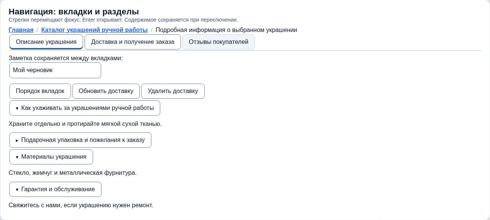
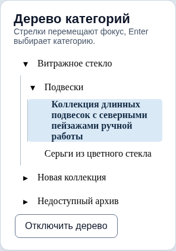

# Перейти между разделами и узлами дерева

[Каталог виджетов](../../WIDGET_GALLERY.ru.md) · [English](../../en/widgets/navigation.md)

Tabs и Accordion открывают содержимое внутри страницы. Breadcrumbs ведёт на другие страницы, а TreeView загружает иерархию по мере раскрытия веток.

[Страницы и история](../page-navigation.md)

[Tabs](#tabs) · [Accordion](#accordion) · [Breadcrumbs](#breadcrumbs) · [TreeView](#treeview)

## Tabs

Переключай представления на одной странице. Модель `getSelectedKeyModel()` выбирает вкладку по стабильному ключу. Фабрика создаёт содержимое при первом открытии, а при переключении оно сохраняется.

```java
var tabs = new Tabs();
tabs.addTab("log", "Log", () -> new Section(new TextWidget("Observations")));
```

[Путь по разделам, вкладки и раскрывающиеся секции](#shot-navigation-desktop) · [Java](../../../src/main/java/com/kniazkov/widgets/view/Tabs.java)

## Accordion

Разреши читателю раскрывать именованные разделы. Модель хранит множество ключей раскрытых секций. Конструктор задаёт, сколько разделов можно открыть одновременно. Содержимое сохраняется после первого открытия.

```java
var faq = new Accordion(false);
faq.addSection("when", "When?", () -> new Section(new TextWidget("After sunset")));
```

[Путь по разделам, вкладки и раскрывающиеся секции](#shot-navigation-desktop) · [Java](../../../src/main/java/com/kniazkov/widgets/view/Accordion.java)

## Breadcrumbs

Покажи путь к текущей странице. Предки становятся ссылками, последний элемент — названием текущей страницы. При смене пути передай новую последовательность в `setItems`.

```java
var path = new Breadcrumbs("Location", List.of(
    new Breadcrumbs.Item("Home", "/"), new Breadcrumbs.Item("Log", "")));
```

[Путь по разделам, вкладки и раскрывающиеся секции](#shot-navigation-desktop) · [Java](../../../src/main/java/com/kniazkov/widgets/view/Breadcrumbs.java)

## TreeView

Покажи иерархию с устойчивыми ключами узлов. При открытии ветки источник асинхронно возвращает потомков. Модели хранят выбранный ключ и раскрытые ветки. У листа нет действия раскрытия.

```java
var tree = new TreeView(List.of(new TreeView.Node("sky", "Sky", true)),
    key -> CompletableFuture.completedFuture(List.of(new TreeView.Node("moon", "Moon", false))),
    new TreeView.Messages("Loading", "Empty", "Try again"));
```

[Иерархия каталога с раскрывающимися ветками](#shot-tree-desktop) · [Java](../../../src/main/java/com/kniazkov/widgets/view/TreeView.java)

## Снимки AllWidgets

<a id="shot-navigation-desktop"></a>

**Путь по разделам, вкладки и раскрывающиеся секции**



<a id="shot-navigation-mobile-tabs"></a>

**Вкладки и перенос пути в узком окне**


<a id="shot-navigation-mobile-accordion"></a>

**Раскрытые секции в узком окне**


<a id="shot-tree-desktop"></a>

**Иерархия каталога с раскрывающимися ветками**


<a id="shot-tree-mobile"></a>

**Дерево каталога на узком экране**


