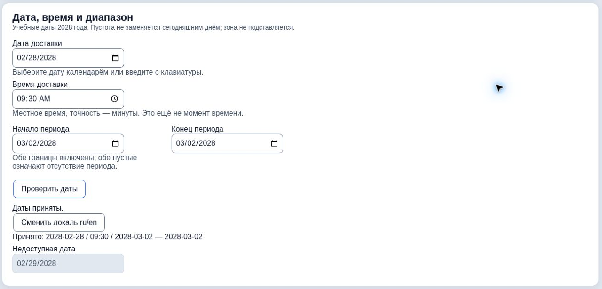
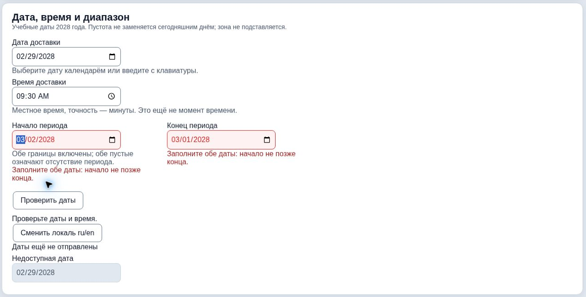
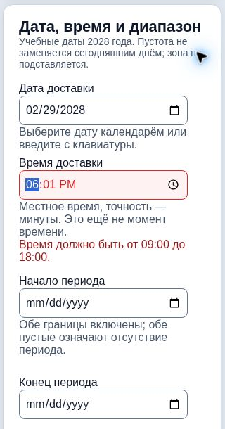
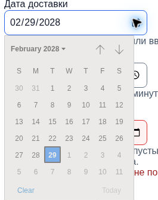
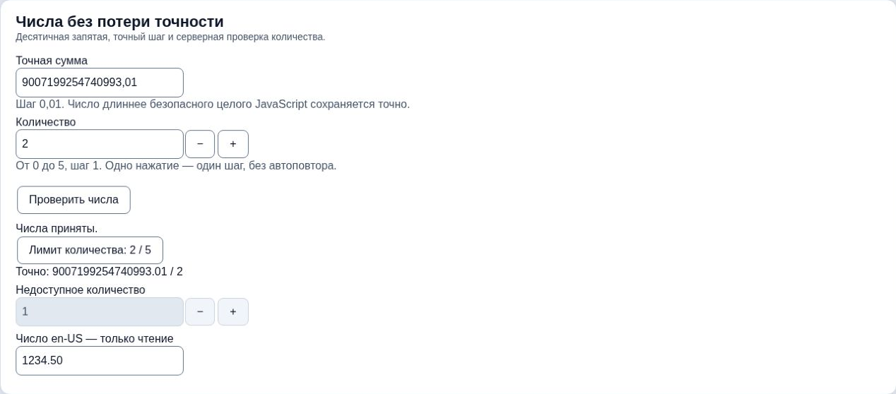
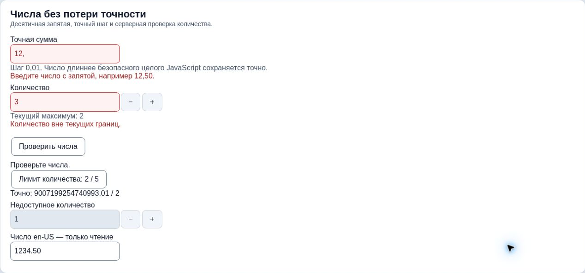
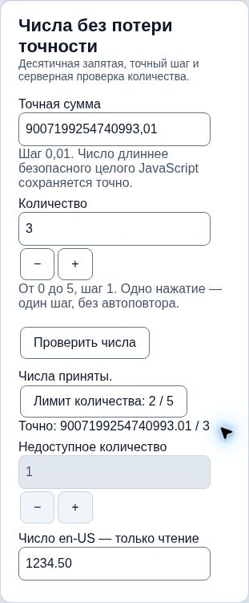
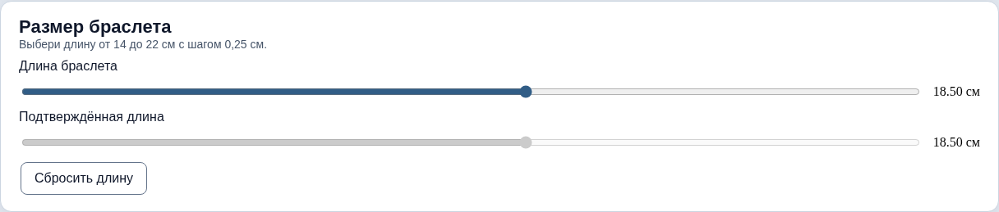
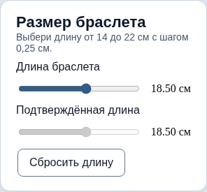

# Ввести число, дату или время

[Каталог виджетов](../../WIDGET_GALLERY.ru.md) · [English](../../en/widgets/numbers.md)

Для точного десятичного ввода выбирай NumberField, для изменения кнопками — QuantityField, а для выбора положения на ограниченной шкале — Slider.

[Числа и ограничения](../../NUMBER_FIELDS.ru.md) · [Даты и время](../../TEMPORAL_FIELDS.ru.md)

[NumberField](#numberfield) · [QuantityField](#quantityfield) · [Slider](#slider) · [DateField](#datefield) · [TimeField](#timefield) · [DateRange](#daterange)

## NumberField

Введи с клавиатуры целое число или точную десятичную дробь. NumberModel хранит черновик, результат преобразования и значение BigDecimal, если оно есть. Учитывай локаль и границы: например, один минус ещё не задаёт число. Прочитать преобразованное значение можно через `getValueModel().value()`.

```java
var price = new NumberField(NumberModel.decimals());
price.setLocale(Locale.US);
price.setValue(new BigDecimal("12.50"));
```

[Точное число и поле количества](#shot-numbers-desktop) · [Java](../../../src/main/java/com/kniazkov/widgets/view/NumberField.java)

## QuantityField

Добавь к числовому полю кнопки уменьшения и увеличения. Они работают с одной NumberModel и учитывают шаг и границы. QuantityField можно передать форме как готовое поле.

```java
var form = new Form("Order", "Save");
form.addField(new QuantityField("quantity", "Quantity", NumberModel.integers()));
```

[Точное число и поле количества](#shot-numbers-desktop) · [Java](../../../src/main/java/com/kniazkov/widgets/view/QuantityField.java)

## Slider

Выбери значение из диапазона перетаскиванием или клавишами. SliderModel хранит точные десятичные шаги. Интервал должен делиться на шаг без остатка. Для ввода точного значения с клавиатуры и работы с черновиком подойдёт NumberField. При перетаскивании значение на экране меняется сразу, а модель Java обновляется при отпускании.

```java
var scale = new SliderModel(BigDecimal.ZERO, BigDecimal.TEN, BigDecimal.ONE, BigDecimal.ONE);
var rating = new Slider(scale, "Rating", "points");
```

[Ползунок со значением и единицей измерения](#shot-slider-desktop) · [Java](../../../src/main/java/com/kniazkov/widgets/view/Slider.java)

## DateField

Выбери календарный день. TemporalModel даёт локальную дату и состояние проверки. Границы включены, у даты нет часового пояса. Свяжи редактор с подписью или помести его в FormField.

```java
var date = new DateField();
date.setValue(LocalDate.of(2027, 1, 1));
```

[Поля даты, времени и диапазона дат](#shot-temporal-desktop) · [Java](../../../src/main/java/com/kniazkov/widgets/view/DateField.java)

## TimeField

Введи местное время с точностью до минуты. Типизированная модель возвращает LocalTime, когда значение задано. Для получения момента времени приложение должно также выбрать дату и часовой пояс.

```java
var time = new TimeField();
time.setValue(LocalTime.of(19, 30));
```

[Поля даты, времени и диапазона дат](#shot-temporal-desktop) · [Java](../../../src/main/java/com/kniazkov/widgets/view/TimeField.java)

## DateRange

Собери начальную и конечную даты. У диапазона два собственных подписанных редактора и модель интервала. Регистрируй его через `addDateRange`, чтобы при отправке форма проверяла порядок дат.

```java
var form = new Form("Observing season", "Apply");
form.addDateRange(new DateRange("season", "From", "Until"));
```

[Поля даты, времени и диапазона дат](#shot-temporal-desktop) · [Java](../../../src/main/java/com/kniazkov/widgets/view/DateRange.java)

## Снимки AllWidgets

<a id="shot-temporal-desktop"></a>

**Поля даты, времени и диапазона дат**



<a id="shot-temporal-error"></a>

**Ошибка проверки диапазона дат**



<a id="shot-temporal-mobile"></a>

**Дата и время на узком экране**



<a id="shot-temporal-picker"></a>

**Нативный календарь открыт из поля даты**



<a id="shot-numbers-desktop"></a>

**Точное число и поле количества**



<a id="shot-numbers-error"></a>

**Неверный числовой ввод с пояснением**



<a id="shot-numbers-mobile"></a>

**Числовые поля и кнопки шага на узком экране**



<a id="shot-slider-desktop"></a>

**Ползунок со значением и единицей измерения**



<a id="shot-slider-mobile"></a>

**Ползунок на узком экране**


