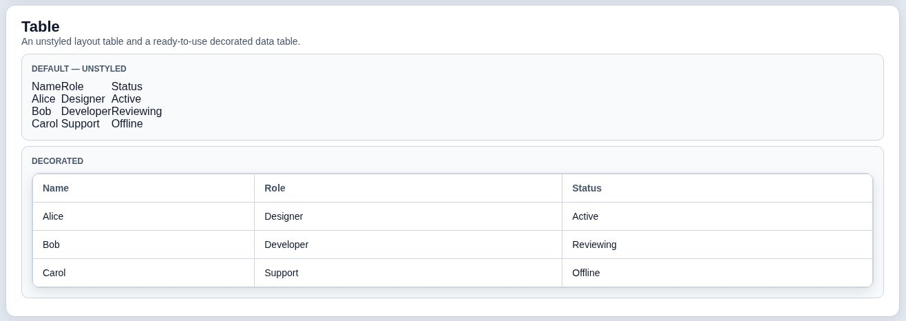
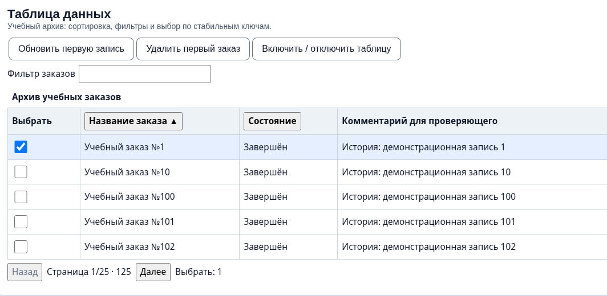
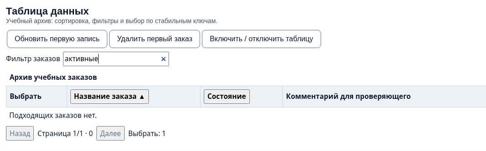
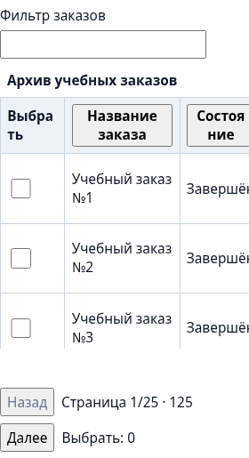

# Показать таблицу или список записей

[Каталог виджетов](../../WIDGET_GALLERY.ru.md) · [English](../../en/widgets/tables.md)

Если в ячейках нужны виджеты, выбирай Table. Если записи приходят из источника данных и нужны фильтр, сортировка или постраничный просмотр, выбирай DataTable.

[DataTable](../../DATA_TABLE.ru.md)

[Table](#table) · [Row](#row) · [Cell](#cell) · [DataTable](#datatable)

## Table

Собери таблицу с настоящими виджетами в ячейках, например кнопками и полями. Строки и ячейки входят в дерево страницы. `getCell(row, column)` создаёт недостающие позиции. Если нужны сортировка или страницы, их организует приложение.

```java
var table = new Table();
table.getCell(0, 0).add(new Section(new Button("Open log")));
```

[Таблицы с оформлением строк и ячеек](#shot-table) · [Java](../../../src/main/java/com/kniazkov/widgets/view/Table.java)

## Row

Объедини ячейки в строку Table. `getCell` расширяет строку до указанного индекса, начиная с нуля. Оформление и события указателя можно задать для всей строки.

```java
var table = new Table();
Row row = table.getRow(0);
row.getCell(1).add(new Section(new TextWidget("Moon")));
```

[Таблицы с оформлением строк и ячеек](#shot-table) · [Java](../../../src/main/java/com/kniazkov/widgets/view/Row.java)

## Cell

Размести блоки в ячейке. Отступы, выравнивание и фон задавай у ячейки, а модели выводимых значений — у её потомков. Строчные виджеты вложи в Section.

```java
var cell = new Cell(new Section(new TextWidget("Moon")));
cell.setPadding(8);
var table = new Table(new Row(cell));
```

[Таблицы с оформлением строк и ячеек](#shot-table) · [Java](../../../src/main/java/com/kniazkov/widgets/view/Cell.java)

## DataTable

Просматривай записи постранично, фильтруй, сортируй и выбирай по стабильному ключу. Асинхронный DataProvider применяет запрос и возвращает строки для показа и общее число совпадений. Если в ячейке нужен редактор, используй Table. На странице помещается до 32 записей. В `onSelect` приходит множество ключей выбранных строк.

```java
var column = new DataTable.DataColumn("name", "Target", false);
var moon = new DataProvider.DataRow("moon", Map.of("name", "Moon"));
var table = new DataTable("Targets", List.of(column), 10, query -> {
    var matches = "moon".contains(query.filter().toLowerCase(Locale.ROOT))
        ? List.of(moon) : List.<DataProvider.DataRow>of();
    var page = query.offset() == 0 ? matches : List.<DataProvider.DataRow>of();
    return CompletableFuture.completedFuture(new DataProvider.Page(page, matches.size()));
});
root.add(table);
```

[Таблица данных с сортировкой и страницами](#shot-data-table-wide) · [Java](../../../src/main/java/com/kniazkov/widgets/view/DataTable.java)

## Снимки AllWidgets

<a id="shot-table"></a>

**Таблицы с оформлением строк и ячеек**



<a id="shot-data-table-wide"></a>

**Таблица данных с сортировкой и страницами**



<a id="shot-data-table-empty"></a>

**Таблица после фильтра без совпадений**



<a id="shot-data-table-narrow"></a>

**Прокручиваемая таблица в узком окне**


